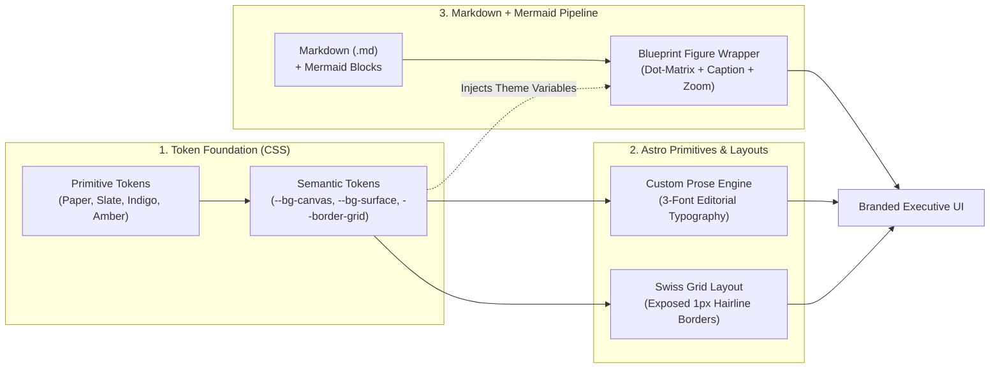

# Implementation & Validation Plan: "Architectural Monograph" Design System Overhaul

> **Document ID:** `ARCH-PLAN-2026-01`  
> **Target Branch:** `feat/architectural-monograph-design-system`  
> **Status:** Active Implementation & Validation Blueprint  
> **Scope:** Token-Driven Editorial Design System (Swiss Grid + Blueprint Aesthetic) in Astro 6

---

## 1. Executive Summary & Objectives

The existing site was scaffolded on the default Astro Blog starter template (`Bear Blog` CSS variables, bundled `Atkinson` fonts, centered 720px floating column, rounded shadow cards, and default Mermaid theme styles). While performant, that visual language does not reflect executive technical authority on enterprise composability, domain autonomy, and socio-technical systems.

This plan overhauls the visual system into an **"Architectural Monograph"** aesthetic—inspired by *Stripe Press*, *Linear*, and a modernized *Martin Fowler Bliki*—using a pure **Vanilla CSS Token-Driven Editorial Design System** that works seamlessly with Astro's native Markdown and Mermaid authoring workflow without introducing heavy React component libraries.

### Non-Negotiable Guardrails
1. **Zero Feature Regression:** All existing routes (`/`, `/blog`, `/blog/[...slug]`, `/blog/tag/[tag]`, `/about`, `/rss.xml`, `/sitemap-index.xml`), SEO/JSON-LD metadata, accessibility (`skip-link`, ARIA landmarks, focus states), social links (LinkedIn, GitHub, DZone), and dark/light theme toggling must continue to work without breakage.
2. **Pure Markdown + Mermaid Authoring:** Authors write standard `.md`/`.mdx` files in `src/content/blog/` with standard ```` ```mermaid ```` code fences and lightweight frontmatter.
3. **Single Source of Truth for Tokens:** Prose, exposed 1px Swiss grid layouts, and Mermaid SVG diagrams derive their colors and typography from `src/styles/tokens.css`.

---

## 2. System Architecture



---

## 3. Step-by-Step Implementation Plan

### Phase 1: 3-Tier Design Token Foundation (`src/styles/tokens.css`)
1. Create `src/styles/tokens.css` defining:
   - **Tier 1 (Primitives):**
     - `--palette-paper-50: #FBFBF9`
     - `--palette-paper-100: #F4F3EF`
     - `--palette-slate-800: #1E293B`
     - `--palette-slate-900: #0F172A`
     - `--palette-slate-500: #64748B`
     - `--palette-indigo-600: #3730A3`
     - `--palette-amber-600: #D97706`
   - **Typography Tokens (3-Font System):**
     - `--font-display: 'Newsreader', Georgia, serif` (Editorial headlines & monograph titles)
     - `--font-sans: 'Plus Jakarta Sans', -apple-system, BlinkMacSystemFont, sans-serif` (High-legibility technical body prose)
     - `--font-mono: 'JetBrains Mono', monospace` (Metadata rails, DOC IDs, taxonomy tags, code blocks, and Mermaid diagrams)
   - **Tier 2 (Semantic Surface & Grid Tokens — Light "Archival Paper" default on `:root, [data-theme="light"], .light`):**
     - `--bg-canvas: var(--palette-paper-50)`
     - `--bg-surface: var(--palette-paper-100)`
     - `--text-primary: var(--palette-slate-900)`
     - `--text-muted: var(--palette-slate-500)`
     - `--accent-primary: var(--palette-indigo-600)`
     - `--accent-secondary: var(--palette-amber-600)`
     - `--border-grid: rgba(15, 23, 42, 0.12)`
     - `--border-strong: rgba(15, 23, 42, 0.85)`
   - **Tier 2 (Semantic Surface & Grid Tokens — Dark "Carbon Blueprint" on `[data-theme="dark"], .dark`):**
     - `--bg-canvas: #0B0F17`
     - `--bg-surface: #111827`
     - `--text-primary: #F8FAFC`
     - `--text-muted: #94A3B8`
     - `--accent-primary: #818CF8`
     - `--accent-secondary: #FBBF24`
     - `--border-grid: rgba(248, 250, 252, 0.1)`
     - `--border-strong: rgba(248, 250, 252, 0.6)`
   - **Tier 3 (Mermaid Diagram Tokens):**
     - Light: `--mermaid-node-bg: #FFFFFF`, `--mermaid-node-border: var(--palette-indigo-600)`, `--mermaid-line: var(--palette-slate-800)`, `--mermaid-cluster-bg: var(--palette-paper-100)`
     - Dark: `--mermaid-node-bg: #1E293B`, `--mermaid-node-border: #818CF8`, `--mermaid-line: #94A3B8`, `--mermaid-cluster-bg: #0F172A`
   - **Legacy Compatibility Bridge:** Map `--accent`, `--bg-primary`, `--bg-secondary` to semantic tokens to prevent any legacy stylesheet breakage.

### Phase 2: Swiss Grid Layout & Editorial Prose Engine (`src/styles/layout.css` & `src/styles/global.css`)
1. Create `src/styles/layout.css` implementing:
   - `.architect-grid`: 2-column asymmetric CSS Grid (`grid-template-columns: 240px 1fr`, `max-width: 1200px`, `margin: 0 auto`, exposed `border-left: 1px solid var(--border-grid)` and `border-right: 1px solid var(--border-grid)`).
   - `.architect-rail`: Left-hand metadata & navigation rail (`border-right: 1px solid var(--border-grid)`, `padding: 2rem 1.5rem`, `font-family: var(--font-mono)`, `font-size: 0.8rem`, `color: var(--text-muted)`).
   - `.architect-main`: Primary editorial column (`padding: 3rem 4rem`, `max-width: 76ch`).
   - `.mermaid-blueprint`: Dot-matrix blueprint container (`background-color: var(--bg-surface)`, `background-image: radial-gradient(var(--border-grid) 1px, transparent 1px)`, `background-size: 16px 16px`, `border: 1px solid var(--border-grid)`, `border-left: 3px solid var(--accent-primary)`, `padding: 2rem`, `margin: 2.5rem 0`, `overflow-x: auto`).
   - Responsive breakpoint at `@media (max-width: 900px)` collapsing `.architect-grid` to `1fr` and converting `.architect-rail` right border to a bottom `1px solid var(--border-grid)` border.
2. Refactor `src/styles/global.css` to import `tokens.css` and `layout.css`, apply `--font-sans` to `body`, `--font-display` to `h1`–`h4`, and `--font-mono` to `code`, `pre`, `table` headers, and metadata elements.

### Phase 3: Content Collection Schema & Knowledge Taxonomy (`src/content.config.ts`)
1. Extend `src/content.config.ts` (preserving Astro 6 `glob` loader) with architectural taxonomy fields:
   - `category: z.enum(['Essay', 'Architecture Note', 'Research', 'Perspective']).default('Essay')`
   - `tags: z.array(z.string()).default([])`
   - `readingTime: z.string().optional()`
   - `status: z.enum(['Draft', 'Evergreen', 'Published']).default('Published')`
   - `docId: z.string().optional()`
2. Update existing blog posts in `src/content/blog/` with curated `category`, `readingTime`, `status`, `docId`, and complete `tags` coverage so every Knowledge Architecture category and homepage pillar tag (`/blog/tag/architecture`, `/blog/tag/sdlc`, `/blog/tag/ai`, `/blog/tag/research`) is rich and navigable.

### Phase 4: Asymmetric "Spec Sheet" Layout & Token-Synced Mermaid (`src/layouts/BlogPost.astro` & `src/pages/blog/[...slug].astro`)
1. Upgrade `src/pages/blog/[...slug].astro` to pass `headings` (from `render(post)`) and `id` to `BlogPost.astro`.
2. Overhaul `src/layouts/BlogPost.astro` into the 2-Column Asymmetric Spec Sheet:
   - **Spec Header Row:**
     - Left Rail: `DOC ID`, `CATEGORY`, `STATUS`, `PUBLISHED` date, `UPDATED` date (if present), and `READING TIME`.
     - Main Column: Category badge, high-contrast `Newsreader` `<h1>` headline, executive abstract (`description`), and technical figure framing for `heroImage`.
   - **Spec Body Row:**
     - Left Rail: Sticky `ON THIS PAGE` Table of Contents (auto-generated from article headings with client-side fallback for non-collection pages like `/about`) and `TAGS` index (`#Architecture`, `#DDD`, etc.) linking to `/blog/tag/[tag]`.
     - Main Column: Editorial prose slot + Blueprint Figure Wrapper for Mermaid diagrams.
3. Implement Token-Synced Mermaid initialization in `src/layouts/BlogPost.astro`:
   - Convert Astro Shiki `pre[data-language="mermaid"]` blocks into `.mermaid-blueprint` figures with a technical figure header (`BLUEPRINT // TECHNICAL DIAGRAM` + interactive Expand/Zoom toggle) and inner `.mermaid` container.
   - Pull active CSS variables via `getComputedStyle(document.documentElement)` (`--font-mono`, `--mermaid-node-bg`, `--text-primary`, `--mermaid-node-border`, `--mermaid-line`, `--mermaid-cluster-bg`, `--bg-surface`) and initialize `mermaid` with `theme: 'base'`.
   - Re-render diagrams dynamically on theme toggle (`theme-change` event) so switching between Light ("Archival Paper") and Dark ("Carbon Blueprint") updates Mermaid SVG tokens in real time.

### Phase 5: Site-Wide Swiss Grid Overhaul (`Header`, `Footer`, `index`, `blog/index`, `blog/tag/[tag]`, `about`)
1. **`src/components/BaseHead.astro`**: Load Google Fonts (`Newsreader`, `Plus Jakarta Sans`, `JetBrains Mono`) and update theme-color meta support.
2. **`src/components/Header.astro`**: Exposed 1px hairline navigation grid aligned to `1200px` max-width; brand cell (`SHASHI KUMAR` + monospace architectural subtitle), navigation cells (`Home`, `Essays & Notes` -> `/blog`, `About` -> `/about`), and theme toggle synchronizing both `data-theme` attribute and `.light`/`.dark` classes on `<html>`.
3. **`src/components/Footer.astro`**: Swiss Grid specification footer preserving copyright, `IEEE Senior Member · Hackathon Raptors Fellow` credentials, and LinkedIn / GitHub / DZone social links.
4. **`src/pages/index.astro`**: Executive Architectural Monograph homepage built on `.architect-grid`:
   - Spec Hero with left metadata rail (`MONOGRAPH // VOL. 2026`, `ROLE // PRODUCT ARCHITECT`, `AFFILIATION // IEEE SR. MEMBER`) + main editorial hero ("From Blacksmiths to Goldsmiths."), portrait frame, and CTAs.
   - 4 Architectural Pillars (`01 // Software Architecture`, `02 // Enterprise SDLC`, `03 // AI-Augmented Engineering`, `04 // Published Research`) in an exposed 1px hairline 2x2 grid linking to `/blog/tag/architecture`, `/blog/tag/sdlc`, `/blog/tag/ai`, and `/blog/tag/research`.
   - Structured Knowledge Ledger displaying recent publications with `DOC ID`, `Category`, `Date`, `Title`, `Abstract`, and `Tags`.
   - Executive Connect specification section with LinkedIn, GitHub, and DZone actions.
5. **`src/pages/blog/index.astro`**: Structured Knowledge Architecture index with left rail taxonomy filters (*All Entries*, *Essays*, *Field Notes / ADRs*, *Research & Perspectives*) and tag directory, paired with a structured architectural ledger in the main column.
6. **`src/pages/blog/tag/[tag].astro`**: Swiss Grid tag index with left taxonomy rail and filtered architectural entries.
7. **`src/pages/about.astro`**: Upgraded with `docId="ARCH-CHARTER-00"`, `category="Perspective"`, `readingTime="5 min read"`, and `tags` to render as an executive architectural dossier inside `BlogPost.astro`.

---

## 4. Validation Path & Acceptance Criteria

To guarantee the visual overhaul meets every specification without breaking any existing functionality, validation proceeds through four automated gates:

### Gate 1: Static Type & Production Build Verification
- **Command:** `npm run build`
- **Acceptance Criteria:**
  - Astro content sync and Zod schema validation pass with zero errors.
  - All static routes (`/index.html`, `/about/index.html`, `/blog/index.html`, `/blog/what-is-blacksmith-to-goldsmith/index.html`, `/blog/why-astro-and-gh-pages/index.html`, `/blog/why-i-love-wardley-mapping/index.html`, `/blog/tag/*/index.html`, `/rss.xml`, `/sitemap-index.xml`) generate cleanly.
  - All 15+ image assets optimize via Sharp without missing asset warnings.

### Gate 2: CSS Token & Layout Primitive Audit
- **Verification Target:** `src/styles/tokens.css`, `src/styles/layout.css`, `src/styles/global.css`
- **Acceptance Criteria:**
  - All Tier 1 Primitive tokens (`--palette-paper-50` through `--palette-amber-600`) and Typography tokens (`--font-display`, `--font-sans`, `--font-mono`) are declared in `:root`.
  - All Tier 2 Semantic tokens (`--bg-canvas`, `--bg-surface`, `--text-primary`, `--text-muted`, `--accent-primary`, `--accent-secondary`, `--border-grid`, `--border-strong`) and Tier 3 Mermaid tokens (`--mermaid-node-bg`, `--mermaid-node-border`, `--mermaid-line`, `--mermaid-cluster-bg`) are defined for both `:root` (Light - Archival Paper) and `[data-theme="dark"]` / `.dark` (Dark - Carbon Blueprint).
  - `.architect-grid`, `.architect-rail`, `.architect-main`, and `.mermaid-blueprint` classes match the architectural blueprint specifications and include responsive `@media (max-width: 900px)` rules.

### Gate 3: Automated UI Attribute & Feature Regression Suite (`scripts/validate-ui.mjs`)
- **Command:** `node scripts/validate-ui.mjs`
- **Acceptance Criteria:**
  1. **Font Loading:** Google Fonts stylesheet for `Newsreader`, `Plus Jakarta Sans`, and `JetBrains Mono` is present in `<head>` across all pages.
  2. **Exposed Grid & Spec Layout:** `.architect-grid`, `.architect-rail`, and `.architect-main` are rendered on Home, Blog Index, Tag pages, Blog Post pages, and About page.
  3. **Spec Sheet Metadata:** Blog posts render `DOC ID`, `PUBLISHED` date, `CATEGORY`, `STATUS`, `ON THIS PAGE` TOC, and `TAGS` in `.architect-rail`.
  4. **Token-Synced Mermaid Blueprint:** Blog post layout includes the Mermaid v11 ESM initializer with `theme: 'base'`, `getToken('--font-mono')`, `getToken('--mermaid-node-bg')`, `getToken('--mermaid-node-border')`, `getToken('--mermaid-line')`, and `.mermaid-blueprint` wrapper transformation.
  5. **Structured Knowledge Taxonomy:** Blog index renders category filter controls (`Essay`, `Architecture Note`, `Research`) and post entries carry `data-category` attributes.
  6. **Feature Preservation:**
     - Skip link (`a.skip-link[href="#main-content"]`) and `<main id="main-content">` exist on every page.
     - Theme toggle button (`#theme-toggle`) and inline theme initialization script (`data-theme` + class sync) exist on every page.
     - Homepage preserves Hero title, profile image, 4 pillar links (`/blog/tag/architecture`, `/blog/tag/sdlc`, `/blog/tag/ai`, `/blog/tag/research`), recent posts list, and social links (LinkedIn, GitHub, DZone).
     - All internal links across built HTML files resolve to valid generated routes (zero broken links / 404s).
     - `/rss.xml` and `/sitemap-index.xml` are valid and non-empty.

### Gate 4: Live Dev Server & Interactive Verification
- **Command:** `npm run dev`
- **Acceptance Criteria:**
  - Live HTTP check confirms `200 OK` across all routes and assets.
