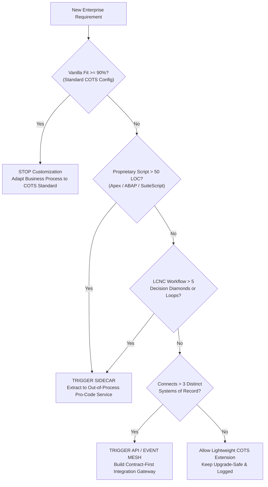
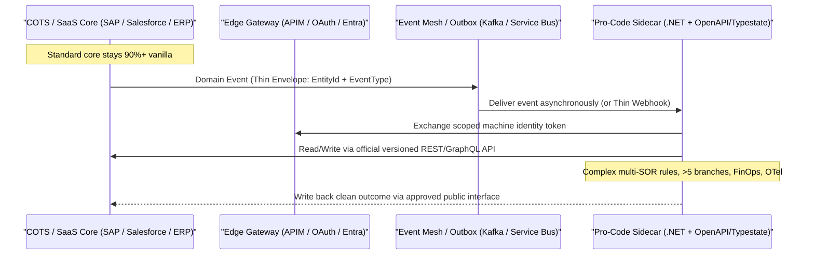

> **Original Thought & Source Lineage:** This article traces an eleven-year architectural thread across four of my LinkedIn publications: two August 2015 deep-dives into PeopleSoft clean-core decoupling—[*Executing Remote Application Business/Data Logic on PIH Event*](https://www.linkedin.com/pulse/executing-remote-application-businessdata-logic-pih-event-kumar/) (LinkedIn Pulse, **August 26, 2015**) and [*PeopleSoft to Third Party and vice-e-verse Single Sign On*](https://www.linkedin.com/pulse/peoplesoft-third-party-vice-e-verse-single-sign-shashi-n-kumar/) (LinkedIn Pulse, **August 30, 2015**)—followed by [*COTS vs. Bespoke App Adoption*](https://www.linkedin.com/feed/update/urn:li:share:6902021515639148544/) (**February 22, 2022**) and codified into hard circuit breakers in [*The 4 LCNC & COTS Architectural Stop Rules*](https://www.linkedin.com/feed/update/urn:li:activity:7417411175040319488/) (**January 14, 2026**).

Enterprise architects love debating bleeding-edge patterns, yet some of the most expensive failures I have seen over two decades happen in supposedly "bought, not built" software: CRM, ERP, Order Management, and Low-Code/No-Code (LCNC) suites.

Whenever an organization buys a Commercial Off-The-Shelf (COTS) platform, it pays a steep licensing premium for two promises: **speed to market** and **vendor-managed upgrades**. Then, six months after go-live, a business unit insists on a custom pricing exception or multi-system approval flow. Nobody wants to spin up a standalone service—so they squeeze the logic inside the vendor's proprietary escape hatch.

Eleven years ago, I documented that exact boundary battle inside Oracle PeopleSoft. By **November 2026**, generative coding agents haven't cured this disease—they have **removed the friction that used to slow it down**.

---

## 1. The 2015 Clean-Core Precedent: Refusing to Pollute the Portal

Back in August 2015, while architecting Oracle PeopleSoft Interaction Hub (PIH) portals, teams routinely ran into a tempting trap: a portal event needed custom Financials data (such as Chart of Accounts attributes) stored across another PeopleSoft pillar (HCM vs. FSCM).

The naive COTS customization path was clear: copy those custom fields into PIH's Configurable Profile Management tables, write batch sync jobs, and maintain custom PeopleCode inside the portal core. Six upgrades later, every patch cycle became multi-month regression surgery.

In [my August 26, 2015 Pulse article](https://www.linkedin.com/pulse/executing-remote-application-businessdata-logic-pih-event-kumar/), I documented the clean-core alternative:

1. **Zero Data Duplication Inside the Core:** Refuse to replicate domain attributes from FSCM/HCM into PIH tables simply to render a portal trigger.
2. **Remote Facade Delegation:** Execute remote content-provider `iScript` logic directly on the owning application server (`htmlProcess` or signon PeopleCode routing hooks), trading a tiny initial redirect latency for complete upgrade isolation.
3. **Explicit Identity Boundaries at the Perimeter:** As detailed four days later in [my August 30, 2015 SSO teardown](https://www.linkedin.com/pulse/peoplesoft-third-party-vice-e-verse-single-sign-shashi-n-kumar/), keep authentication translation out of business code—bridging mutual trust across `PS_TOKEN` cookies, `PRTL_SS_CI` Component Interfaces, `SetAuthenticationResult`, and reverse-proxy header injection via Oracle Access Manager (`OAM`) while cleanly isolating casual gateway sessions from core 3-tier users.

The technology names change (`PeopleCode` and `OAM` then; `Salesforce Apex`, `SAP BTP`, `NetSuite SuiteScript`, `ServiceNow Flow Designer`, `Entra ID`, and `MACH/PBC` sidecars today). The structural law never moves: **never turn your system of record into an application server for cross-domain glue**.

---

## 2. The November 2026 Paradox: Why Coding Agents Made COTS Shoehorning Worse

As I noted in [my February 2022 reflection on COTS vs. Bespoke](https://www.linkedin.com/feed/update/urn:li:share:6902021515639148544/), low-code platforms genuinely compress simple workflows when configured close to standard behavior. Historically, however, proprietary scripting languages acted as a natural speed bump: writing 400 lines of gnarly `SuiteScript` or `Apex` hurt enough that developers pushed back and asked for a proper microservice.

By **November 2026**, that speed bump vanished. Frontier coding agents generate vendor-specific scripts, drag-and-drop JSON workflow exported definitions, and brittle API webhooks in under a minute. The short-term friction fell to zero while the **platform coupling penalty stayed identical**:

- Governor limits, synchronous trigger timeouts, and hidden batch recursion inside SaaS multi-tenant sandboxes don't disappear just because an AI wrote the `Apex` trigger cleanly.
- Automated vendor seasonal upgrades still collide blindly with custom metadata overrides.
- Worse yet, AI-authored glue written inside proprietary COTS sandboxes rarely receives the CI test harnesses, contract assertions, or OpenTelemetry tracing that first-class pro-code repositories enjoy.

Fast generation inside a constrained COTS core simply accelerates the creation of an **unupgradeable distributed monolith**.

---

## 3. The Four Hard Architectural Stop Rules

To settle endless "just put it in a Salesforce Flow / SAP exit / Power Automate script" debates cleanly, every enterprise platform needs mechanical exit gates—not subjective arguments. In [my January 14, 2026 LinkedIn framework](https://www.linkedin.com/feed/update/urn:li:activity:7417411175040319488/), I codified four objective **Architectural Stop Rules**:

Look closely at why concrete thresholds beat architectural slogans:

| Stop Rule | Hard Quantitative Trigger | Failure Mode Prevented | Mandatory Pivot Target |
| :--- | :--- | :--- | :--- |
| **1. The "Shoehorn" Stop** | Custom proprietary vendor script (**Apex, ABAP, SuiteScript**) **> 50 lines** | Governor limit throttling, brittle upgrade merges, untestable vendor sandbox locks | **Pro-Code Sidecar** (`.NET` / containerized service behind webhook or CDC event) |
| **2. The "Spaghetti" Stop** | Low-code / no-code visual flow **> 5 branching diamonds or loops** | Visual abstraction collapse; complex exception trees impossible to diff in code review | **Pro-Code Workflow / Durable Execution** (explicit state machine + unit suite) |
| **3. The "Integration" Stop** | LCNC automation touching **> 3 distinct Systems of Record** | Turning a CRM/LCNC tool into an unmonitored ESB with point-to-point secrets sprawl | **Dedicated API / Kafka Event Mesh** (OpenAPI / AsyncAPI contract + correlation IDs) |
| **4. The "Vanilla" Stop** | Standard out-of-the-box COTS capability satisfies **>= 90%** of business need | Burning seven figures reconstructing bespoke edge behavior to replicate a legacy UX | **Process Alignment** (adapt workflow to software, not software to workflow) |

Every single rule converts an emotional stakeholder negotiation into a falsifiable architectural measurement.

---

## 4. The Clean-Core Sidecar Topology in 2026

How do you execute that pivot in November 2026 without sacrificing the speed that tempted teams toward low-code in the first place? You adopt the exact **Sidecar + Standardized Joint** discipline that kept 2015 PeopleSoft cores intact—upgraded for modern event meshes and AI-assisted pro-code delivery:

Notice four critical properties of this boundary:

1. **Thin Event Payloads Over Heavy State Replication:** Just as our 2015 PIH design refused copying FSCM Chart of Accounts into portal profile tables, your COTS webhooks and Kafka events should carry minimal identifiers (`EntityId`, `TenantId`, `CorrelationId`, `SequenceVersion`), pulling authoritative records over versioned APIs only when needed.
2. **Pro-Code Is Where Coding Agents Shine Safely:** Moving complex logic (>50 LOC, >5 branches) out of vendor sandboxes into a `.NET` or Go sidecar places that logic inside **Git**, where OpenAPI contracts, `NetArchTest` rules, unit suites, and SAST gates validate agent-written PRs in seconds.
3. **Authentication Stays at the Edge:** Vendor tokens, service principals, and user claims cross the boundary through centralized gateways (`APIM` / `Entra` / `OAM` equivalents) rather than hardcoded API keys tucked inside low-code connectors.
4. **Reversible "Lego Pieces":** Because the COTS core calls a published event/webhook joint rather than embedding 800 lines of `Apex`, you can refactor, scale, rewrite, or even swap your sidecar service—or switch ERP modules—with zero open-heart surgery inside the vendor schema.

---

## 5. Closing Principle: Pay for the Core, Own the Edge

Buying COTS or low-code platforms does not mean abdicating architecture. You pay the vendor a premium for an **opinionated, upgradeable commodity core** (`90%` vanilla workflows).

The moment a requirement breaches **50 lines of proprietary code**, **5 workflow branches**, or **3 integrated systems**, the cheapest line of code inside the COTS platform becomes the most expensive mistake on your roadmap. Draw your four circuit breakers in daylight, let coding agents accelerate your *outside-the-core* tested sidecars, and keep your core clean enough to survive the next decade of upgrades.
