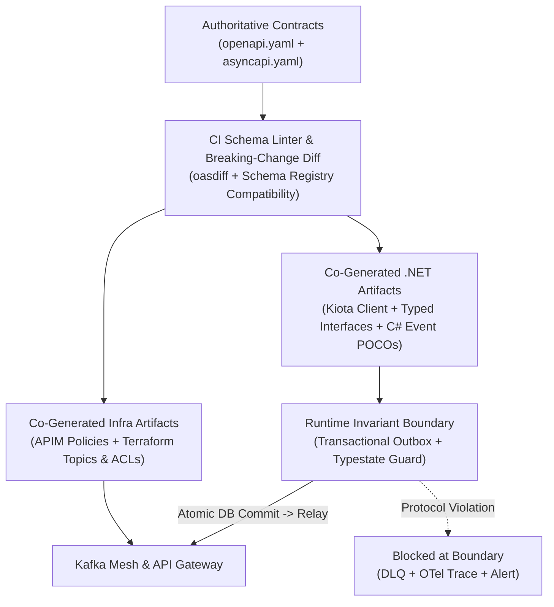

> **Original Thought & Source Lineage:** This practitioner note synthesizes three foundational 2025 publications: [*Implementing API Design First in .NET for Efficient Development, Testing, and CI/CD*](https://dzone.com/articles/implementing-api-design-first-ci-cd-testing) (DZone, **May 23, 2025** — `6,183` views), [*API Design First: AsyncAPI in .Net*](https://dzone.com/articles/api-design-first-asyncapi-in-dotnet) (DZone, **September 8, 2025** — `2,773` views; companion code in [`kumarshaz/kafka-dotnet`](https://github.com/kumarshaz/kafka-dotnet)), and [*The Evolving Landscape of AI Communication: From IPC to MCP and A2A*](https://medium.com/@kumar.shashinath/the-evolving-landscape-of-ai-communication-from-inter-process-communication-to-agent-to-agent-0dd526b94bde) (Medium, **April 27, 2025**; DZone cross-post [August 22, 2025](https://dzone.com/articles/a2a-mcp-agent-ai-communication-evolution), `2,659` views).

A stubborn pattern still dominates `.NET` shops even after a decade of "API Design-First" consensus: teams write the ASP.NET Core controller and C# record classes first, wire up Swashbuckle or OpenAPI reflection, and call the *emitted* JSON document a contract.

In May and September 2025, I documented an alternative end-to-end discipline across both synchronous HTTP APIs and asynchronous Kafka meshes: treating hand-authored, versioned specifications (`openapi.yaml` and `asyncapi.yaml`) as the single build-time authority from which both **application code** and **infrastructure topology** are derived.

By **November 2026**, coding agents and multi-agent integration protocols (`MCP` for agent-to-tool links and `A2A` for agent-to-agent delegation) proved that design-first specs were half the battle—and exposed the next boundary we ignored: **static schemas validate shapes, not time**.

---

## 1. Synchronous Contracts in `.NET`: Breaking the Code-First Reflex

The appeal of code-first Swashbuckle is speed on Day 1. The cost shows up on Day 30 when a frontend team, a partner gateway, and a `.NET` backend drift silently over nullable fields or changed HTTP status codes.

In [my May 2025 DZone guide](https://dzone.com/articles/implementing-api-design-first-ci-cd-testing), the practical cure required three concrete mechanisms rather than slideware:

1. **Dual-Spec Drift Visibility:** Serve *both* the authoritative static `openapi.yaml` design contract and the live reflected runtime specification side-by-side inside Swagger UI (`Swashbuckle` UI configured with two endpoints) during local and QA builds. Any discrepancy between intended contract and compiled route jumps off the screen.
2. **Deliberate Codegen Selection:** Pick your generator according to organizational coupling:

| Tooling Option | Strengths in `.NET` Pipelines | Best Fit | Watch-Out |
| :--- | :--- | :--- | :--- |
| **`Microsoft Kiota`** | Clean idiomatic C# typed fluent SDKs, lightweight runtime footprint, strong OpenAPI 3.0/3.1 alignment | Enterprise internal SDK consumers & API gateways | Primarily client-focused; pair with typed server endpoints |
| **`NSwag`** | Native `.NET` ecosystem toolchain, solid C# client + controller generation, NJsonSchema ecosystem | All-`.NET` teams wanting zero Node/Java build dependencies | Generated inheritance hierarchies need discipline to avoid mixing domain and transport models |
| **`openapi-generator-cli`** | Polyglot (C# + TypeScript + Java + Go) from one YAML; flexible templates | Mixed frontend/backend orgs + Azure API Management (APIM) | Heavy Java CLI toolchain; needs CI caching & template pinning |
| **Swashbuckle Reflection** | Instant feedback from code annotations | Prototyping & documenting *actual* runtime surface | Never treat reflected output as the authoritative contract |

3. **Pipeline-Backed Verification:** Lock `openapi.yaml` in source control and enforce validation inside Azure DevOps / GitHub Actions *before* deployment:
   - Lint & break-check the OpenAPI YAML (`Spectral` / `oasdiff`).
   - Run contract assertions (`NJsonSchema.Validation`, `FluentAssertions`, `WireMock.Net`, `Microsoft.AspNetCore.Mvc.Testing`) verifying every error payload (`ProblemDetails` RFC 9457), status code, and schema rule.
   - Publish typed NuGet consumer packages directly from CI and sync policies cleanly into Azure API Management (APIM) rather than editing portal XML manually.

---

## 2. Asynchronous Event Meshes: Co-Generating C# and Terraform (`AsyncAPI`)

Asynchronous Kafka architectures fail for a subtler reason than REST APIs: **topology drift**. A developer renames a topic, tweaks partition counts for ordering, or drops a compatibility header—while Terraform infra repos and consumer services go out of sync.

In [my September 2025 AsyncAPI walkthrough](https://dzone.com/articles/api-design-first-asyncapi-in-dotnet) and [`kumarshaz/kafka-dotnet`](https://github.com/kumarshaz/kafka-dotnet), I tackled missing official C# + Terraform AsyncAPI tooling by authoring a focused Handlebars generator parsing **AsyncAPI v2.5.0 Kafka bindings**. One machine-readable `asyncapi.yaml` emitted two synchronized outputs:

- **Application Layer:** Strongly typed C# domain event POCOs (`JsonSchema` constraints mapped cleanly), Confluent Kafka producers/consumers wired with correlation ID headers, and Dead Letter Queue (DLQ) routing scaffolding.
- **Infrastructure Layer:** Matching **Terraform** (`kafka_topic`, partition count, replication factor, retention MS, and least-privilege ACLs) committed right next to the application build.



If an architect enforces compatibility rules in Confluent Schema Registry (`BACKWARD_TRANSITIVE` or `FULL_TRANSITIVE`) alongside generated Terraform ACLs, no service accidentally poisons a shared Kafka topic with ad-hoc JSON strings.

---

## 3. The November 2026 Reality: Why `SchemaValid` Does Not Mean `ProtocolValid`

Fast-forward to late 2026. Every major coding agent writes fluent OpenAPI YAML, AsyncAPI specs, and `System.Text.Json` serialization fixtures without breaking a sweat. Yet distributed `.NET` systems integrating coding agents and partner workflows keep failing in production. Why?

Two major 2026 trends collided right on top of our API boundaries:

### Trend 1: Connectivity Commoditized; Orchestration & State Became the Bottleneck

In [my April 2025 communication evolution analysis](https://medium.com/@kumar.shashinath/the-evolving-landscape-of-ai-communication-from-inter-process-communication-to-agent-to-agent-0dd526b94bde), I traced enterprise messaging from OS-level IPC and sockets through ESBs, iPaaS, Kafka, and into **MCP** (agent-to-tool/data) and **A2A** (agent-to-agent negotiation). By November 2026, MCP tool definitions and A2A Agent Cards have essentially commoditized transport discovery—just as HTTP and JSON commoditized RPC syntax years ago.

Because transport schemas are now cheap to generate, teams expose **hundreds of internal endpoints and Kafka events directly as agent tools**. The moment an autonomous workflow orchestrates a multi-step business capability across those tools, structural schema validation catches serialization bugs (`string` vs. `int`), while **temporal state-machine violations** slip cleanly past green OpenAPI checks:

- Calling `CapturePayment` on a valid payment DTO before `AuthorizeHold` completes.
- Performing dual-writes (saving `Order` in SQL Server and firing `OrderCreated` to Kafka inside the same method, leaking phantom events when SQL rolls back).
- Issuing parallel A2A/MCP retries without cryptographic `IdempotencyKey` + monotonic sequence enforcement, triggering duplicate settlements.

In our empirical software engineering research workspace (`MEIGS Theory`), we call this the **Syntactic–Typestate Gap**: an agent-synthesized change passes `100%` of static schema validators and mocked local unit tests (`local pass = 1.0`), yet breaks the cross-service state protocol over time.

---

## 4. Upgrading Contract-First `.NET` With Temporal & Outbox Invariants

Closing that gap in 2026 doesn't require throwing away OpenAPI or AsyncAPI. It requires **promoting temporal state transitions and atomic delivery guarantees into the contract itself**.

### Pattern A: Encode Protocol Preconditions via Sealed Typestate Records

Stop exposing flat CRUD RPCs (`UpdateOrderStatus(id, newStatus)`) where any caller or LLM tool call can jump from `Cancelled` back to `Shipped`. Model legal transitions directly in `.NET` interfaces and OpenAPI `discriminator` schemas:

```csharp
namespace Fulfillment.Contracts;

public enum OrderState { Draft, Authorized, Reserved, Shipped, Cancelled }

// Only an AuthorizedOrder token can enter Inventory Reservation;
// agents and handlers cannot call ReserveAsync with a DraftOrder.
public sealed record DraftOrder(Guid OrderId, decimal TotalAmount);
public sealed record AuthorizedOrder(Guid OrderId, string AuthorizationToken, DateTimeOffset AuthorizedAt);
public sealed record ReservedOrder(Guid OrderId, string ReservationId, int SequenceVersion);

public interface IFulfillmentProtocol
{
    Task<Result<AuthorizedOrder>> AuthorizeAsync(
        DraftOrder draft,
        string idempotencyKey,
        CancellationToken ct);

    Task<Result<ReservedOrder>> ReserveInventoryAsync(
        AuthorizedOrder authorized,
        string idempotencyKey,
        CancellationToken ct);
}
```

When exposed via HTTP or MCP tool adapters, the gateway validates both the typed payload *and* the monotonic `(OrderId, ExpectedState, SequenceVersion)` guard against optimistic concurrency (`409 Conflict` / `412 Precondition Failed`) before touching state.

### Pattern B: Require the Transactional Outbox in Every AsyncAPI Contract

Treat "publish inside handler after DB save" as a banned anti-pattern in architecture unit tests. Any AsyncAPI producer must write domain mutations and outbox events inside the same ACID database transaction, accompanied by mandatory metadata headers in `asyncapi.yaml`:

```yaml
components:
  messageTraits:
    EnterpriseEventEnvelope:
      headers:
        type: object
        required: [x-correlation-id, x-idempotency-key, x-causation-id, x-aggregate-version]
        properties:
          x-correlation-id:
            type: string
            format: uuid
          x-idempotency-key:
            type: string
          x-causation-id:
            type: string
          x-aggregate-version:
            type: integer
            minimum: 1
```

This single message trait forces every `.NET` producer (human or AI-generated) to bind distributed trace causation and idempotent deduplication directly into the Kafka contract—meaning consumers and AI tool relays can safely drop duplicate agent retries at O(1) database cost.

---

## 5. The Contract-First Maturity Checklist for Late 2026

If you run `.NET` microservices or Kafka meshes today, audit your delivery pipeline against five crisp checks:

1. **Authoritative Source Check:** Does your `openapi.yaml` and `asyncapi.yaml` generate your C# DTOs and Kafka bindings—or are static specs rotting downstream of Swashbuckle controllers?
2. **Infra Symmetry Check:** Are Kafka topic partitions, retention windows, Schema Registry rules, and DLQs generated from the same AsyncAPI truth (`Terraform` / `Bicep`), or configured ad-hoc in portals?
3. **Outbox Guarantee:** Does every published event commit inside the domain database transaction before relay, eliminating dual-write split-brain?
4. **Protocol Order Guard:** Do external REST/MCP/A2A commands enforce legal state transitions (`ExpectedState` + `Idempotency-Key`) rather than generic status-patch endpoints?
5. **Runtime Drift Check:** Does CI run `oasdiff` + contract suites (`WireMock.Net` / Testcontainers) on every PR so neither humans nor agents silently ship breaking wire behavior?

Schema-first stopped being an optional documentation exercise when human microservices scaled past ten teams. Once autonomous coding agents and MCP tool callers entered the loop in 2026, **stateful contract-first architecture became the difference between composable speed and distributed chaos**.
