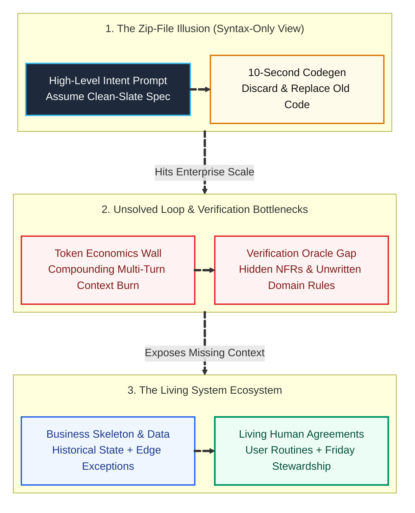
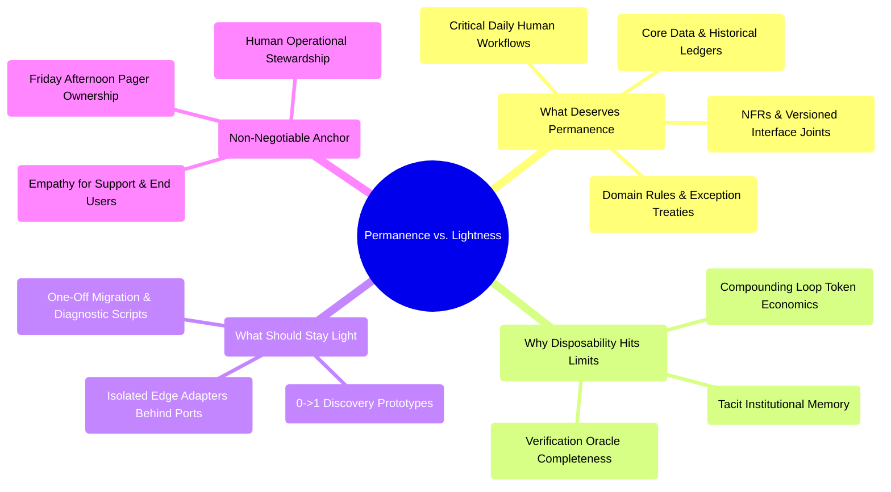

An interesting idea has taken hold across AI-assisted engineering circles: **disposable software**. When frontier models can synthesize thousands of lines of working syntax in seconds (fuelled by Intent or Spec Driven Development), why agonize over refactoring, maintainability, or evolutionary architecture? Why not treat applications as an on-demand artifact and just regenerate a fresh replacement from the Spec?

That argument sounds liberating only if you mistake the source archive for the system.

**Software is not just a `.zip` file of semi-English algorithms.** It is both the **skeleton** and the **residue** of a business process. If production software were merely a bundle of replaceable syntax, **why would Legacy Modernization still exist as one of the hardest, riskiest, multi-year undertakings in enterprise engineering?** Organizations with massive budgets and full access to modern coding agents are not deleting their twenty-year-old settlement, underwriting, logistics, ERP cores or even a pure workflow system over a long weekend. For good structural reasons.

---

## 1. The Epic Wrapped Around the Code

When engineers look at an unfamiliar repository and declare it "easy to rewrite," they are looking at static control flow while ignoring the **ecosystem** the software carries around it. Every layer of a long-running production system has a long story to tell, like an epic written across years of real operational stress:

- **Business Domain & Edge-Case Rules**: Production code rarely represents a clean textbook formula. It encodes years of hard-won exceptions, regulatory carve-outs, regional tax quirks, partner-specific tolerances, and commercial compromises discovered only when real money and real operations collided with edge cases.
- **Non-Functional Requirements (NFRs)**: Latency ceilings under end-of-quarter load spikes, idempotency across flaky network boundaries, audit trail immutability, security isolation, and recovery behavior during partial outages live inside subtle architectural choices that rarely show up in a one-paragraph feature prompt.
- **The Data It Generates and Consumes**: Software is anchored by data gravity. Years of historical records, schema migrations, in-flight state transitions, dirty upstream payloads, and downstream reporting contracts form a living timeline that cannot simply be "regenerated" clean.
- **User Interaction & Daily Muscle Memory**: Around every critical screen, API response, and operational alert sits human habit. Dispatchers, analysts, operations leads, and support engineers build workflows, mental models, and timing expectations around how the system behaves—including its known eccentricities.

In complexity terms (echoing Barry O'Reilly's *Residuality Theory*), mature enterprise software is what **survives** after repeated business stressors hit an organization. Strip away that residue blindly in the name of a clean regeneration, and you re-expose the business to every forgotten failure mode the "messy" system was quietly absorbing.

---

## 2. Spec-Driven Ambition vs. Unsolved Engineering Physics

To its credit, modern **Spec-Driven and Intent-Driven Development (SDD)** tries to confront this head-on. As I explored in [*The Blacksmith-to-Goldsmith Transition*](/blog/what-is-blacksmith-to-goldsmith/) and [*From ADRs to Executable Constraints*](/blog/from-adrs-to-executable-constraints/), moving architectural intent upstream into explicit specifications and executable guardrails is genuinely valuable.

In fact, an entire wave of emerging disciplines like **Harness Engineering**, **Loop Engineering**, **Verification Engineering**, and autonomous repair pipelines etc has sprung up specifically to turn intent into regenerated code reliably.

Yet when pushed to justify *wholesale disposable software* across real enterprise systems, these advances still collide with **two unaddressed bottlenecks**:

1. **The Token Economics Bottleneck**: Harness engineering and iterative agentic loops are not free at scale. Re-synthesizing non-trivial services requires stuffing domain lexicons, cross-service schemas, NFR constraints, security policies, and historical regression cases into multi-turn repair loops. As system coupling grows, context windows and retry loops compound inference burn and latency (a core driver of the three-year ownership math in [*Be the Editor, Not the Author*](/blog/editorial-architecture-and-three-year-tco/)). Burning massive token budgets to repeatedly regenerate and re-stabilize behavior that already worked deterministically is an economic regression, not progress.
2. **The Verification Paradox**: Loop engineering and verification engineering are only as strong as their **verification oracle**. How do you prove that a newly regenerated codebase preserves five hundred subtle domain edge cases, concurrency invariants, and NFR thresholds?
   - If your specification and verification suite are exhaustive enough to specify every invariant unambiguously, **your specification and test harness have become the non-disposable software**, with all the same maintenance weight, domain complexity, and coupling. There are still a fair argument of maintaining it and will always be the life saver in case of hard core infra updates.
   - If your specification stays brief and high-level, probabilistic regeneration inevitably drops unwritten operational behavior, introducing silent regressions wrapped in clean-looking syntax.

Harness engineering narrows syntactic drift, and verification engineering catches structural violations, but neither magically compresses decades of socio-technical domain reality into a cheap, throwaway rebuild.

---

## 3. Software Is a Living Agreement Between People

Step back from compilers, prompts, and verification harnesses, and a deeper truth comes into focus:

> **At its heart, software isn't just a bundle of logic you can throw away and regenerate. It is a living agreement between people.**

Every "messy" legacy system exists because real teams solved real problems, made compromises under pressure, and built shared habits around those compromises so the business could keep running. That odd validation rule in an order-capture service or that two-phase settlement hold in a billing pipeline is rarely accidental stupidity—it is usually a treaty negotiated between operations, finance, compliance, and customers after an expensive incident years ago.

When people call software disposable, they are looking strictly at the **lines of code** and forgetting the **trust, institutional memory, and daily routines** wrapped around them:

- Operations teams trust that specific failure states surface in predictable ways they know how to triage.
- Business partners rely on subtle payload behaviors, ordering guarantees, and timing windows that never made it into an OpenAPI description.
- Internal users depend on consistent workflow semantics to do their jobs under real-world deadlines without re-learning the tool every Tuesday.

Treat the underlying software as disposable, and you don't just swap out code—you unilaterally tear up the living agreements that hold daily operations together.

---

## 4. Permanence vs. Lightness: The Pragmatic Architectural Split

Rejecting the "everything is disposable" hype does not mean treating every line of glue code like a sacred monument. The pragmatic way to architect in the AI era isn't all-or-nothing—it is **knowing what deserves permanence and what should stay light**.

In my **Lego Framework** (and in [*Clean-Core Sidecars and COTS Stop Rules*](/blog/clean-core-sidecars-and-cots-stop-rules/)), this maps directly to separating the **Standardized Skeleton** from modular, replaceable **Plastic Surgery** at the edges:

| Architectural Layer | Stance | Examples | Why This Posture Matters |
| :--- | :--- | :--- | :--- |
| **Core Data & State Ledgers** | **Build for Permanence** | Canonical schemas, financial/order ledgers, event histories, audit trails, tenancy boundaries | Data outlives every application generation; casual schema or semantic churn corrupts institutional truth. |
| **Core Business Rules & Critical Workflows** | **Build for Permanence** | Pricing, settlement, underwriting, compliance invariants, daily operator workflows, NFR SLAs | People and downstream systems depend on behavioral stability every day; casual regeneration creates operational chaos. |
| **Standardized Contracts & Joints** | **Build for Permanence** | Versioned OpenAPI/AsyncAPI specs, domain ports, architectural unit tests, idempotency contracts | Rigid joints isolate blast radius so internal implementations can evolve safely without breaking consumers. |
| **Peripheral Adapters & UI Shells** | **Keep Light & Replaceable** | Thin presentation views, format translators, isolated webhook adapters behind strict ports | Bounded blast radius; safe to refactor or regenerate as long as contract assertions and UX expectations hold. |
| **Discovery Spikes & One-Off Tooling** | **Truly Disposable** | `0→1` UX prototypes, throwaway data-inspection scripts, benchmark harnesses, migration scaffolds | Built explicitly to learn fast before locking durable contracts—never mistaken for production foundations. |

Look at how clarifying that distinction is in practice:

- **Guard the Core With Care**: Your core data, your business rules, and the critical workflows people depend on every day must be engineered to last, versioned deliberately, and evolved with empathy for the teams who run and use them.
- **Contain Disposability Behind Rigid Joints**: If you want an AI agent to rapidly rewrite or replace an adapter, a UI widget, or a transformation slice, earn that freedom first by locking a permanent data model, a strict interface contract, and deterministic boundary tests around it.

---

## 5. The Friday Afternoon Test: Stewardship Still Belongs to Humans

Tools will keep improving. Harness engineering will orchestrate tighter feedback loops, verification tooling will formalize more invariants, and inference economics will continue to evolve.

None of that alters the foundational responsibility of software engineering: **stewardship still belongs to humans.**

Code generation has zero skin in the game. A model can emit a brand-new microservice in ten seconds, pass a synthetic test suite, and terminate its context window. It does not sit with a support team scrambling through broken customer orders, explain a subtle calculation drift to an auditor, or rebuild operator trust after a "regenerated" workflow breaks a decade-old edge case.

Whenever someone pitches software as effortlessly disposable, apply one final architectural filter: **Even if a machine writes the code in ten seconds, a human still has to answer the phone when something goes wrong on a Friday afternoon.**

Keep your prototypes light, keep your modular edges replaceable, and let agents accelerate the mechanics—but build your core data, your domain agreements, and your critical workflows with the care of the person who has to answer that phone.
