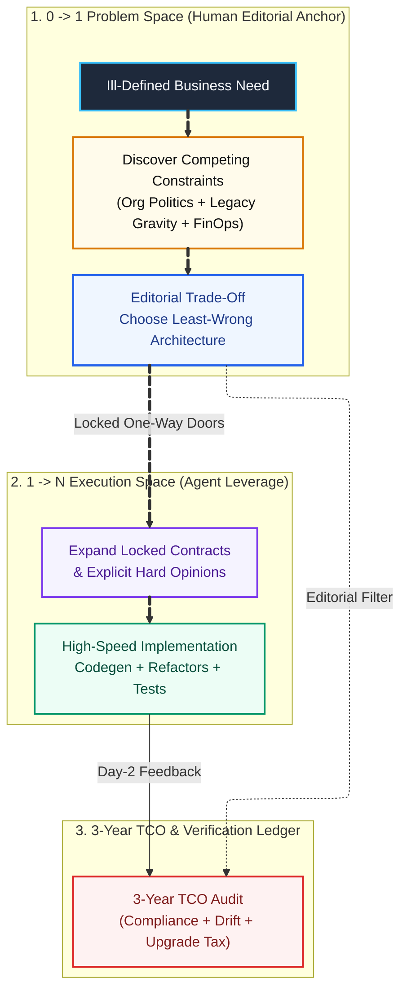
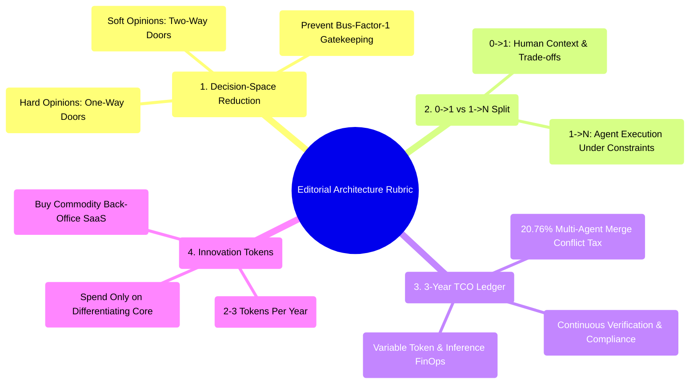

> **Original Thought & Source Lineage:** This perspective weaves together three Medium essays—[*SaaS Evaluation in GenAI Era*](https://medium.com/@kumar.shashinath/saas-evaluation-in-genai-era-8d9efadf6d99) (**August 25, 2025**), [*The Signal in the Noise: Architecture in the Age of Absolutes*](https://medium.com/@kumar.shashinath/the-signal-in-the-noise-architecture-in-the-age-of-absolutes-9b3a58fb4b8a) (**January 4, 2026**), and [*The Multiplier Architect: Being Opinionated Without Being a Tyrant*](https://medium.com/@kumar.shashinath/the-multiplier-architect-being-opinionated-without-being-a-tyrant-bc05d83d0aa8) (**January 4, 2026**)—with three 2026 LinkedIn reflections: [MS Build 2026's "Unmetered Intelligence" & token economics](https://www.linkedin.com/feed/update/urn:li:activity:7467621671315750912/) (**June 2, 2026**), [*The 0→1 vs. 1→N Boundary*](https://www.linkedin.com/feed/update/urn:li:activity:7488048153728884736/) (**July 28, 2026**), and [*The Architect and the Devil's Advocate*](https://www.linkedin.com/feed/update/urn:li:activity:7514422401972031489/) (**October 9, 2026**).

Enterprise technology moves in swings of confident absolutes. One quarter, microservices are mandatory everywhere; the next quarter, an infrastructure post-mortem (such as AWS Prime Video consolidating a distributed Step Functions and Lambda video monitoring pipeline back into a single service) convinces teams that *every* microservice was a mistake.

In 2026, that pendulum swung hardest on **Build vs. Buy**: *"Why renew a six-figure SaaS contract when our engineers can vibe-build an internal replacement over a long weekend?"*

Wait ten months—until **November 2026**—and look at the engineering ledgers of teams that actually took that leap. Very few failed to build the initial demo. Almost all underestimated the **three-year total cost of ownership**, the **cognitive bottleneck of uncurated choices**, and the quiet distinction between **`0→1` problem framing** and **`1→N` code generation**.

---

## 1. Contextual Bias & Shrinking the Decision Space

In [*The Signal in the Noise*](https://medium.com/@kumar.shashinath/the-signal-in-the-noise-architecture-in-the-age-of-absolutes-9b3a58fb4b8a), I argued that generic architecture trend pieces are pure noise until passed through **Contextual Bias**—your organization's specific failure tolerance, compliance posture, team topology, and legacy gravity.

Yet there is a trap awaiting architects who take nuance seriously: becoming an **"Option Catalog."** Under generative AI tooling, anyone can spit out twelve plausible architecture alternatives in fifteen seconds. Adding a thirteenth caveat does not help a delivery team ship cleanly.

As I reflected [on October 9, 2026](https://www.linkedin.com/feed/update/urn:li:activity:7514422401972031489/), senior architectural leadership requires shifting from **permanent Devil's Advocate** to **Decision-Space Reducer**:

- Before raising one more edge-case objection, ask: *"Did I just introduce another concern, or did I improve the resolution of the decision?"*
- Distinguish an **`#ImplementationDecision`** (reversible local plumbing) from a **`#PlatformDecision`** (structural gravity affecting five teams for five years).
- Learn to say *"I don't know that yet—but is knowing it material enough to alter this decision right now?"*

That pairs directly with the core split in [*The Multiplier Architect*](https://medium.com/@kumar.shashinath/the-multiplier-architect-being-opinionated-without-being-a-tyrant-bc05d83d0aa8) (adapting Liz Wiseman's *Multipliers*):

| Decision Class | Door Type | Ownership Pattern | Examples in 2026 AI Teams |
| :--- | :--- | :--- | :--- |
| **Hard Opinions** | **One-Way Doors** (high reversal cost) | **Owned & enforced strictly by the Architect + CI gates** | Data tenancy isolation, schema/wire compatibility, auth boundaries, transactional outbox guarantees, clean-core COTS stop rules |
| **Soft Opinions** | **Two-Way Doors** (cheaply reversible) | **Delegated cleanly to domain teams & coding agents** | Internal helper abstractions, serializer preference inside isolated slices, test naming syntax, local UI state patterns |

Being opinionated everywhere turns an architect into a **Human Gatekeeper Bottleneck**—a dynamic proven empirically across `521` active GitHub repositories in our research telemetry, where a single top reviewer absorbs an average **`66.43%`** of human review workload and **`23.42%` of repositories operate at Bus Factor = 1**. Hard opinions should shrink the dangerous decision space *before* implementation begins, leaving teams and coding agents free inside safe boundaries.

---

## 2. The `0→1` vs. `1→N` Boundary in November 2026

By mid-2026, watching teams push frontier coding harnesses across Claude Opus / Sonnet, OpenAI o-series / GPT-5, and Gemini agentic workflows exposed an unmistakable fault line that I wrote about on [July 28, 2026](https://www.linkedin.com/feed/update/urn:li:activity:7488048153728884736/):

- **Where Agents Already Outrun Us (`1→N`):** Given crisp constraints, schema contracts, and localized scope, frontier coding harnesses expand specifications into idiomatic implementations, localized refactors, and test coverage faster than senior engineers can type.
- **Where Agents Still Stall (`0→1`):** When the requirement itself is murky, stakeholder incentives conflict across ERP/legacy estates, compliance liabilities (`SOC 2`, `ISO 27001`, `HIPAA`, `PCI DSS`) sit under ambiguity, or a platform shift forces irreversible cost commitments, models optimize for local plausibility over enterprise consequence.

Architecture was never about generating the theoretically cleanest diagram. It has always been choosing the **least-wrong trade-off** among competing organizational constraints.

---

## 3. Pricing the 3-Year TCO of "Free" AI Code (`"SaaS is Dead"`)

That `0→1` vs. `1→N` split explains why the 2025–2026 *"SaaS is Dead"* narrative hits a wall when CFOs and VP Engineering leaders calculate **3-Year Total Cost of Ownership**.

In Case Study B of [*The Signal in the Noise*](https://medium.com/@kumar.shashinath/the-signal-in-the-noise-architecture-in-the-age-of-absolutes-9b3a58fb4b8a), and earlier in [*SaaS Evaluation in GenAI Era*](https://medium.com/@kumar.shashinath/saas-evaluation-in-genai-era-8d9efadf6d99), I warned against pricing custom AI builds solely at Day-1 code generation cost. By November 2026, four real empirical forces confirm why "zero build cost" does not equal "zero ownership cost":

1. **Multi-Turn Conflict & Merge Churn Aren't Free:** Across **`142,652` multi-agent PRs in the AgenticFlict corpus**, automated parallel development triggered **`29,609` conflict events (`20.76%` macro conflict rate)** averaging `149.8` conflict lines per collided change. Every unquarantined feature you pull in-house adds compounding surface area where autonomous runs collide.
2. **Unreviewed Velocity Creates Hidden Stabilization Taxes:** Across `26,779` inline code-patch reviews in `AIDev`, merged AI-assisted PRs still carried **`1,003` broad exception handlers**, **`354` suppressed linter/type checks**, and **`709` explicit security or bug warnings**. Cheaply synthesized CRUD software accumulates latent operational risk unless you pay continuously for verification infrastructure.
3. **Token Economics Still Meter Complexity:** Even as [MS Build 2026's opening keynote touted *"Unmetered Intelligence"*](https://www.linkedin.com/feed/update/urn:li:activity:7467621671315750912/), metering and token economics shifted front-and-center across enterprise FinOps reviews. Replacing deterministic SaaS workflows with agent-operated in-house glue swaps predictable seat licenses for variable inference bills, observability pipelines, and human escalation queues.
4. **Commodity Plumbing Compounds Vendor Leverage:** When you rebuild commodity billing, audit trails, SOC 2 logging, payroll rules, or multi-carrier tax compliance in-house using an agent, you haven't eliminated vendor lock-in—you have just appointed yourself the permanent maintenance vendor for zero competitive differentiation.

---

## 4. The Editorial Rubric: Acting as Editor, Not Author

To evaluate any Build vs. Buy vs. Agent-Compose decision cleanly in November 2026, apply the three editorial filters I proposed in January 2026 alongside your [GenAI SaaS Scoring Matrix](https://medium.com/@kumar.shashinath/saas-evaluation-in-genai-era-8d9efadf6d99):

1. **The Innovation Tokens Test (Dan McKinley):** Every enterprise team holds roughly **2 to 3 innovation tokens** per year—areas where you can afford bespoke edge complexity. Spend them strictly on your **differentiating core domain** (underwriting logic, proprietary pricing, fulfillment edge), never on rebuilding commodity back-office SaaS just because an agent offered to scaffold it.
2. **The Three-Year Maintenance & Verification Multiplier:** Price any bespoke build by adding continuous verification cost: CI invariant suites, security compliance audits (`GDPR` / `HIPAA` / `PCI`), third-party dependency upgrades, and on-call triage across 36 months—not Week-1 build hours.
3. **Fitness Functions & Mandatory POCs:** Before committing a One-Way Door (either buying an opaque "AI-washed" vendor tool or greenlighting an in-house build), define objective **Fitness Functions** (latency ceiling, data retention/training-opt-out clause, multi-tenant isolation, upgrade exit path) and validate them via a time-boxed **Proof of Concept**, never vendor slide decks.

In an era where generating code takes seconds, the highest-leverage technical leaders do not brag about how much software they authored. They act as **ruthless Editors**: discarding unnecessary components, delegating reversible implementation to teams and agents, rationing bespoke code strictly to differentiating domain edges, and shrinking the decision space until execution becomes unmistakable.
