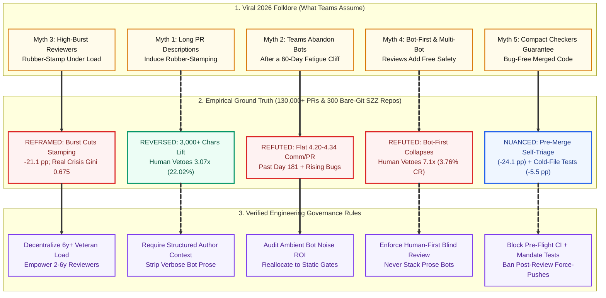
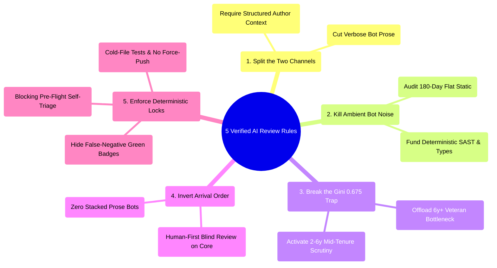

> **Empirical Provenance & Open-Science Replication:** This essay is **Part 1 of a 3-part empirical series** grounded in our SSRN preprint ([**SSRN Abstract `7742641`**](https://papers.ssrn.com/sol3/papers.cfm?abstract_id=7742641) · PDF/Markdown in [`pr-review-replication/paper/`](https://github.com/kumarshaz/pr-review-replication/tree/main/paper)), archived permanently on Zenodo (**Dataset DOI:** [`10.5281/zenodo.24452362`](https://doi.org/10.5281/zenodo.24452362) · [`zenodo.org/records/24452362`](https://zenodo.org/records/24452362)), and backed by our standalone open-science replication package ([**`kumarshaz/pr-review-replication`**](https://github.com/kumarshaz/pr-review-replication) — **`81/81` assertions passing**, `36/36` SHA-256 verified artifacts in [`VERIFICATION_REPORT.md`](https://github.com/kumarshaz/pr-review-replication/blob/main/replication/VERIFICATION_REPORT.md)). Every statistic below is computed directly from verifiable open-source repository telemetry with zero synthetic data and Benjamini-Hochberg false discovery rate (`BH-FDR`) correction (`q < 0.05` across headline claims): **`99,454`** CodeRabbit OSS pull requests (`457` active tenure repositories), **`33,596`** AIDev autonomous coding-agent PRs paired with **`6,618`** human baselines (`>= 100`-star repos), **`6,004`** formal human reviews across **`2,491`** distinct maintainers, **`553`** reparsed `TypeSafe Jev` decision-model PRs (`N = 312` formally hydrated), and **`10,410`** commit-attributed merged PRs traced through **`300`** local bare-git SZZ histories.

Open any engineering feed in late 2026 and you will hear the exact same five intuitions repeated as settled law:

1. Bloated AI-written PR descriptions make reviewers glaze over and rubber-stamp.
2. Engineering teams quietly abandon AI review bots after a 60-day fatigue cliff.
3. Maintainers hit by burst review queues (`5+` PRs/day) rubber-stamp everything to survive.
4. Letting an AI review bot comment before a human is harmless defense-in-depth—and two bots are even safer.
5. Compact, low-entropy AI checkers automatically eliminate post-merge production bugs.

Those stories feel intuitive. They also drive six- and seven-figure enterprise renewal budgets and GitHub branch-protection rewrites.

The problem? When you test all five against **more than 130,000 real production pull requests** and trace what actually breaks inside bare-git commit history 14 and 30 days after merge, **three of the five myths collapse outright, one flips completely upside down, and the fifth hides a subtle trap that makes naïve engineering dashboards lie.**

Before we walk through the five verdicts, keep one diagnostic rule in mind: **raw pooled bug counts lie via Simpson's Paradox.** Risky PRs touch high-churn "hotspot" files that were *already* breaking before the PR opened. Unless you stratify post-merge defect tracking (`SZZ` bugfixes) by **cold files**—files with zero bugfix commits in the prior 30 days (`pre_pr_30d_hotspot_fixes == 0`)—protective controls like unit tests look harmful, and noisy signals look causal. Strip away hotspot confounding, and repository ground truth snaps into focus.

---

## How We Built the Data Analysis Pipeline

Before diving into the five verdicts, here is a brief look under the hood of the empirical pipeline packaged in [**`kumarshaz/pr-review-replication`**](https://github.com/kumarshaz/pr-review-replication)—engineered so any engineer or reviewer can audit every number locally without paid LLM keys or GitHub API tokens:

| Pipeline Stage | What It Does | Key Script & Verified Output in `pr-review-replication` |
| :--- | :--- | :--- |
| **1. Zero-API Corpus Hydration & Bare-Git Cloning** | Downloads public Zenodo and Hugging Face corpora (`AIDev`, `CodeRabbit OSS`, `CodeReviewer`, `CodeReviewBench`, `AgenticPRs`, `TypeSafe Jev`) and clones `300` repositories using `git clone --bare --filter=blob:none`. | [`00_fetch_datasets.py`](https://github.com/kumarshaz/pr-review-replication/blob/main/replication/scripts/00_fetch_datasets.py) · [`DATASETS.md`](https://github.com/kumarshaz/pr-review-replication/blob/main/replication/DATASETS.md) |
| **2. Clean 38-Bot Attribution & Offline Signal Reparsing** | Separates `38` genuine Tier-1 review/SAST bots from coding-agent self-replies (`copilot-swe-agent[bot]`), dependency bots, and merge-queue banners (`graphite-app[bot]` in general PR comments), and deterministically reparses Jev verdicts offline. | [`bot_catalog.py`](https://github.com/kumarshaz/pr-review-replication/blob/main/replication/pipeline/config/bot_catalog.py) · [`p00_reparse_jev_offline.py`](https://github.com/kumarshaz/pr-review-replication/blob/main/replication/pipeline/src/pipelines/p00_reparse_jev_offline.py) |
| **3. Commit-Attributed Bare-Git SZZ & Cold-File Controls** | Traces `10,410` merged PRs across `300` bare-git commit histories into uncensored `14d` (`8,936`) and `30d` (`7,982`) post-merge bugfixes and reverts while recording each file's prior 30-day hotspot fixes (`pre_pr_30d_hotspot_fixes == 0`) to neutralize Simpson's Paradox. | [`p00b_build_szz_constraints.py`](https://github.com/kumarshaz/pr-review-replication/blob/main/replication/pipeline/src/pipelines/p00b_build_szz_constraints.py) · [`szz_defect_traceability_ledger.csv`](https://github.com/kumarshaz/pr-review-replication/blob/main/replication/results/pr_review/data_tables/szz_defect_traceability_ledger.csv) |
| **4. Statistical Inference, BH-FDR & 1-Command Verification** | Runs DuckDB/SciPy aggregations (`NQ-01`–`NQ-08`), Wilson 95% CIs, two-proportion Z-tests, post-hoc power, within-repo Mantel–Haenszel stratification (`OR_MH`), symmetric 14d DiD, Gini concentration, and `BH-FDR` (`q < 0.05`)—re-audited via `python3 replication/run_replication.py` (`81/81 PASS`, `36/36` SHA-256 checksums, zero-synthetic AST scan). | [`p16`](https://github.com/kumarshaz/pr-review-replication/blob/main/replication/pipeline/src/pipelines/p16_jev_judgment_and_szz_outcomes.py) · [`p17`](https://github.com/kumarshaz/pr-review-replication/blob/main/replication/pipeline/src/pipelines/p17_open_questions_nq01_to_nq08.py) · [`run_replication.py`](https://github.com/kumarshaz/pr-review-replication/blob/main/replication/run_replication.py) |

Every myth below links directly to the exact CSV ledger and JSON report that generated it.

---

## 1. Myth 1 (Reversed): "Long AI PR Descriptions Cause Rubber-Stamping"

**The Folklore:** Coding agents now ship multi-paragraph PR descriptions, file summaries, and test walkthroughs. Surely reviewers get overwhelmed by "wall-of-text" descriptions and reflexively click Approve.

**The Ground Truth:** The data shows the **exact opposite** across `5,997` human-reviewed pull requests. The shorter and vaguer the PR description, the *more* human reviewers blindly rubber-stamp it:

| PR Description Length | Reviewed PRs (`N`) | Median Chars | Human `CHANGES_REQUESTED` Veto % | Bare `APPROVED` Rubber-Stamp % |
| :--- | ---: | ---: | ---: | ---: |
| `< 100` chars | `237` | `41` | **`7.17%`** | **`60.76%`** |
| `100–499` chars | `1,182` | `287` | `8.71%` | `46.45%` |
| `500–1,499` chars | `1,627` | `907` | `10.51%` | `46.04%` |
| `1,500–2,999` chars | `1,929` | `2,229` | `20.84%` | `38.21%` |
| `3,000+` chars | `1,022` | `3,718` | **`22.02%`** | **`32.78%`** |

Moving from terse `<100`-character PRs to detailed `3,000+`-character PRs **triples human `CHANGES_REQUESTED` vetoes (`3.07x`: `7.17% -> 22.02%`, `p = 1.74e-7`, `q = 1e-6`, Power `100%`)** and slashes bare rubber-stamping nearly in half (**`-46.1%`: `60.76% -> 32.78%`, `p = 1.33e-15`**). Even better, PRs carrying structured walkthrough context show *lower* 30-day post-merge SZZ bugfix rates (**`37.58%` vs. `43.36%`**, `p = 0.0081`, `q = 0.0217`). *(Evidence: [`nq03_pr_description_bloat_log.csv`](https://github.com/kumarshaz/pr-review-replication/blob/main/replication/results/pr_review/data_tables/nq03_pr_description_bloat_log.csv) · [`open_questions_nq01_nq08_results.json`](https://github.com/kumarshaz/pr-review-replication/blob/main/replication/results/pr_review/open_questions_nq01_nq08_results.json).)*

**Why first principles explain the flip—The Two-Channel Signal Asymmetry:**
Engineers routinely conflate two completely different text channels inside a pull request:

- **Channel 1 — Author-Provided Intent (PR Body):** Gives a human reviewer an inspectable claim to verify against the diff. When an author or coding agent spells out *what* invariants should hold and *why* a boundary moved, reviewers can **unzip** the design and spot contradictions—tripling legitimate vetoes. A 41-character `"fix bug"` description gives the reviewer zero mental anchor, pushing them straight into a `60.76%` rubber-stamp.
- **Channel 2 — Third-Party Review-Bot Prose (Review Thread):** Projects unearned authority *after* the diff is opened (`968.6` mean bot chars vs. `116.1` human chars—an **`8.3x`** verbosity ratio). Within reviewed bot-present PRs (`Cohort C`, `n = 1,671`), higher bot comment verbosity negatively correlates with human veto scrutiny (`Spearman rho = -0.0674`, `p = 0.0058`).

**The Rule:** Stop banning structured PR descriptions. Demand explicit author-side intent, risk scope, and verification steps—and cut noisy third-party bot prose instead.

---

## 2. Myth 2 (Refuted): "Teams Abandon AI Review Bots After a 60-Day Fatigue Cliff"

**The Folklore:** Organizations turn on an AI PR review bot, endure two months of nitpicks, and silently mute or uninstall it around Day 60 once novelty wears off.

**The Ground Truth:** We tested this longitudinally across **`99,454` CodeRabbit OSS pull requests** spanning `457` repositories—and verified it with a strict fixed-cohort survivorship sensitivity check (`87,899` PRs across `362` repositories active for at least `61` days) so late-joining repos couldn't skew the curve:

| Bot Tenure Window | PRs (`N`) | Active Repos | Mean Comments / PR | Zero-Comment PRs % | Median Close Latency | Bug-Labeled PRs % |
| :--- | ---: | ---: | ---: | ---: | ---: | ---: |
| **Days `0–15`** | `2,111` | `457` | **`4.92`** | `0.14%` | `19.7h` | **`3.13%`** |
| **Days `16–30`** | `1,998` | `246` | **`4.08`** | `0.10%` | `17.6h` | `4.65%` |
| **Days `31–60`** | `4,581` | `311` | `4.12` | `0.07%` | `18.4h` | `5.30%` |
| **Days `61–180`** | `21,168` | `362` | **`4.34`** | `0.14%` | `20.0h` | **`5.86%`** |
| **Days `181+`** | `69,596` | `306` | **`4.20`** | `0.16%` | `22.4h` | `5.19%` |

*(Methodological disclosure: The public Zenodo CodeRabbit dataset marks all `99,454` closed PRs with `state='closed'` without a separate merged boolean, so we deliberately report verified comment density, silence rate, close latency, and bug-label rates rather than extrapolating unobserved merge rates.)*

There is **no 60-day abandonment cliff.** Mean comment density dips slightly during initial tuning in Days `16–30` (`4.92 -> 4.08`, or `4.84 -> 3.90` in the `87,899`-PR fixed cohort), then **stabilizes flat at `4.20–4.34` comments per PR past Day 181**—with `zero_comment_pct` remaining below **`0.20%`** at every stage. Meanwhile, bug-labeled PRs nearly double from **`3.13%`** (`Days 0–15`) to **`5.86%`** (`Days 61–180`), climbing highest on louder `.coderabbit.yaml` profiles (`default 2.01%`, `chill 7.78%`, **`assertive 8.90%`**). *(Evidence: [`nq08_queue_burst_and_fatigue_log.csv`](https://github.com/kumarshaz/pr-review-replication/blob/main/replication/results/pr_review/data_tables/nq08_queue_burst_and_fatigue_log.csv) · [`coderabbit_policy_outcomes_log.csv`](https://github.com/kumarshaz/pr-review-replication/blob/main/replication/results/pr_review/data_tables/coderabbit_policy_outcomes_log.csv).)*

**Why this matters more than abandonment:**
Abandonment is clean—if a team uninstalls a noisy tool at Day 60, at least you stop paying for it. What actually happens in production is **The Smoke Alarm That Never Turns Off**: teams don't rip the bot out of CI; they normalize `4.2` comments of ambient static per PR as background wallpaper, scroll straight past it, and quietly keep renewing the invoice while defect pressure ticks upward.

---

## 3. Myth 3 (Refuted & Reframed): "High-Burst Reviewers Rubber-Stamp Everything"

**The Folklore:** Coding agents flood queues with bursts of PRs; when a maintainer gets hit with five or more reviews in a single 24-hour window, cognitive exhaustion forces them to rubber-stamp approvals.

**The Ground Truth:** Measure acute 24-hour reviewer burst load across `16,886` formal human review events, and the folklore breaks cleanly in half:

- **Low burst (`1` review / 24h, `N = 6,198`):** `44.05%` bare rubber-stamping, `9.04%` CR veto.
- **Medium burst (`2–4` reviews / 24h, `N = 6,230`):** `32.47%` bare rubber-stamping, `8.96%` CR veto.
- **High burst (`5+` reviews / 24h, `N = 4,458`):** **`22.93%` bare rubber-stamping (`-21.12 pp`, `p < 1e-15`, Power `100%`)**, with CR veto holding flat at **`8.70%`** (`p = 0.55`).

High-burst reviewers aren't careless rubber-stampers—they are active maintainers operating in focused triage batches.

**So where is the real human review crisis?** Look one layer deeper at **who** carries that load across **`2,491` distinct human reviewers**:

- **Reviewer Workload `Gini = 0.6747`**—a level of inequality closer to oligarchic wealth concentration than healthy shared code ownership.
- Across `3,615` GitHub-matched tenure reviews, **`91.8%` (`3,317 / 3,615`) fall on `6y+` veterans**, echoing the [Bus-Factor-1 Conway Gatekeeper centralization](/blog/from-partner-diagram-rot-to-context-engineering/) we observed earlier.
- Yet look at veto scrutiny by tenure:
  - **`2–6y` mid-tenure reviewers (`N = 220`):** **`13.64%`** `CHANGES_REQUESTED` veto rate—**`2.1x`** sharper scrutiny than veterans.
  - **`6y+` veterans (`N = 3,317`):** **`6.39%`** `CHANGES_REQUESTED` veto rate.
  - **`<2y` newcomers (`N = 78`):** **`1.28%`** `CHANGES_REQUESTED` veto rate.

The pathology isn't burst volume; it is **structural senior centralization**. Organizations allow AI coding velocity to scale 5x while keeping review authority locked inside a tiny ring of exhausted `6y+` veterans—who default to pattern-matching triage while `2–6y` engineers sit vastly under-utilized on the sidelines. *(Evidence: [`nq08_queue_burst_and_fatigue_log.csv`](https://github.com/kumarshaz/pr-review-replication/blob/main/replication/results/pr_review/data_tables/nq08_queue_burst_and_fatigue_log.csv) · [`analyzed_human_reviewed_prs_log.csv`](https://github.com/kumarshaz/pr-review-replication/blob/main/replication/results/pr_review/data_tables/analyzed_human_reviewed_prs_log.csv).)*

---

## 4. Myth 4 (Refuted): "Letting an AI Bot Speak First Is Harmless Defense-in-Depth"

**The Folklore:** Wire an AI review bot to trigger immediately on `pull_request: opened`. It catches typos before your senior engineer looks at the PR, saves review minutes, and stacks safely with a second bot.

**The Ground Truth:** Pull-request review is **not commutative**: `Review(Bot, Human) != Review(Human, Bot)`.

Across `1,694` uncensored human-reviewed AIDev pull requests with verified timestamp ordering, look at what happens the moment a Tier-1 prose review bot comments *before* a human versus when a human speaks *first*:

| Arrival Order | PRs (`N`) | Human `CHANGES_REQUESTED` Veto % | Bare `APPROVED` Rubber-Stamp % | Median Review-to-Merge |
| :--- | ---: | ---: | ---: | ---: |
| **`Human_First`** (Human reviews before Bot) | `86` | **`26.74%`** | **`29.07%`** | **`160.3 min`** |
| **`Bot_First`** (Tier-1 Bot comments before Human) | `426` | **`3.76%`** | **`51.41%`** | **`38.2 min`** |
| **`No_Tier1_Bot`** (Human-only baseline) | `1,179` | `11.87%` | `49.96%` | `27.2 min` |

That is the **Bot-First Anchoring Law**:

- Letting an AI review bot speak first collapses human `CHANGES_REQUESTED` vetoes by **`7.1x`** (**`26.74% -> 3.76%`**, `-22.99 pp`, `p = 2.29e-13`, `q < 1e-6`, Power **`100%`**).
- Bare rubber-stamp approvals surge **`+22.34 pp`** (**`29.07% -> 51.41%`**, `p = 1.55e-4`, `q = 6.19e-4`, Power **`97.33%`**).
- Median review-to-merge latency compresses **`4.20x`** (**`160.3 min -> 38.2 min`**, Mann-Whitney `p = 8.01e-4`, `q = 2.94e-3`).

And stacking a second bot makes it worse, not safer. Across `2,138` reviewed PRs, adding **`2+` bots beside a solo human drops human CR vetoes to `2.20%`** (`4/182`, `p = 4.86e-3`, Power `94.11%`) versus `7.92%` (`155/1,956`) for a solo human with zero bots. Replacing a second human reviewer with an AI bot (`2+ Humans` vs. `1 Human + 1 Bot`, `N = 2,953`) collapses human vetoes from **`24.99%` down to `3.91%`** (Power `100%`).

**Why first principles predict this—Cockpit Crew Resource Management:**
Commercial aviation learned this lesson in blood decades ago: under Crew Resource Management (CRM), captains ask the first officer for their read *before* voicing their own, because whoever speaks first anchors everyone else's judgment. A fluent LLM bot—which on `CodeReviewBench` (`N = 150`; [`code_review_bench_15tools_log.csv`](https://github.com/kumarshaz/pr-review-replication/blob/main/replication/results/pr_review/data_tables/code_review_bench_15tools_log.csv)) scores `98.67%` "actionable" and `92.00%` "relevant" while being only **`24.00%` factually accurate**—walks into your PR thread, drops a confident 3,000-character checklist, and hands the human reviewer psychological permission to stop digging. *(Evidence: [`nq05_review_speed_bimodality_log.csv`](https://github.com/kumarshaz/pr-review-replication/blob/main/replication/results/pr_review/data_tables/nq05_review_speed_bimodality_log.csv) · [`multi_scale_sample_persistence_log.csv`](https://github.com/kumarshaz/pr-review-replication/blob/main/replication/results/pr_review/data_tables/multi_scale_sample_persistence_log.csv).)*

*(In Part 2 of this series—Human-First Blind Review—I publish the exact inverted 4-stage pipeline, copy-paste GitHub Branch Protection policies, and `.coderabbit.yaml` rulesets to fix arrival order without losing deterministic safety.)*

---

## 5. Myth 5 (Nuanced): "Compact AI Checkers Eliminate Post-Merge Bugs Automatically"

In my earlier [essay on Editorial Architecture and Three-Year TCO](/blog/editorial-architecture-and-three-year-tco/), I noted that System One decision models like **`TypeSafe Jev`** compress verbose LLM review walls (`4.20x–10.09x` fewer characters at `$0.0262/PR`), while warning that their real-world post-merge impact remained unproven.

Now we have bare-git commit ground truth across `N = 312` formally hydrated Jev PRs (`getsentry/sentry`, `craftmilldev/loopway`, `craftmilldev/sesh`), `N = 348` pooled coding-agent Jev PRs, and `10,410` SZZ-linked merged PRs. The answer splits cleanly into **what works upstream** versus **what fails downstream**:

1. **Where Compact Decision Checkers Genuinely Win — Pre-Merge Author Self-Triage:**
   When a compact Jev signal flags a PR, bad changes get caught *before* they ever land on `main`:
   - Merge rate drops **`-24.14 pp`** (**`90.80% -> 66.67%`**, `p = 1.12e-7`, Power **`99.97%`**).
   - Pre-review author self-closure jumps **`5.04x`** (**`1.15% -> 5.80%`**).
   - Post-Jev pre-merge corrective commits rise **`+11.82 pp`** (**`59.20% -> 71.01%`**)—reaching **`94.87%`** in the tersest quartile (`64–476` chars).
2. **Where Compact Checkers Fail — Advisory Overrides & False-Negative Complacency:**
   - **Advisory Comments Don't Stop Agents:** When Jev runs in non-blocking advisory mode on coding-agent PRs (`N = 348`), **`89.14%` (`156/175`)** of flagged agent PRs still get merged anyway.
   - **Zero Downstream Bug Magic on Merged Cold Files:** Once we control for file hotspot selection bias (`pre_pr_30d_hotspot_fixes`, `p = 5.42e-7`) and restrict to cold files, within-repo Mantel-Haenszel 14-day SZZ lands at an exact null (**`OR_MH = 0.9537`, `p = 0.95`**).
   - **The "All Clear" Badge Hazard:** Worse, PRs stamped `Jev_Clean` exhibit a **`+0.4205`** net 14-day symmetric difference-in-differences defect jump (`N = 88`) versus **`+0.0588`** on `Jev_Flagged` (`N = 102`)—a **`7x` complacency jump** when teams treat a green heuristic badge as a substitute for verification.
3. **The Two Concrete Controls That *Do* Move Bare-Git Post-Merge Defects:**
   - **Cold-File Test Mandate:** Naive pooled dashboards suffer textbook Simpson's Paradox, making test-bearing agent PRs look *buggier* (`+9.70 pp`, `40.01% -> 49.71%`, `p = 5.10e-8`) because engineers add tests to turbulent hotspots. Control for cold files (`pre_pr_30d_hotspot_fixes == 0`), and the sign reverses cleanly: co-authored tests **cut coding-agent 30-day SZZ defects by `-5.47 pp`** (**`28.09% -> 22.63%`**, `p = 0.0107`, a `-19.5%` relative drop).
   - **Hard Ban on Post-Review Force-Pushes:** Rewriting commit history after review spikes 30-day bare-git SZZ defects by **`+21.01 pp`** in Bot+Human PRs (**`40.22% -> 61.22%`**, `p = 0.0046`, `q = 0.0157`, Power `80.48%`) and **`+16.36 pp`** in Human-Only PRs (**`37.49% -> 53.85%`**, `p = 0.0084`).

Every piece of this reinforces the rule from [From ADRs to Executable Constraints](/blog/from-adrs-to-executable-constraints/): **advisory prose suggests; deterministic CI gates enforce.** *(Evidence: [`JEV_JUDGMENT_AND_SZZ_REPORT.md`](https://github.com/kumarshaz/pr-review-replication/blob/main/replication/results/pr_review/JEV_JUDGMENT_AND_SZZ_REPORT.md), [`jev_judgment_and_szz_outcomes.json`](https://github.com/kumarshaz/pr-review-replication/blob/main/replication/results/pr_review/jev_judgment_and_szz_outcomes.json), [`nq06_assertion_theater_szz_log.csv`](https://github.com/kumarshaz/pr-review-replication/blob/main/replication/results/pr_review/data_tables/nq06_assertion_theater_szz_log.csv), [`nq04_pingpong_rework_szz_log.csv`](https://github.com/kumarshaz/pr-review-replication/blob/main/replication/results/pr_review/data_tables/nq04_pingpong_rework_szz_log.csv), and [`szz_defect_traceability_ledger.csv`](https://github.com/kumarshaz/pr-review-replication/blob/main/replication/results/pr_review/data_tables/szz_defect_traceability_ledger.csv).)*

---

## 6. The Empirical Scorecard & Five Governance Rules

Put all five empirical verdicts side by side, and a crisp architectural posture emerges—not driven by vendor slide decks or LinkedIn hot takes, but by statistically powered repository evidence:

| # | Viral Claim | Verdict | Sample (`N`) | Verified Effect Size | Statistical Rigor | Evidence Artifact & Rule |
| :---: | :--- | :---: | :---: | :--- | :--- | :--- |
| **1** | Long AI PR descriptions cause rubber-stamping | **REVERSED** | `5,997` reviews (`237` vs `1,022`) | **`3.07x`** human CR (`7.17% -> 22.02%`); **`-46.1%`** stamping (`60.76% -> 32.78%`) | `p = 1.74e-7`, `q = 1e-6`, Power `100%` | [`nq03`](https://github.com/kumarshaz/pr-review-replication/blob/main/replication/results/pr_review/data_tables/nq03_pr_description_bloat_log.csv) — Mandate structured author intent; prune noisy third-party bot walls. |
| **2** | Teams abandon AI review bots after 60 days | **REFUTED** | `99,454` PRs (`87,899` fixed cohort) | Flat **`4.20–4.34`** comm/PR past Day 181 (`<0.20%` silent); bugs **`3.13% -> 5.86%`** | Fixed-cohort survivorship verified (`362` repos) | [`nq08`](https://github.com/kumarshaz/pr-review-replication/blob/main/replication/results/pr_review/data_tables/nq08_queue_burst_and_fatigue_log.csv) — Audit long-lived prose-bot ROI; fund deterministic static & contract gates. |
| **3** | High-burst reviewers (`5+`/24h) rubber-stamp | **REFUTED & REFRAMED** | `16,886` reviews; `2,491` reviewers | Burst cuts stamping **`-21.12 pp`** (`44.05% -> 22.93%`); **`Gini = 0.6747`**, `91.8%` on `6y+` | `p < 1e-15`, Power `100%`; `2–6y` CR `13.64%` vs `6y+` `6.39%` | [`nq08`](https://github.com/kumarshaz/pr-review-replication/blob/main/replication/results/pr_review/data_tables/nq08_queue_burst_and_fatigue_log.csv) — Break senior centralization and elevate `2–6y` reviewers into formal rotation. |
| **4** | Bot-first & stacked bots add free safety | **REFUTED** | `426` vs `86` (`SM-04`: `182`) | **`7.1x`** CR collapse (`26.74% -> 3.76%`); **`+22.34 pp`** stamping; `2+` bots = **`2.20%`** CR | `p = 2.29e-13`, `q < 1e-6`, Power `100%` | [`nq05`](https://github.com/kumarshaz/pr-review-replication/blob/main/replication/results/pr_review/data_tables/nq05_review_speed_bimodality_log.csv) — Enforce **Human-First Blind Review** on Tier-1 paths; outlaw stacked prose bots. |
| **5** | Compact checkers eliminate post-merge bugs | **NUANCED** | `312` Jev; `2,520` cold-file; `514` force-push | Pre-merge **`-24.14 pp`** (`5.04x` self-close); cold-file tests **`-5.47 pp`**; force-push **`+21.01 pp`** | Jev Power `99.97%`; cold-file `OR_MH = 0.95`; `Jev_Clean` DiD `+0.4205` | [`Jev`](https://github.com/kumarshaz/pr-review-replication/blob/main/replication/results/pr_review/JEV_JUDGMENT_AND_SZZ_REPORT.md) · [`nq04`](https://github.com/kumarshaz/pr-review-replication/blob/main/replication/results/pr_review/data_tables/nq04_pingpong_rework_szz_log.csv) · [`nq06`](https://github.com/kumarshaz/pr-review-replication/blob/main/replication/results/pr_review/data_tables/nq06_assertion_theater_szz_log.csv) — Block pre-flight CI, hide clean badges, mandate cold tests, ban force-pushes. |

---

## Closing Takeaway: Replace Folklore with Instrumentation

Moving an engineering organization from [Master Blacksmiths to Master Goldsmiths](/blog/what-is-blacksmith-to-goldsmith/) does not mean layering more conversational AI agents on top of already overloaded pull-request queues. It means ruthlessly measuring which controls preserve human judgment and which controls quietly sedate it.

Every dollar spent stacking verbose prose bots in front of exhausted `6y+` veterans buys you two things simultaneously: faster rubber-stamps (`38.2` minutes instead of `160.3`) and a `7.1x` collapse in the exact human vetoes you thought you were augmenting.

You do not need a new vendor contract to start fixing this on Monday morning. You already own your bare-git history. Measure your reviewer Gini, block post-review force-pushes, require cold-file tests on agent PRs, and let the human speak first.

> **Verify Every Metric Yourself:** Read the full preprint on [**SSRN (`Abstract 7742641`)**](https://papers.ssrn.com/sol3/papers.cfm?abstract_id=7742641), inspect the frozen dataset archive on [**Zenodo (`DOI: 10.5281/zenodo.24452362`)**](https://doi.org/10.5281/zenodo.24452362), or clone [`kumarshaz/pr-review-replication`](https://github.com/kumarshaz/pr-review-replication) and run `python3 replication/run_replication.py` to independently audit all `36` SHA-256 verified JSON/CSV tables and `10,410` commit-attributed bare-git SZZ pull requests.

*(Next in this 3-part series: **Part 2** translates the `7.1x` Bot-First Anchoring Law into a copy-paste 4-stage inverted GitHub/GitLab PR pipeline; **Part 3** equips CTOs and VPs of Engineering to replace vanity AI velocity dashboards with four board-level KPIs built around Reviewer Gini and Cold-File SZZ.)*
