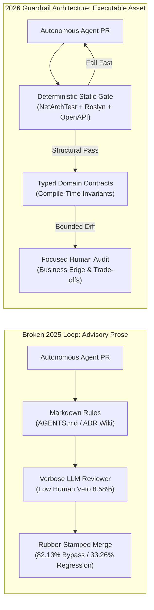

> **Original Thought & Source Lineage:** This architecture note expands ideas first published across two essays: [*VS Code Agent Mode: An Architect's Perspective for the .NET Ecosystem*](https://dzone.com/articles/vs-code-agent-mode-dotnet) (DZone, **September 19, 2025** — open companion to the earlier [Medium preview](https://medium.com/@kumar.shashinath/vs-code-agent-mode-an-architects-perspective-for-the-net-ecosystem-7749fa038699) on August 11, 2025) and [*The Automation Boomerang*](https://www.linkedin.com/feed/update/urn:li:activity:7330076293637566464/) (LinkedIn, **May 18, 2025**), crystallized in January 2026 into a single maxim on [LinkedIn (January 8, 2026)](https://www.linkedin.com/feed/update/urn:li:activity:7414916817858736128/):
>
> *"In the AI-Native era, the code is no longer the asset; the verification of the code is the asset."*

In the middle of 2025, when agentic modes inside IDEs first shifted from inline autocomplete to multi-file workspace edits, I argued that most enterprise teams were about to hit a wall they didn't even know existed: **architectural intent wasn't encoded where execution happened**.

We wrote Architecture Decision Records (ADRs) in Confluence. We drew clean Hexagonal rings in Miro. We expected senior engineers on Pull Request duty to catch domain leakage, direct repository coupling, or bypassed validation contracts through tribal memory.

By **November 2026**, that hope hasn't just eroded—it has mathematically collapsed under agentic submission volume. Here is what changed, what empirical telemetry from real repositories actually shows, and how software architects must re-wire the verification boundary.

---

## 1. The Automation Boomerang

Across eighteen years spanning commercial off-the-shelf systems, integration platforms, JVM services, and enterprise `.NET`, our industry has moved along an unexpected loop that I called [The Automation Boomerang](https://www.linkedin.com/feed/update/urn:li:activity:7330076293637566464/):

1. **Phase 1 — Deterministic Automation:** We wrote compilers, static analyzers, schema validators, and CI pipelines specifically to eliminate human slips and erratic typos.
2. **Phase 2 — Agentic Delegation:** We introduced probabilistic LLMs to handle messy, multi-file engineering work beyond rigid scripts, hoping to offload toil and even automate review gates.
3. **Phase 3 — Probabilistic Re-entry:** We discovered that generative models reintroduce subtle, context-blind errors—silently flattening architectural layers, swallowing exceptions, or inventing plausible-looking bypasses—wrapped in syntactically spotless code.

When code generation drops toward zero marginal cost while human attention remains bounded, the bottleneck shifts cleanly out of typing and directly into **supervisory verification**.

---

## 2. The November 2026 Reality: Why Prose Rules and Review Bots Fail Alone

In late 2025 and early 2026, engineering teams responded to agent drift by dropping Markdown rulebooks into repository roots: `AGENTS.md`, `CLAUDE.md`, `.cursorrules`, and `.github/copilot-instructions.md`. That helped solo interactive sessions—until autonomous PR pipelines hit production teams.

When we examine real open-source multi-agent pull request corpora in late 2026—most notably the **AIDev** dataset (`33,596` autonomous agent pull requests across `2,807` active repositories with at least 100 stars, alongside `6,618` paired human baseline PRs)—three structural failures stand out:

1. **The Supervisory Gate Collapses Under Volume:** Median PR merge latency dropped from **`3.893 hours`** on human baselines to **`0.046 hours`** (`~2.8 minutes`) on agent PRs, and **`82.13%` of agent pull requests bypassed formal human review comments completely**. Maintainers aren't lazy; under rational inattention, human eyes cannot audit tenfold multi-file diff volume at zero marginal merge friction.
2. **Adding Conversational "AI Review Bots" Worsens Post-Merge Outcomes:** When teams tried plugging Tier-1 LLM review bots in front of overwhelmed humans, verbose prose created false confidence. Across `26,779` inline patch comments and `17` distinct review bot families in AIDev:
   - **Deterministic SAST Brains** (short, deterministic rule checks) held a **`14.45%`** human veto rate when reviewed and a **`9.31%`** 90-day post-merge regression rate.
   - **Multi-Model RAG Agentic Brains** (long conversational PR walkthroughs) depressed human veto vigilance to **`8.58%`** while suffering a **`33.26%` 90-day post-merge regression rate** (**3.57x higher**). Across merged PRs overall, **`1,003` broad exception handlers**, **`354` linter/type suppressions**, and **`709` security or bug warnings** landed directly in mainline branches—`13.64%` of bot comments (`162` explicitly flagged security/bug issues) were merged completely unaddressed.
3. **Instruction Markdown Is Untrusted Input:** Security benchmarks such as **GitInject** (`11` documented malicious indirect prompt-injection scenarios targeting `AGENTS.md`, `CLAUDE.md`, and `GEMINI.md` files) proved that natural-language instruction files sit inside the *untrusted PR attack surface*. Relying on an LLM to police another LLM via English instructions breaks both security isolation and architectural integrity.

Prose instructions are **advisory hints**. Only deterministic build, type, and graph checks are **gates**.



---

## 3. The Three-Stage Migration to Constraint-Driven Architecture

In my [September 2025 DZone essay](https://dzone.com/articles/vs-code-agent-mode-dotnet), I mapped a three-stage evolution that separates teams drowning in AI rework from teams compounding velocity:

| Stage | How Intent Is Encoded | Behavior Under Coding Agents | Nov 2026 Verdict |
| :--- | :--- | :--- | :--- |
| **1. Documentation-Based** | Confluence pages, ADRs, static wiki diagrams, `AGENTS.md` | Agents treat guidelines as soft weights; under context pressure, direct DB calls leak into controllers. | **Obsolete as a solitary control** |
| **2. Framework-Based** | Starter templates, shared base classes, NuGet infrastructure conventions | Agents copy neighboring patterns fairly well, until two conflicting examples coexist in one repo. | **Necessary scaffolding, leaky perimeter** |
| **3. Constraint-Based** | Generic type boundaries, Roslyn analyzers, `NetArchTest` CI suites, JSON/Spec schema locks | Non-compliant topologies **fail to compile or fail CI** before reaching human attention budgets. | **The enduring verification asset** |

Notice what makes Stage 3 fundamentally different: you stop asking an inductive model *please obey Hexagonal boundaries*, and you make boundary violations unrepresentable or unmergeable.

---

## 4. Concrete Implementation: Encoding `.NET` Guardrails in Code

As a practitioner in the `.NET` ecosystem, turning documentation into executable invariants starts with three lightweight mechanisms every team can ship inside an afternoon.

### A. Make Illegal Boundaries Uncompilable With Domain Primitives

When endpoints share primitive handlers and raw EF Core `DbContext` injections, an AI agent optimizing for green tests will happily place SQL queries directly inside Minimal API lambdas or controllers. Instead, force every endpoint across a constrained generic boundary (`IApiEndpoint<TRequest, TResponse>`) where validation and domain isolation are part of the type signature:

```csharp
namespace Ordering.Application.Contracts;

public interface IValidatedRequest { }

public interface IApiEndpoint<in TRequest, TResponse>
    where TRequest : IValidatedRequest
{
    Task<Result<TResponse>> HandleAsync(TRequest request, CancellationToken ct);
}

// Compile-time boundary: endpoints must consume validated immutable inputs
// and return explicit Result<T> types instead of throwing control-flow exceptions.
public sealed record ReserveInventoryCommand(Guid SkuId, int Quantity, string IdempotencyKey)
    : IValidatedRequest;

public abstract class DomainApiController<TRequest, TResponse>(
    IApiEndpoint<TRequest, TResponse> endpoint)
    where TRequest : IValidatedRequest
{
    protected async Task<IResult> ExecuteAsync(TRequest request, CancellationToken ct)
    {
        var outcome = await endpoint.HandleAsync(request, ct);
        return outcome.Match(
            onSuccess: value => Results.Ok(value),
            onFailure: error => Results.Problem(error.Detail, statusCode: error.HttpStatus));
    }
}
```

Combined with Roslyn warning-as-error rules (`TreatWarningsAsErrors` for banned APIs like direct `HttpClient` instantiation or unguarded `DateTime.Now`), the compiler catches architectural drift *inside the agent's inner repair loop* before git ever sees a commit.

### B. Turn Your Dependency Diagram Into CI Unit Tests (`NetArchTest`)

Your clean-architecture diagram belongs inside `Ordering.ArchitectureTests`. If Domain ever references Infrastructure or EF Core, or if a handler swallows domain exceptions without telemetry, the build goes red in 400 milliseconds:

```csharp
using NetArchTest.Rules;
using Xunit;

namespace Ordering.ArchitectureTests;

public sealed class HexagonalBoundaryTests
{
    private const string DomainNs = "Ordering.Domain";
    private const string ApplicationNs = "Ordering.Application";
    private const string InfrastructureNs = "Ordering.Infrastructure";
    private const string ApiNs = "Ordering.Api";

    [Fact]
    public void Domain_MustNotDependOn_InfrastructureOrApi()
    {
        var result = Types.InAssembly(typeof(Ordering.Domain.Orders.Order).Assembly)
            .ShouldNot()
            .HaveDependencyOnAny(InfrastructureNs, ApiNs, "Microsoft.EntityFrameworkCore")
            .GetResult();

        Assert.True(result.IsSuccessful,
            $"Hexagonal violation detected: {string.Join(", ", result.FailingTypeNames ?? [])}");
    }

    [Fact]
    public void CommandHandlers_MustBeSealed_AndImplementValidatedBoundary()
    {
        var result = Types.InAssembly(typeof(Ordering.Application.Contracts.IValidatedRequest).Assembly)
            .That()
            .ResideInNamespaceContaining("Handlers")
            .Should()
            .BeSealed()
            .GetResult();

        Assert.True(result.IsSuccessful,
            $"Unsealed handler detected: {string.Join(", ", result.FailingTypeNames ?? [])}");
    }
}
```

### C. Pass the Composability Check

Back in my September 2025 piece, I proposed adapting four formal checks—**The Composability Test**—for every generated module:

1. **Systematicity:** Do handlers follow a predictable, uniform contract shape so agents and humans compose new endpoints reliably?
2. **Productivity:** Can teams recombine existing validated domain services without inventing bespoke glue code?
3. **Substitutivity:** Can you swap an Infrastructure adapter (SQL Server $\to$ Postgres, Kafka $\to$ Azure Service Bus) without mutating Domain logic?
4. **Localism:** Does changing one feature leave unrelated Vertical Slices untouched?

If an agent-authored PR breaks any of those four properties, automated AST + dependency checks should reject it *before* spending a single minute of staff-engineer review capacity.

---

## 5. Where the Human Architect Stands Now

In [a later reflection on July 28, 2026](https://www.linkedin.com/feed/update/urn:li:activity:7488048153728884736/), I drew the boundary line cleanly between **0→1 problem discovery** and **1→N execution**:

- **1→N execution** (expanding clean contracts into implementations, migrations, unit tests, and boilerplate) has largely been conquered by frontier harnesses.
- **0→1 framing** (discovering competing business constraints, defining failure modes, and writing the verification suite) belongs squarely to the architect.

That is what moving from **Master Blacksmith** to **Master Goldsmith** actually means in practice. Don't celebrate how fast an agent generates ten thousand lines of C# or TypeScript. Ask instead: **if you wiped the implementation directory tomorrow and fed only your specs, type boundaries, architecture tests, and contract assertions back into the pipeline—would you get the same reliable system back?**

If the answer is no, you haven't built an asset yet. You've only generated inventory.
