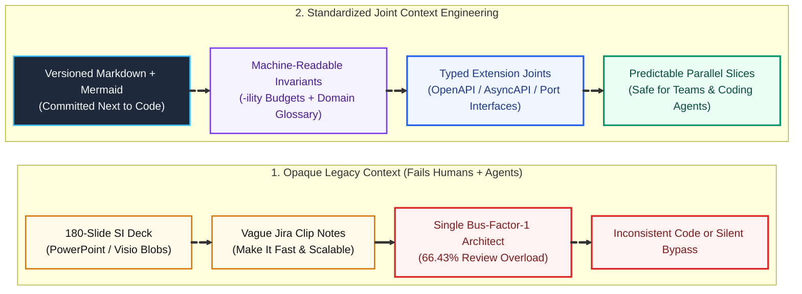
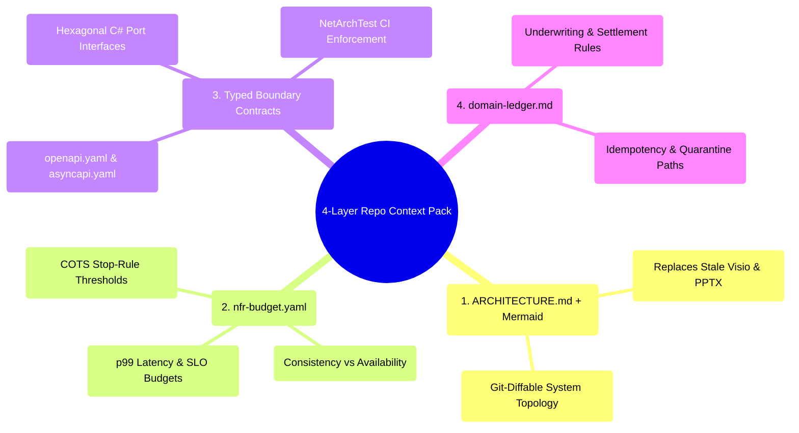

> **Original Thought & Source Lineage:** This essay builds on four 2026 reflections: [*The Haircut Paradox in Software Requirements*](https://www.linkedin.com/feed/update/urn:li:activity:7426766861784231936/) (LinkedIn, **February 9, 2026**), [*Partner Diagram Rot & Context Engineering*](https://www.linkedin.com/feed/update/urn:li:activity:7438041594374737920/) (LinkedIn, **March 12, 2026**), [*Standardized Joints & The VS Code Architectural Skeleton*](https://www.linkedin.com/feed/update/urn:li:activity:7505271064604803072/) (LinkedIn, **September 14, 2026**), and [*Connecting the Dots: Learning Business Economics & Ecosystem for Software Architects*](https://medium.com/@kumar.shashinath/connecting-the-dots-78a6c1c120a7) (Medium, **January 5, 2026**).

Every large enterprise has a graveyard inside SharePoint. Open almost any folder from a multi-million-dollar, multi-year system integrator (SI) transformation program and you will find it: a gleaming 180-slide PowerPoint deck filled with rounded rectangles, bidirectional arrows, color-coded swimlanes, and zero enforceable contracts.

For twenty years, human engineering teams tolerated those artifacts because a veteran principal architect sat in meetings translating what those dashed arrows *actually* meant—which queue handled retries, which ledger settled money, and which ERP boundary could never fail silently.

Then 2026 arrived. And as I asked on [LinkedIn in March 2026](https://www.linkedin.com/feed/update/urn:li:activity:7438041594374737920/): **what happens to all those polished partner diagrams the moment coding agents and context harnesses need to execute them?**

---

## 1. Partner Diagram Rot: Reading Between the Boxes and Connectors

Even as multimodal vision-language models improved rapidly through 2025 and 2026, a structural truth remained stubbornly unchanged: **an unlabeled connector inside a slide-deck box diagram does not contain engineering specification**.

Slide decks fail context engineering for three structural reasons:

1. **Missing Protocol & Semantics on Edges:** A human looks at an arrow between `Order Service` and `Freight Settlement` and infers outbox delivery, idempotency, or regulatory audit trails based on lived domain intuition. An AI coding harness looks at an image of a line and guesses the lowest-entropy HTTP CRUD call.
2. **Binary File Isolation:** `.pptx`, `.vsdx`, and exported PDFs sit outside version control (`git diff`), detached from the code modules, schema files, and infrastructure manifests they purport to describe. Code mutates daily; the deck freezes on kickoff day.
3. **Zero Composable Validation:** You cannot run CI against a slide deck. The moment the SI consultants roll off, architectural truth fragments across local Slack threads and individual engineers' heads.

That erosion hits organizations far harder when software economics cross domains—moving from Human Capital Management to Merchant Acquiring, eCommerce OMS, and 3PL Freight Brokerage, as I traced in [*Connecting the Dots*](https://medium.com/@kumar.shashinath/connecting-the-dots-78a6c1c120a7). Transferring real architectural insight across domains isn't copying boxes; it is transferring **underwriting models, risk boundaries, and exception semantics** cleanly into executable form.

---

## 2. The Haircut Paradox: Why "Clip Notes" Fail Hybrid Human-Agent Teams

Paired with diagram rot inside the enterprise sits an equally stubborn failure at the requirements layer—what I call [**The Haircut Paradox**](https://www.linkedin.com/feed/update/urn:li:activity:7426766861784231936/).

I have been getting haircuts my entire life. Even at chains like Great Clips that store literal *"Clip Notes"* in a database specifically to guarantee consistency—*"Number 2 on the sides, scissors on top"*—sitting in a different barber's chair still yields a different haircut every single time. Why? Because natural-language shorthand omits implicit tolerances, blending geometry, and context.

In software delivery, teams routinely fall into an AI-era twist on the exact same paradox:

- Teams reject bloated 40-page Waterfall specification binders as outdated bureaucracy.
- So they swing to the opposite extreme: writing two-line Jira tickets and loose prompt *"Clip Notes"* for both junior developers and AI coding agents.
- When the resulting PR explodes across seven tightly coupled files or blows latency SLOs under load, they blame the model or the engineer.

What *"Number 2 on the sides"* hides in software is every **`-ility` trade-off** where actual architecture happens:
- **Performance vs. Cost:** How fast must an endpoint respond before compute and inference spend breaks unit economics?
- **Reliability vs. Speed-to-Market:** Is this a fail-closed financial settlement ledger or an experimental reporting slice?
- **Maintainability vs. Local Cleverness:** Should this share a canonical joint, or isolate behind an anti-corruption adapter?

Prose adjectives like *"fast," "scalable,"* and *"clean"* do not constrain probabilistic synthesis.

---

## 3. The November 2026 Cost: Gatekeeper Concentration & Bypass Collapse

When architecture lives inside tribal memory and glossy slide decks instead of versioned, machine-readable repository artifacts, the organization silently transfers coordination load onto a shrinking number of veteran reviewers.

Look at what empirical repository telemetry reveals in late 2026 across `AIDev` (`33,596` agent pull requests across `2,807` active repositories):

1. **Conway Gatekeeper Burnout:** Across `521` repositories with 5 or more human reviews, a single top reviewer handles an average **`66.43%`** of all human review work—and **`23.42%` of repositories operate at Bus Factor = 1**. When context lives inside one principal engineer's head rather than the repository's structural skeleton, every ambiguous agent PR stalls on one exhausted gatekeeper.
2. **The Speed-vs.-Scrutiny Snap:** Look across organizational archetypes in the same corpus:
   - In **AI-Native Agent Tooling Organizations** (`26` repos, `823` agent PRs), **`70.35%`** of agent PRs bypassed formal human review completely, human veto rate on reviewed PRs dropped to **`6.15%`**, and **`13.33%`** of human vetoes were overridden.
   - In **OSS Foundation & Standards Consortia** (`66` repos, `710` agent PRs), where written specifications, strict RFC contracts, and CI checks govern contribution boundaries, silent bypass dropped to **`26.62%`** and human veto scrutiny held at **`20.73%`**.

Ambiguous *Clip Notes* plus unmachine-readable diagrams either burn out your Bus-Factor-1 architects or push teams straight into silent bypass mode.

---

## 4. Standardized Joints & Context Engineering: Copying the VS Code Blueprint

So how do we replace slide-deck theater without sliding backward into slow Waterfall bureaucracy? Look at a non-obvious case study I highlighted in [September 2026 after watching *The VS Code Story*](https://www.linkedin.com/feed/update/urn:li:activity:7505271064604803072/).

Microsoft transformed a JavaScript/Electron shell into the dominant operating skeleton of AI-native engineering not because the text editor UI was flashy, but because its architects engineered **standardized decoupling joints**:

- **Language Server Protocol (LSP):** Decoupled every language compiler/analyzer from the UI surface.
- **Remote Tunnels:** Decoupled local interaction surfaces from remote compute and execution sandboxes.
- **AI Agent Host / Extension Contracts:** Decoupled orchestration harnesses so independent AI coding systems could plug cleanly into an existing ecosystem.

Think about the lesson for enterprise context engineering: **VS Code scaled because the joints carried typed protocol contracts, not slide-deck arrows.**



---

## 5. The 4-Layer Repository Context Pack (No More Slide Graveyards)

When an enterprise team retires partner PowerPoints and adopts context engineering inside Git, four versioned artifacts replace 200 slides of box-and-arrow bloat:

| Artifact | Committed Location | Replaces | Enforced Consumer |
| :--- | :--- | :--- | :--- |
| **1. `ARCHITECTURE.md` + Inline Mermaid** | Repo / service root | Stale Visio / PPT transformation diagrams | Humans + Context Harnesses (strictly diffed on PRs touching boundaries) |
| **2. Machine-Readable `-ility` & Stop-Rule Contract** | `docs/nfr-budget.yaml` (or frontmatter spec) | Haircut *Clip Notes* (*"keep it reliable/fast"*) | Quantitative latency p99 targets, retry caps, consistency model, and COTS sidecar rules |
| **3. Typed Boundary Contracts (`contracts/`)** | `openapi.yaml`, `asyncapi.yaml`, C# Port Interfaces | Unlabeled connectors between diagram boxes | Codegen, `oasdiff`, Schema Registry, and `NetArchTest` boundary checks |
| **4. Domain Economics & Exception Glossary** | `docs/domain-ledger.md` | Cross-domain tribal knowledge locked in veteran heads | Explicit edge semantics: how underwriting, settlement, chargebacks, or partial failures resolve |



Notice what happens when you capture an explicit `-ility` contract next to the code instead of writing fuzzy prose:

```yaml
# docs/joints/freight-settlement-joint.yaml
joint_id: "3PL-SETTLEMENT-04"
owner_domain: "CarrierSettlement"
pattern: "Transactional Outbox -> Idempotent Settlement Command"
tradeoffs:
  consistency_over_latency: true
  max_p99_ack_ms: 450
  idempotency_window_hours: 168
invariants:
  - "Never compute carrier margin adjustment inside ERP portal hooks (>50 LOC stop rule)."
  - "Never transition SettlementState from Disputed -> Paid without dual-signed audit event."
  - "Fail small: if downstream broker ledger times out, route to QuarantineQueue; never drop packet."
```

That fifteen-line YAML artifact fits in ten seconds of context window, diffs cleanly inside a GitHub Pull Request, prevents an AI agent from inventing naive CRUD mutations, and eliminates half a dozen Slack alignment meetings.

---

## 6. Closing Reflection: Kill the Deck, Keep the Joint

Your next architecture transformation deliverable does not need fifty gradients and rounded rectangles inside a quarterly executive slideshow. If a human engineer and an autonomous coding harness cannot clone the repository, read the markdown topology, inspect the quantitative `-ility` budgets, and compile the typed joints without cornering your single busiest staff architect on Teams—your architecture isn't documented yet.

Stop polishing diagrams that rot on Friday afternoon. Encode the joints where the code actually lives.
