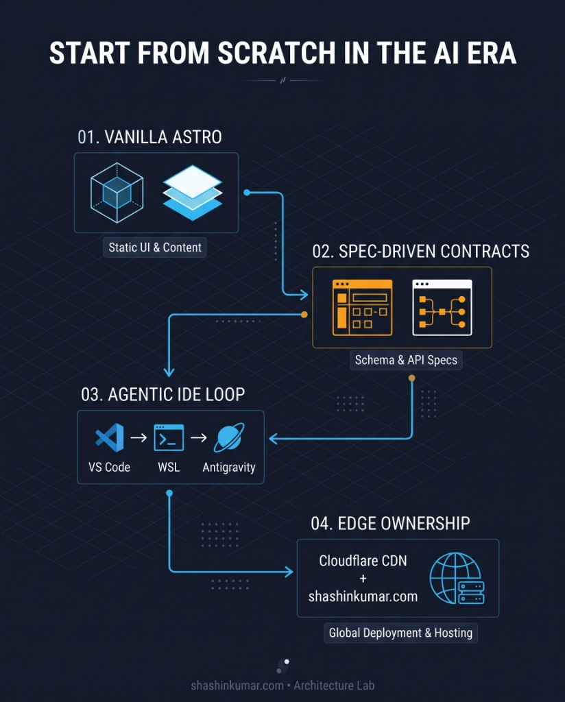
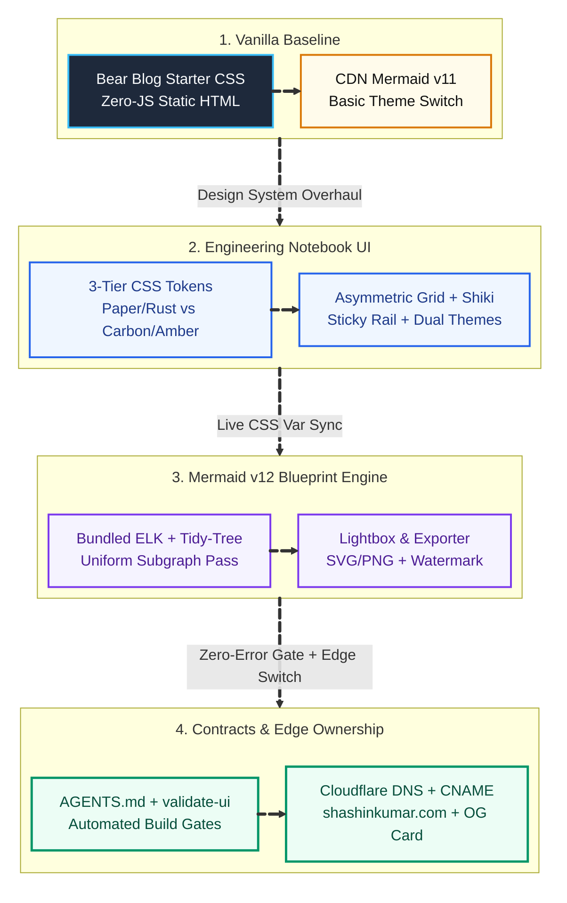
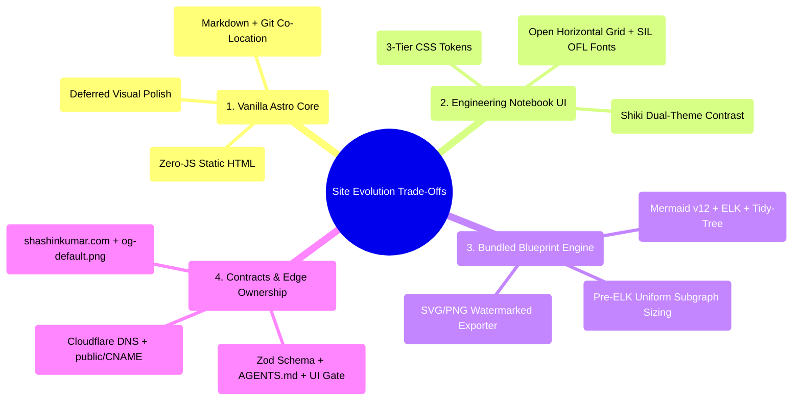

> **Lineage & Reference Architecture:** This note picks up directly where my first post—[*Why Astro & GitHub Pages for My Architecture Blog*](/blog/why-astro-and-gh-pages/)—left off, and pairs with the technical system breakdown in [*Engineering This Monograph*](/foundry/engineering-this-monograph/).

Most personal engineering sites fail in one of two opposite directions. Either they pull in a heavy Single Page Application stack on Day 1 just to serve Markdown essays—classic **premature Blacksmithing**—or they freeze on a default starter template where diagrams break across themes, code blocks fail contrast checks, and the site stays tied to a generic subdomain.

When I first stood up `kumarshaz.github.io`, I didn't draft a grand multi-phase UI roadmap. I started with the smallest working core, shipped essays, observed where the platform pushed back, and refactored one architectural boundary at a time—following the **Lego Framework** principle of keeping a rigid skeleton with repairable, swappable joints.

Looking back across that progression—from bare-bones Astro and GitHub Pages, through a token-driven design system and bundled Mermaid v12 engine, to custom DNS ownership at `shashinkumar.com`—every step emerged from hands-on research and forced a real engineering trade-off.

---

## 1. Explore, Learn, and Build: How "Start From Scratch in the AI Era" Emerges Naturally

People often treat *"starting from scratch in the AI era"* as a formal doctrine or an excuse to prompt an entire bespoke platform into existence in one sitting. In practice, doing that only generates undifferentiated complexity before you even know what your writing or tooling workflow actually demands.

Instead, the pattern shown below isn't an abstract philosophy imposed up front—it is simply the **natural outcome of an explore, learn, and build loop**:



When you explore a minimal toolset, learn directly from real friction, and build only what earns its keep, four functional layers end up reinforcing each other organically:

1. **`01. Vanilla Astro` (*Static UI & Content*)**: You begin by exploring the lightest viable stack—zero-JavaScript static HTML and file-system Markdown—so shipping content takes minutes rather than weeks.
2. **`02. Spec-Driven Contracts` (*Schema & API Specs*)**: As content and UI complexity grow, you learn that informal conventions drift fast. Locking Zod schemas (`src/content.config.ts`), agent charters (`AGENTS.md`), and automated validation scripts (`scripts/validate-ui.mjs`) turns expectations into verifiable gates.
3. **`03. Agentic IDE Loop` (*VS Code → WSL → Antigravity*)**: With strict contracts in place, human architectural judgment and AI coding agents iterate cleanly inside isolated branches (`blogs/{topic-name}`), compressing repetitive CSS, layout, and testing cycles without losing structural discipline.
4. **`04. Edge Ownership` (*Cloudflare CDN + shashinkumar.com*)**: Once the platform matures into a durable knowledge hub, you outgrow borrowed platform subdomains and take ownership of canonical URLs, DNS routing, TLS behavior, and social metadata at the edge.

None of those layers was over-engineered before its turn. Each step answered a concrete bottleneck uncovered while building the previous one.

---

## 2. Phase 1: Vanilla Astro & GitHub Pages — The Baseline

In [*Why Astro & GitHub Pages for My Architecture Blog*](/blog/why-astro-and-gh-pages/), I documented why I started with plain vanilla Astro and GitHub Pages: **Island Architecture** shipped zero JavaScript by default, Markdown lived cleanly alongside code in Git, and GitHub Actions collapsed version control, builds, and global static hosting into a single free pipeline.

Functionally, that baseline began from the stock Astro blog starter template—complete with Bear Blog CSS (`--accent: #2337ff`), bundled `Atkinson` fonts, and placeholder posts. Getting from a stock template to a usable publishing baseline uncovered the first batch of small, practical adjustments:

- **CI Runtime Alignment**: Astro 6 required Node `>=22.12.0`, forcing an explicit `node-version: 22` pin inside `withastro/action` in `.github/workflows/deploy.yml` alongside workflow runner updates.
- **Topic Taxonomy Routing**: A chronological feed quickly flattens technical essays, so I extended `src/content.config.ts` with `tags` and added dynamic `/blog/tag/[tag]` generation to group posts across `Architecture`, `SDLC`, `AI`, and `Research`.
- **Lightweight Mermaid Patch**: When visual strategy posts like [*Why I Love Wardley Mapping*](/blog/why-i-love-wardley-mapping/) needed native diagrams without hand-exporting PNGs, a small `<script type="module">` patch in `BlogPost.astro` pulled Mermaid v11 from jsDelivr CDN and switched between `'default'` and `'dark'` themes on initial load.

### Phase 1 Research & Trade-Offs

| Functional Area | Why It Won Initially | Where Friction Emerged |
| :--- | :--- | :--- |
| **Bear Blog Starter Shell** | Zero setup friction; instant static speed. | Centered `720px` shadow cards looked like a hobby template rather than a crisp engineering specification. |
| **jsDelivr CDN Mermaid** | Zero `npm` dependencies in `package.json`. | Tied builds to external CDN availability, broke live Dark/Light toggling without page reloads, and lacked advanced layout engines (`ELK` / `Tidy-Tree`). |
| **Minimal Frontmatter** | Fast manual publishing for initial essays. | Lacked `category` filters, document identifiers (`docId`), and automated regression checks for broken links or theme contrast. |

The takeaway from Phase 1 was pragmatic: **a starter template validates the publishing habit cheaply, but visual authority and diagram fidelity require intentional architecture once your catalog scales**.

---

## 3. Phase 2: Token-Driven Design System, Foundry & Mermaid v12

As the site expanded into deeper architecture notes and companion software tools, ad-hoc template styling could no longer hold the system together. Rather than adopting React or a heavy component framework, I refactored the frontend around a **pure CSS Token-Driven Editorial Design System** backed by automated build verification.

Getting the visual system right wasn't a single leap—it evolved through rapid explore-and-refine passes:

### A. Converging on the "Engineering Notebook" Aesthetic

1. **Three-Tier Token Architecture (`src/styles/tokens.css`)**: Separated raw color/font primitives (**Tier 1**), semantic surface and rule variables like `--bg-canvas`, `--bg-surface`, `--text-primary`, and `--border-strong` (**Tier 2**), and diagram variables like `--mermaid-node-bg`, `--mermaid-node-border`, and `--mermaid-line` (**Tier 3**) so HTML prose, layout grids, and rendered diagrams share a single source of truth.
2. **Pruning Decorative Clutter**: Early styling drafts experimented with boxed outer wireframe borders, serif display headlines (`Newsreader`), indigo accents, and pseudo-code labels (`MONOGRAPH //`, `DOM-01`). Inspecting real rendered pages exposed those prefixes as visual noise, leading to an immediate cleanup.
3. **Open Layout & Technical Typography (`Option D`)**: The site converged on an open `1120px` **Engineering Notebook** grid (`src/styles/layout.css`) anchored by `2px` horizontal rules, a `240px` sticky metadata/TOC rail alongside a `76ch` prose column, **SIL OFL 1.1** open-source fonts (`Space Mono`, `IBM Plex Sans`, `IBM Plex Mono`), and calibrated **Engineering Paper & Signal Rust** (Light) / **Anvil Carbon & Signal Amber** (Dark) palettes.
4. **Dual-Theme Code Readability & Taxonomy Polish**: Switching to a warm light paper canvas exposed low-contrast code blocks, solved by configuring Shiki dual themes (`github-light` / `github-dark`) in `astro.config.mjs` and synchronizing them via `[data-theme="dark"]` selectors in `src/styles/global.css`. Category filters in `/blog` were standardized around **Essays**, **Practitioner Notes**, and **Research** with populated badge counts.

### B. Separating "What I Write" from "What I Build" (`/foundry`)

As reusable architecture toolkits (**Atruss Code Atlas**, **TDD Analyzer**, **To-Markdown Converter**, and the monograph platform itself) matured alongside essays, mixing product specs into the blog feed blurred two distinct intents. Adding a second Zod-validated `foundry` collection in `src/content.config.ts` introduced structured repository and live-demo metadata (`repoUrl`, `liveUrl`)—rendering `Product UI ↗` and `GitHub Repo ↗` action pills in the sticky rail and surfacing **What I Write About** alongside **What I Build** on the homepage.

### C. Re-Architecting the Mermaid Blueprint Pipeline

To eliminate CDN fragility and inconsistent diagram rendering, the Mermaid integration in `BlogPost.astro` was rebuilt from a 39-line CDN script into a bundled, interactive blueprint engine:



- **Bundled Multi-Engine Layouts**: Replaced the jsDelivr import with bundled `mermaid`, `@mermaid-js/layout-elk`, and `@mermaid-js/layout-tidy-tree`. Flowcharts opt into `layout: elk`, while mindmaps use `layout: tidy-tree` (enforced both at runtime in `BlogPost.astro` and at build time in `scripts/validate-ui.mjs`).
- **Live Theme Synchronization**: Toggling Light/Dark mode in `Header.astro` dispatches a `theme-change` event, prompting `BlogPost.astro` to re-read active CSS tokens and re-render Mermaid SVGs in place without reloading the page.
- **Uniform Subgraph Sizing**: Native ELK renders sibling boxes at uneven widths proportional to text length. Wrapping ELK's layout renderer in a two-pass probe (`createUniformSubgraphRender`) measures natural label dimensions and equalizes sibling nodes inside each subgraph so boxes align cleanly.
- **Interactive Inspection & Portable Exports**: Wrapped every diagram in a `.mermaid-blueprint` frame featuring zoom controls, fullscreen lightbox expansion, heading-resolved titles (`resolveDiagramTitle`), theme-aware copyright footers, and standalone SVG / high-DPI PNG downloads with embedded surface backgrounds.
- **Executable Governance (`AGENTS.md` + `scripts/validate-ui.mjs`)**: Codified branching rules (`blogs/*`), Zod schema contracts, and hundreds of automated checks verifying token completeness, layout primitives, internal link integrity, and taxonomy badge counts on every build.

### D. The Skeptic's Audit of the Design System

Keeping third-party UI libraries out preserved static simplicity on landing and index pages, yet it did not magically erase complexity—it relocated it:

1. **Concentrated Layout Script**: Supporting two-pass ELK sizing, theme re-rendering, SVG serialization, PNG rasterization, and lightbox accessibility pushed `src/layouts/BlogPost.astro` past `1,400` lines of specialized client TypeScript.
2. **Scoped Bundle Weight**: Bundling Mermaid and ELK guarantees deterministic offline rendering at the cost of a heavier JavaScript payload specifically on article routes containing diagrams, while index and home routes stay lean.
3. **Migration Residue**: `src/components/BaseHead.astro` still carries legacy Google Fonts families alongside `Space Mono` and `IBM Plex` to satisfy early automated assertions in `scripts/validate-ui.mjs`—a practical reminder that validation gates lock in backward compatibility until you refactor both the implementation and the gate contract together.

---

## 4. Phase 3: Custom DNS, Cloudflare & Edge Ownership

Even with a cohesive design system and automated validation suite, canonical URLs, RSS feeds, sitemaps, diagram watermarks, and social previews still pointed to `kumarshaz.github.io`—and link previews fell back to Astro's stock placeholder graphic.

Graduating to **`shashinkumar.com`** unified the site's external identity with its internal engineering rigor:

```javascript
// astro.config.mjs — canonical origin anchored to custom domain
export default defineConfig({
	site: 'https://shashinkumar.com',
	integrations: [mdx(), sitemap()],
	markdown: {
		shikiConfig: {
			themes: {
				light: 'github-light',
				dark: 'github-dark',
			},
		},
	},
});
```

Alongside updating `astro.config.mjs` and adding `public/CNAME`, the migration updated diagram copyright watermarks, Foundry `liveUrl` references, and `scripts/validate-ui.mjs` checks to confirm `dist/CNAME`, `rel="canonical"`, `rss.xml`, and `sitemap-index.xml` emit zero residual `kumarshaz.github.io` feed links. Replacing the stock Open Graph fallback in `BaseHead.astro` with a branded `public/og-default.png` card completed the visual identity across link shares.

### The DNS, TLS & Portability Trade-Offs

Pointing a custom domain through Cloudflare DNS in front of GitHub Pages looks deceptively simple in Git, yet three architectural trade-offs determine whether it runs reliably:

1. **Vendor Decoupling (*Substitutivity*) vs. Zero-Config Simplicity**:
   - *Trade-off*: Staying on `kumarshaz.github.io` eliminates domain renewals and DNS configuration overhead. Adopting `shashinkumar.com` takes on DNS management in exchange for **canonical host portability**—allowing static hosting to move from GitHub Pages to Cloudflare Pages, object storage, or self-hosted edges in the future without breaking RSS subscribers, search indexing, or external backlinks.
2. **Apex Routing (`CNAME` Flattening vs. Static `A` Records)**:
   - *Technical constraint*: Standard DNS rules disallow a bare `CNAME` at a zone apex (`shashinkumar.com` without `www.`) because it conflicts with `SOA`/`NS` records, forcing many registrars into hardcoded `A` records pointing at GitHub Pages IPs. Routing through **Cloudflare DNS** enables native **CNAME flattening** at the apex alongside edge caching, redirect rules, and response header control.
3. **TLS Termination & Multi-Repo Blast Radius**:
   - **Proxy & ACME Alignment**: Enabling Cloudflare's edge proxy before GitHub Pages finishes Let's Encrypt validation—or mismatching `Flexible` SSL against GitHub's HTTPS enforcement—produces redirect loops (`ERR_TOO_MANY_REDIRECTS`) or broken certificate renewals. Aligning Cloudflare to **`Full (Strict)`** (once origin TLS is verified) eliminates split-brain TLS behavior.
   - **Sibling Project Sub-Path Coupling**: Because `kumarshaz.github.io` is a GitHub user-level repository, attaching `shashinkumar.com` via `CNAME` automatically re-roots sibling GitHub Pages project sites under the same account onto sub-paths (such as `https://shashinkumar.com/atruss-code-atlas/`). Root DNS changes therefore carry multi-repository URL coupling across linked Foundry live portals.

---

## 5. Summary of Architectural & Functional Trade-Offs

| Functional Layer | Research Trigger / Friction | Architectural Decision | Explicit Trade-Off Accepted |
| :--- | :--- | :--- | :--- |
| **Vanilla Astro Core** | Needed zero-JS, Git-native authoring without CMS or server maintenance. | Astro static generation + Markdown collections on GitHub Pages. | Accepted starter aesthetics on Day 1 to prioritize shipping. |
| **CI & Taxonomy Routing** | Default Node runners lagged Astro requirements; flat feeds hid topics. | Pinned Node 22 in GitHub Actions + dynamic `/blog/tag/[tag]` routes. | Coupled CI config to Node LTS cadence and static tag route fan-out. |
| **Token-Driven Design System** | Starter cards lacked executive clarity; light paper broke dark code blocks. | 3-tier `tokens.css`, Option D `layout.css`, `Space Mono`/`IBM Plex`, dual-theme Shiki. | Preserved legacy font links briefly to keep backward validation gates green. |
| **Foundry Collection** | Built tools (`Atruss Code Atlas`, `TDD Analyzer`) needed code/live metadata. | Separate `foundry` schema (`repoUrl`, `liveUrl`) surfaced alongside `/blog`. | Dual collection schema and tag synchronization across `/blog` and `/foundry`. |
| **Mermaid v12 Blueprint Engine** | CDN Mermaid failed offline builds, live theme swaps, and uniform box alignment. | Bundled ELK + Tidy-Tree, pre-ELK uniform sizing, lightbox, watermarked SVG/PNG export. | Higher client TS complexity in `BlogPost.astro` and heavier diagram-page JS. |
| **Executable Governance** | Agentic and manual edits risk silent layout, link, and schema regressions. | `AGENTS.md` branch/schema rules + `scripts/validate-ui.mjs` build gate. | Every feature requires maintaining matching validation assertions. |
| **Custom DNS & Social Identity** | Platform subdomain coupled brand equity to GitHub and stock social cards. | `public/CNAME` (`shashinkumar.com`), Cloudflare DNS, canonical `Astro.site`, `og-default.png`. | Apex TLS/proxy alignment and sub-path coupling across sibling project sites. |



---

## 6. Repairable Anatomy in Practice

The real lesson across this site's evolution comes down to **sequencing**.

Had I tried to architect a three-tier token system, write a two-pass ELK subgraph equalizer, maintain an automated UI test harness, and configure Cloudflare apex flattening before publishing my first post, the site would have stalled under self-inflicted complexity. Conversely, stopping at the starter template would have left visual presentation, diagram reliability, and domain identity lagging behind the technical depth of the articles.

By letting each stage emerge from an **explore, learn, and build** cycle anchored by swappable boundaries:

- Replacing the Bear Blog shell with the **Engineering Notebook** design system never required rewriting existing Markdown posts.
- Upgrading from CDN Mermaid v11 to bundled **Mermaid v12 with ELK, Tidy-Tree, uniform subgraphs, and SVG/PNG exports** preserved every existing fenced diagram intact.
- Moving canonical identity from **`kumarshaz.github.io` to `shashinkumar.com`** took a `CNAME` declaration, a single `site` origin update, a branded social card, and an automated gate verifying canonical tags, RSS, and sitemaps migrated in lockstep.

Start light enough that you ship. Lock contracts once patterns repeat. Verify invariants mechanically in your build pipeline. And claim edge ownership once your publishing foundation is ready to outlive any single host.
