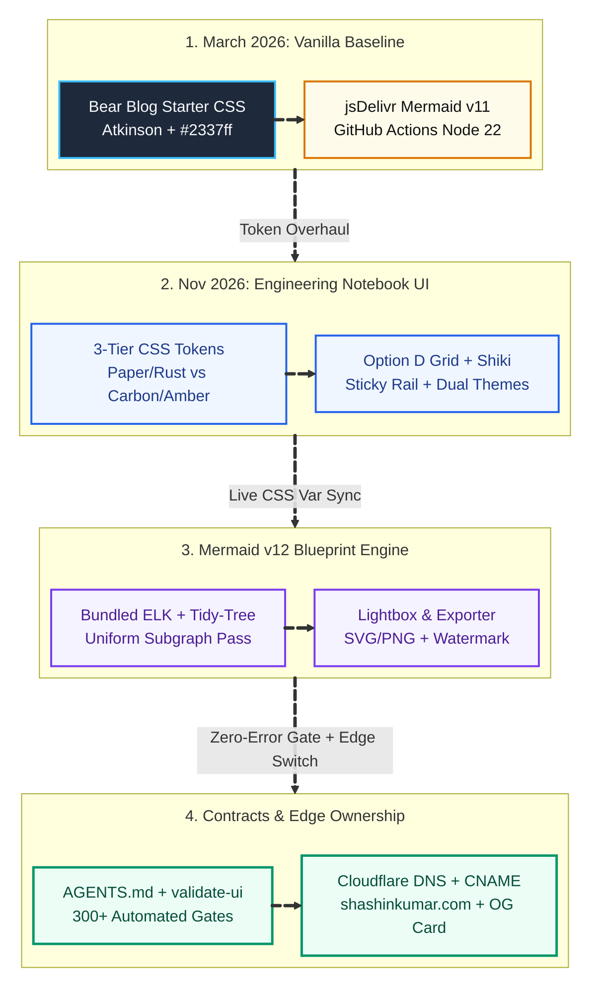
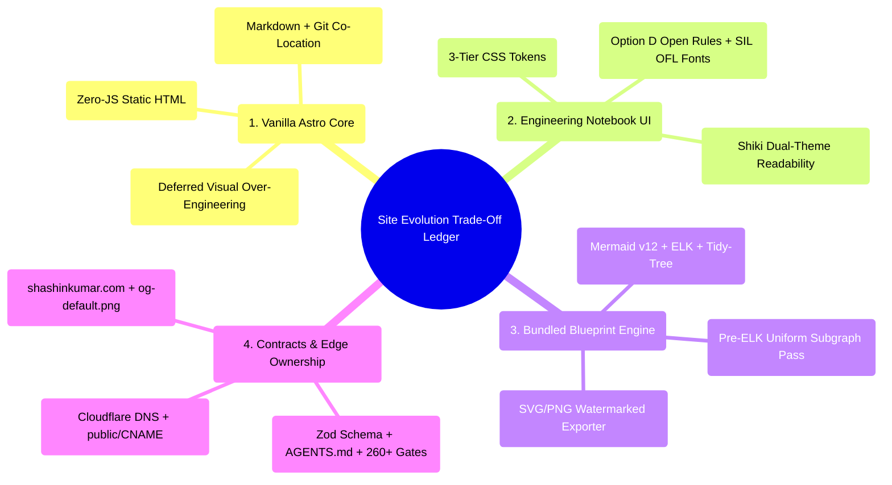

> **Lineage & Reference Architecture:** This note picks up directly where my very first post—[*Why Astro & GitHub Pages for My Architecture Blog*](/blog/why-astro-and-gh-pages/) (`ARCH-2026-01`, March 22, 2026)—left off, and pairs with the technical specification in [*Engineering This Monograph*](/foundry/engineering-this-monograph/) (`FNDRY-2026-01`, November 12, 2026). Every milestone below is drawn directly from this repository's 54-commit history between **March 22** and **November 24, 2026**.

Most personal engineering websites fail in one of two predictable ways. Either they import a forty-package React/Next.js monolith on Day 1 to publish three Markdown essays—classic **premature Blacksmithing**—or they freeze on a stock starter theme where diagrams clash with Dark Mode, code blocks fail contrast checks, and the author remains a permanent tenant on a platform subdomain.

When I launched `kumarshaz.github.io` in March 2026, I deliberately refused to design the "final" site up front. Instead, I treated my personal site the exact way I treat enterprise systems under the **Lego Framework**: start with a minimal, rigid skeleton, lock interfaces with explicit contracts before scaling features, and refactor subsystems in place (*"plastic surgery"*) only after real usage exposes concrete friction.

Looking back across **54 commits**—from bare-bones Astro and GitHub Pages, through a multi-pass token-driven design system and bundled Mermaid v12 engine, to custom DNS edge ownership at `shashinkumar.com`—every step required its own technical research and carried its own non-obvious invoice.

---

## 1. Defining "Start From Scratch in the AI Era"

Before diving into commit hashes and CSS tokens, it helps to name the operating pattern that governed this entire eight-month evolution: **Start From Scratch in the AI Era**.


Most teams misread that phrase. They hear *"AI Era"* and immediately ask a coding agent to scaffold an entire bespoke frontend, headless CMS, custom analytics backend, and multi-environment deployment pipeline in a single afternoon. That is not starting from scratch—that is generating three years of unverified maintenance debt in thirty minutes.

As illustrated above, **Starting From Scratch in the AI Era** is an **incremental, four-stage architectural ratchet**:

1. **`01. Vanilla Astro` (*Static UI & Content*)**: Begin with the smallest verifiable core that solves the actual publishing problem—zero-JavaScript static HTML and file-system Markdown. No runtime framework lock-in, no database, and no premature abstractions.
2. **`02. Spec-Driven Contracts` (*Schema & API Specs*)**: Before letting AI agents or new layouts touch the codebase at speed, lock the invariants. Here, that meant Zod content schemas (`src/content.config.ts`), operational guardrails (`AGENTS.md`), and a headless build assertion gate (`scripts/validate-ui.mjs`).
3. **`03. Agentic IDE Loop` (*VS Code → WSL → Antigravity*)**: Pair human `0→1` architectural taste with coding agents inside branch-isolated loops (`blogs/{topic-name}`). The human decides *which* trade-offs are worth paying; the agent accelerates `1→N` implementation, CSS refactoring, and regression verification.
4. **`04. Edge Ownership` (*Cloudflare CDN + shashinkumar.com*)**: Graduate from borrowed hosting identity (`kumarshaz.github.io`) to owned DNS, edge TLS/caching control, canonical SEO URLs, and branded social metadata—without breaking a single existing permalink.

Every transition between those four stages was triggered by an empirical bottleneck in the previous stage, never by aesthetic boredom.

---

## 2. Phase 1: Vanilla Astro & GitHub Pages — The Baseline (March 2026)

In [*Why Astro & GitHub Pages for My Architecture Blog*](/blog/why-astro-and-gh-pages/) (`ARCH-2026-01`), I laid out the original thesis on **March 22, 2026**: Astro's Island Architecture eliminated client-side hydration bloat, Markdown kept technical writing close to Git commits, and GitHub Pages collapsed source control, CI/CD, and static edge delivery into a single free workflow.

What the commit log actually shows behind that clean thesis is instructive:

- **Stock Starter Reality (`0b33c44`, March 22, 2026)**: The first commit (`42` files, `7,149` insertions) wasn't a custom design system at all—it was Astro `^6.0.8`'s default blog starter (`"name": "grubby-group"`, Bear Blog CSS with `--accent: #2337ff`, bundled `Atkinson` WOFF fonts, and sample `first-post.md`–`third-post.md` placeholders).
- **Immediate CI Runtime Friction (`2c43463` & `c936839`, March 22, 2026)**: Within hours of the initial push, GitHub Actions hit Node version mismatch warnings. Commit `c936839` explicitly pinned `node-version: 22` inside `withastro/action@v3` (`.github/workflows/deploy.yml`) because Astro 6 required `>=22.12.0`.
- **Incremental Personalization & Taxonomy (`c32add7` → `7c71e15`, March 22–23, 2026)**: Rather than rewriting the template, I swapped `SITE_TITLE`, purged stock dummy posts, added `tags: z.array(z.string()).optional()` to `src/content.config.ts`, built dynamic `/blog/tag/[tag]` pages (`449358c`), and published my first three foundational posts: `ARCH-2026-01` (*Why Astro & GitHub Pages*), `ARCH-2026-02` ([*The Blacksmith-to-Goldsmith Transition*](/blog/what-is-blacksmith-to-goldsmith/)), and `ARCH-2026-03` ([*Why I Love Wardley Mapping*](/blog/why-i-love-wardley-mapping/)).
- **The First Mermaid Shortcut (`4141150`, March 26, 2026)**: When *Why I Love Wardley Mapping* needed a timeline diagram, I patched 39 lines into `src/layouts/BlogPost.astro` importing `mermaid@11` directly from jsDelivr CDN with a binary ternary: `theme: isLightMode ? 'default' : 'dark'`.

### Phase 1 Research & Trade-Offs

| Dimension | Why It Won on Day 1 | Where It Cracked Under Real Writing |
| :--- | :--- | :--- |
| **Bear Blog CSS Shell** | Zero setup time; 100/100 Lighthouse out of the box. | Centered `720px` rounded-shadow cards felt like a generic hobbyist blog—not an executive architectural spec sheet. |
| **jsDelivr CDN Mermaid** | Zero `npm` dependency overhead in `package.json`. | Broke offline reproducibility, ignored live theme toggles without a full page reload, and lacked `ELK` / `Tidy-Tree` graph engines for complex system topologies. |
| **Loose Markdown Frontmatter** | Fast to publish the first three articles manually. | No `category` taxonomy, no `docId` tracking, and no automated link or contrast validation before pushing to `main`. |

The Phase 1 lesson was clear: **a bare starter buys speed of validation, not visual authority**. Once the writing shifted toward multi-diagram enterprise architecture notes, the Bear Blog container and CDN Mermaid script became the limiting factor.

---

## 3. Phase 2: The Token-Driven Design System & Governance Gate (November 2026)

Eight months after launch, commits `273f4f2` through `ddaecd8` (**November 12–18, 2026**) executed a full architectural overhaul—replacing ad-hoc Bear Blog CSS with a **Token-Driven Editorial Design System** and **automated regression checks**.

Crucially, the commit log proves that good design systems rarely emerge cleanly in one pass. It took **four distinct iterations** in rapid succession to get the visual hierarchy right.

### A. From "Archival Monograph" to "Option D: Engineering Notebook"

1. **Pass 1 — The "Architectural Monograph" Spec (`273f4f2` & `49fcfd5`, Nov 13)**: Built the three-tier CSS token architecture (`src/styles/tokens.css`), exposed `1px` Swiss Grid borders (`src/styles/layout.css`), Zod category taxonomy, and the first `scripts/validate-ui.mjs` suite (`270` lines). The initial palette paired `#FBFBF9` paper with Indigo `#3730A3` and `Newsreader` serif display headers.
2. **Pass 2 — Stripping Synthetic Noise (`26bbb4c`, Nov 13)**: Looking at the rendered UI exposed an aesthetic mistake: decorative prefixes like `MONOGRAPH //`, `SECTION 01`, and `DOM-01` created visual clutter without adding information. Commit `26bbb4c` deleted `522` lines of decorative noise and tested warmer vellum/bronze tones.
3. **Pass 3 — Typography & "Option D: Engineering Notebook" (`0a381d6` & `9945aef`, Nov 13)**: Serif headlines (`Newsreader`) felt too literary for systems engineering specs. Switching `--font-display` to `Space Mono`, `--font-sans` to `IBM Plex Sans`, and `--font-mono` to `IBM Plex Mono` (all open-source **SIL OFL 1.1**), removing outer boxy container walls in favor of an open `1120px` canvas with bold `2px` horizontal rules, and calibrating **Engineering Paper & Signal Rust** (`#F2F1EC` / `#C84B20`) against **Anvil Carbon & Signal Amber** (`#111214` / `#E87A48`) finally clicked.
4. **Pass 4 — Contrast & Taxonomy Fixes (`dd9cc51`, `8e11596`, `e949d8f`, Nov 13)**: The new light canvas immediately exposed a sharp contrast defect—dark-styled code blocks clashed violently against `#F2F1EC` paper. Commit `dd9cc51` configured Shiki dual themes (`github-light` and `github-dark`) inside `astro.config.mjs` and wired CSS variable overrides in `src/styles/global.css`. Meanwhile, `Field Notes` was renamed `Practitioner Notes` (`8e11596`), missing taxonomy filter counts were patched (`e949d8f`), and [`AGENTS.md`](https://github.com/kumarshaz/kumarshaz.github.io/blob/main/AGENTS.md) codified the branch, frontmatter, and validation rules (`d14f38d`).

### B. Separating "What I Write" from "What I Build" (`/foundry`)

On **November 15, 2026** (`dca1714` & `f55a52a`), I noticed a structural gap: long-form essays live well in `/blog`, but reusable engineering artifacts—like **Atruss Code Atlas**, **TDD Analyzer**, **To-Markdown Converter**, and the site's own monograph architecture—needed distinct metadata (`repoUrl`, `liveUrl` rendering `Product UI ↗` and `GitHub Repo ↗` action pills in the sticky rail). Adding the separate `foundry` Zod collection in `src/content.config.ts` let the homepage left rail surface both **What I Write About** and **What I Build** cleanly without polluting the essay taxonomy.

### C. Re-Architecting Mermaid: CDN v11 → Bundled v12 (`ELK` + `Tidy-Tree`)

Between `4f2dbeb` and `ddaecd8` (**November 15–18, 2026**), the site's diagram pipeline underwent its deepest engineering work:



Each upgrade solved a concrete failure observed in rendered diagrams:
- **Deterministic Offline Rendering (`4f2dbeb`)**: Replaced the CDN import with `mermaid ^12.3.0`, `@mermaid-js/layout-elk`, and `@mermaid-js/layout-tidy-tree`. Flowcharts opt into `layout: elk`; mindmaps opt into `layout: tidy-tree` (enforced automatically at runtime via `ensureMindmapTidyTree` in `15bb72f` and verified across every Markdown block by `scripts/validate-ui.mjs`).
- **Live Theme Synchronization (`f55a52a`)**: Instead of reloading the page on Dark/Light toggle, `Header.astro` emits a `theme-change` custom event and `BlogPost.astro` re-reads `--mermaid-node-bg`, `--mermaid-node-border`, `--mermaid-line`, and `--mermaid-cluster-bg` via `getComputedStyle(document.documentElement)` using monotonic render IDs.
- **Uniform Subgraph Sibling Sizing (`f5bd97a`)**: Native ELK renders sibling boxes inside a subgraph at jagged widths matching text length. Wrapping ELK's `loader().render` with `createUniformSubgraphRender` runs a headless probe pass, computes `maxW` and `maxH` per subgraph, and re-renders cleanly so siblings share balanced padding.
- **Interactive Export & Ownership (`f5bd97a`, `4f6138c`, `ddaecd8`)**: Added zoom controls, fullscreen lightbox (`Esc`/backdrop dismissal), SVG and 2× rasterized PNG downloads with embedded Light/Dark `--bg-surface` backdrops, descriptive titles via `resolveDiagramTitle` (instead of `"Architecture Diagram 1"`), and theme-synced copyright footers (`© 2026 Shashi Kumar · shashinkumar.com`).

### D. The Skeptic's Audit of the Design System (What It Actually Cost)

If I presented the Engineering Notebook overhaul as pure upside, I would violate my own *Skeptic Architect* rule—and ignore the empirical thesis of [*From ADRs to Executable Constraints*](/blog/from-adrs-to-executable-constraints/). Here is the honest invoice we accepted:

1. **Zero-Framework Didn't Delete Complexity—It Relocated It**: Avoiding React/Tailwind kept the homepage and index pages at near-zero JS, **but** `src/layouts/BlogPost.astro` grew to `1,485` lines of client TypeScript managing two-pass ELK measurements, XML serialization, PNG `<canvas>` fallback rasterization, and lightbox focus state.
2. **Scoped Bundle Weight**: Bundling `mermaid` + `elkjs` + `tidy-tree` keeps builds reproducible, at the cost of a heavier JavaScript bundle specifically on `BlogPost` routes that contain ```` ```mermaid ```` blocks.
3. **Migration Residue Is Real**: Open `src/components/BaseHead.astro` today and you will notice the Google Fonts link still loads `Newsreader`, `Plus Jakarta Sans`, and `JetBrains Mono` alongside `Space Mono`, `IBM Plex Sans`, and `IBM Plex Mono`—solely because lines `196–200` of `scripts/validate-ui.mjs` still assert the original Pass 1 font query string! That is a textbook reminder that automated gates preserve safety *and* legacy residue until you explicitly refactor both the code and its test contract together.

---

## 4. Phase 3: Custom DNS, Cloudflare & Domain Sovereignty (November 24, 2026)

By late November, the site had rich writing, a coherent Engineering Notebook UI, and an automated 260+ check build gate—yet every canonical link, RSS entry, sitemap URL, and Mermaid diagram watermark still pointed to `https://kumarshaz.github.io`.

Commits `9c4c0df` and `b14bc88` (**November 24, 2026**) completed the fourth pillar of our bootstrap model—**Edge Ownership**—migrating the entire publication surface to `https://shashinkumar.com`.

### What Changed Inside the Repository

```javascript
// astro.config.mjs — single canonical origin switch (commit 9c4c0df)
export default defineConfig({
	site: 'https://shashinkumar.com',
	integrations: [mdx(), sitemap()],
	markdown: {
		shikiConfig: {
			themes: {
				light: 'github-light',
				dark: 'github-dark',
			},
		},
	},
});
```

Alongside `astro.config.mjs` and `public/CNAME` (`shashinkumar.com`), commit `9c4c0df` updated `COPYRIGHT_WATERMARK_TEXT` in `BlogPost.astro`, Foundry `liveUrl` links (such as `https://shashinkumar.com/atruss-code-atlas/`), and `scripts/validate-ui.mjs` assertions verifying that `dist/CNAME`, `rel="canonical"`, `rss.xml`, and `sitemap-index.xml` emit **zero** leftover `kumarshaz.github.io` feed URLs. Hours later, commit `b14bc88` replaced Astro's stock `blog-placeholder-1.jpg` social fallback in `BaseHead.astro` with a branded `1024×571` `public/og-default.png` Open Graph card.

### The DNS, TLS & Portability Trade-Offs

Adopting custom DNS (`shashinkumar.com`) via Cloudflare in front of GitHub Pages looks like a one-line `CNAME` commit from the outside, yet three real architectural trade-offs sit underneath it:

1. **Vendor Decoupling (*Substitutivity*) vs. Zero-Config Simplicity**:
   - *Trade-off*: Staying on `kumarshaz.github.io` requires zero DNS renewals, zero TLS coordination, and zero registrar management. Moving to `shashinkumar.com` introduces registrar lifecycle and DNS configuration responsibilities—**in exchange for permanent canonical portability**. If I ever migrate static hosting from GitHub Pages to Cloudflare Pages, AWS S3/CloudFront, or self-hosted Nginx, not a single RSS subscriber URL, canonical backlink, or sitemap path changes.
2. **Apex Domain Routing (`CNAME` Flattening vs. Static `A` Records)**:
   - *Research finding*: Under RFC 1034, you cannot place a standard `CNAME` record directly at a zone apex (`shashinkumar.com` without `www.`) because it conflicts with `SOA` and `NS` records. On bare DNS providers, you are forced to hardcode GitHub Pages' four `A` records (`185.199.108–111.153`). Routing DNS through **Cloudflare** solves this cleanly via native **CNAME flattening** at the apex while optionally adding anycast edge caching, custom redirect rules (`www` → apex), and security headers.
3. **TLS Termination & Multi-Repo Blast Radius Gotchas**:
   - **ACME & Proxy Mode Alignment**: Enabling Cloudflare's orange-cloud proxy before GitHub Pages finishes Let's Encrypt HTTP-01 validation—or setting Cloudflare SSL to `Flexible` while GitHub enforces HTTPS—triggers classic `ERR_TOO_MANY_REDIRECTS` loops or certificate renewal failures. Aligning SSL to **`Full (Strict)`** (once GitHub's edge certificate is issued, or verifying via DNS-only first) prevents split-brain TLS termination.
   - **Sibling Project Sub-Path Coupling**: Because `kumarshaz.github.io` is a GitHub *user* site, binding `shashinkumar.com` to its `public/CNAME` automatically re-roots GitHub Pages project sites under the same account onto sub-paths (such as `https://shashinkumar.com/atruss-code-atlas/`). One root DNS change carries multi-repository URL coupling—something `9c4c0df` had to synchronize explicitly in `src/content/foundry/atruss-code-atlas.md` and `scripts/validate-ui.mjs`.

---

## 5. The Complete Evolution & Trade-Off Ledger

Tracing the repository from commit `0b33c44` to `684afc6` reveals how each phase replaced an immediate bottleneck with a stronger contract—and an explicit, bounded trade-off:

| Commit / Date | Milestone | Research Trigger / Friction | Architectural Choice | Explicit Trade-Off Accepted |
| :--- | :--- | :--- | :--- | :--- |
| `0b33c44` (`Mar 22`) | **Vanilla Astro Baseline** | Needed zero-JS, Markdown-first publishing without CMS lock-in. | Astro `^6.0.8` + Bear Blog starter on GitHub Pages. | Accepted stock starter visuals to ship Day 1. |
| `c936839` (`Mar 22`) | **CI Runtime Alignment** | Astro 6 failed under older default GitHub Actions Node images. | Pinned `node-version: 22` in `withastro/action@v3`. | Coupled CI deploy spec explicitly to Node LTS cadence. |
| `449358c` (`Mar 23`) | **Tag Taxonomy Routing** | Flat chronological feed lacked topic grouping (`Architecture`, `SDLC`). | Dynamic `/blog/tag/[tag]` generation + `SITE_DESCRIPTION`. | Static route explosion per tag (cheap at `<50` tags). |
| `4141150` (`Mar 26`) | **Mermaid v11 Patch** | Visual essays needed inline diagrams without manual PNG exports. | jsDelivr CDN Mermaid import in `BlogPost.astro`. | Accepted external CDN runtime & stale theme state temporarily. |
| `49fcfd5` → `9945aef` (`Nov 13`) | **Engineering Notebook UI** | Starter shell lacked executive readability & token consistency. | 3-tier `tokens.css`, Option D `layout.css`, `Space Mono` + `IBM Plex`. | Kept legacy Google Fonts string in `BaseHead.astro` for gate parity. |
| `dd9cc51` (`Nov 13`) | **Dual-Theme Syntax** | Dark-themed code snippets clashed on `#F2F1EC` Light paper. | Shiki `github-light` / `github-dark` synced to `[data-theme="dark"]`. | Slightly larger CSS token surface across `.astro-code`. |
| `d14f38d` (`Nov 13`) | **Agentic Spec Contract** | Needed repeatable branch, schema, and validation discipline. | Codified `AGENTS.md` (`blogs/*` branches) + `validate-ui.mjs`. | Strict gate discipline required on every PR (`npm run check`). |
| `dca1714` / `f55a52a` (`Nov 15`) | **Foundry Collection** | Built tools (`Atruss`, `TDD Analyzer`) needed `repoUrl`/`liveUrl` metadata. | Separate `foundry` content collection + `/foundry` index. | Dual collection maintenance in `content.config.ts` & tags. |
| `4f2dbeb` → `ddaecd8` (`Nov 15–18`) | **Mermaid v12 Blueprint** | CDN diagrams lacked ELK, Tidy-Tree, equal boxes, & PNG exports. | Bundled Mermaid v12 + pre-ELK probe pass + lightbox + watermarks. | `1,485`-line TypeScript DOM controller in `BlogPost.astro`. |
| `9c4c0df` / `b14bc88` (`Nov 24`) | **Custom DNS & Brand Card** | `kumarshaz.github.io` coupled brand equity to GitHub & stock OG card. | `public/CNAME` (`shashinkumar.com`), Cloudflare DNS, `og-default.png`. | Apex TLS/proxy alignment & sibling project sub-path coupling. |



---

## 6. Repairable Anatomy in Practice

The hardest lesson across these fifty-four commits has nothing to do with Astro, CSS grids, or Cloudflare DNS records. It is about **sequencing**.

If I had tried to invent a 3-tier token specification, build a two-pass ELK subgraph equalizer, write a 495-line UI regression harness, and configure custom Cloudflare apex flattening *before* publishing my first post in March, the repository would likely still be sitting in an unfinished `draft` branch. Conversely, if I had stopped at the Bear Blog template in March, my technical writing would have outgrown its visual and verification container by November.

Instead, every architectural principle I advocate for enterprise teams—**Master Goldsmith precision**, **standardized rigid skeletons with swappable modular joints**, and **verification as the compounding asset**—worked at single-developer scale:

- Swapping Bear Blog CSS for the **Engineering Notebook** design system never touched a single blog Markdown file.
- Upgrading from jsDelivr Mermaid v11 to bundled **Mermaid v12 with ELK, Tidy-Tree, uniform subgraphs, and SVG/PNG export** never broke existing diagram fences inside nine articles.
- Moving canonical identity from **`kumarshaz.github.io` to `shashinkumar.com`** took one `CNAME` file, one `site` property, and an automated check confirming RSS, sitemap, and social previews migrated cleanly in lockstep.

Start simple enough that you actually ship. Lock contracts as soon as patterns repeat. Demand empirical proof from your build pipeline before trusting either human intuition or AI velocity. And own your edge when your identity is ready to outlive any single host.
