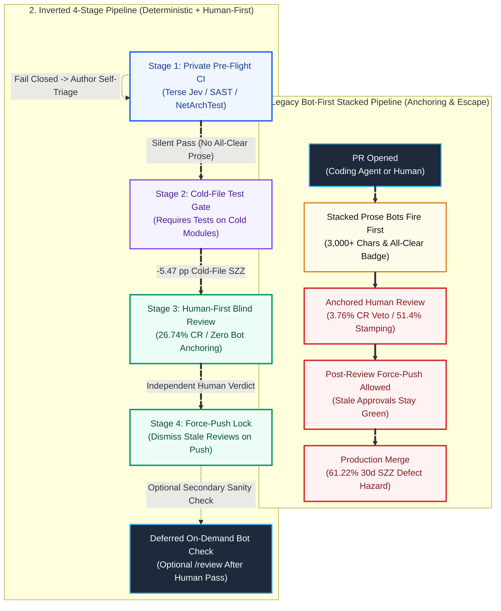
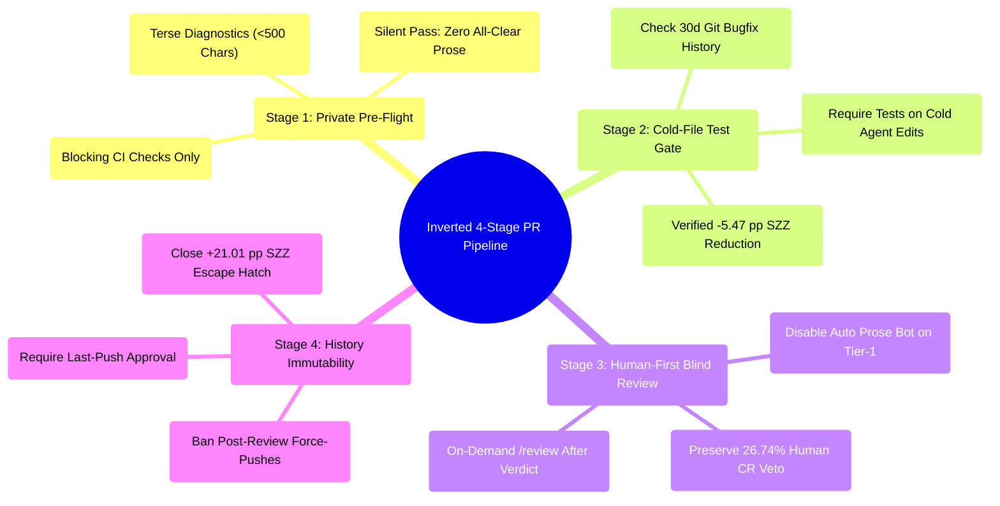

> **Empirical Provenance & Open-Science Replication:** This practitioner note is **Part 2 of a 3-part empirical series** grounded in our SSRN preprint ([**SSRN Abstract `7742641`**](https://papers.ssrn.com/sol3/papers.cfm?abstract_id=7742641) · PDF/Markdown in [`pr-review-replication/paper/`](https://github.com/kumarshaz/pr-review-replication/tree/main/paper)), archived permanently on Zenodo (**Dataset DOI:** [`10.5281/zenodo.24452362`](https://doi.org/10.5281/zenodo.24452362) · [`zenodo.org/records/24452362`](https://zenodo.org/records/24452362)), and backed by our standalone replication repository ([**`kumarshaz/pr-review-replication`**](https://github.com/kumarshaz/pr-review-replication) — **`81/81` assertions passing**, `36/36` SHA-256 verified artifacts in [`VERIFICATION_REPORT.md`](https://github.com/kumarshaz/pr-review-replication/blob/main/replication/VERIFICATION_REPORT.md)). Every number below comes from zero-fabrication telemetry (`BH-FDR q < 0.05` across headline claims): **`1,694`** uncensored human-reviewed AIDev pull requests with timestamped arrival order, **`2,953`** second-reviewer displacement comparisons, **`2,138`** stacked-bot PRs, **`312`** formally hydrated `TypeSafe Jev` decision-model PRs, and **`10,410`** commit-attributed merged PRs traced through **`300`** local bare-git SZZ histories.

Almost every engineering team rolling out AI code review in 2026 wires the exact same GitHub webhook:

```text
pull_request: opened  -->  AI Review Bot posts 3,000-char walkthrough  -->  Human Reviewer assigned
```

The assumption feels airtight: *"Let the bot do a fast first pass, clean up the obvious issues, and hand a pre-digested diff to our senior engineer."*

There is just one flaw with that topology. **Pull-request review is not commutative:**

```text
Review(Bot, Human)  !=  Review(Human, Bot)
```

Commercial aviation learned this decades ago under **Crew Resource Management (CRM)**. Captains are explicitly trained to ask the first officer for their assessment *before* voicing their own, because whoever speaks first anchors everyone else in the cockpit. Software teams forgot that lesson the day they wired fluent LLM bots to fire on `pull_request: opened`.

When an automated prose reviewer speaks first on a pull request—keep in mind that on `CodeReviewBench` (`N = 150`; see [`code_review_bench_15tools_log.csv`](https://github.com/kumarshaz/pr-review-replication/blob/main/replication/results/pr_review/data_tables/code_review_bench_15tools_log.csv)), LLM reviewers score `98.67%` "actionable" and `92.00%` "relevant" while being only **`24.00%` factually accurate**, and bot-only reviews on GHArchive approve at a **`97.2%` (`34.2:1`) skew** ([`multi_dataset_triangulation_results.json`](https://github.com/kumarshaz/pr-review-replication/blob/main/replication/results/pr_review/multi_dataset_triangulation_results.json))—it hands the human reviewer an authoritative mental frame and silent permission to stop digging.

---

## 1. The Empirical Proof: The Bot-First Anchoring Law

Across `1,694` uncensored human-reviewed coding-agent PRs with verified event timestamps, flipping who speaks first—**Human before Bot** versus **Bot before Human**—produces one of the sharpest behavioral cliffs in modern software engineering telemetry:

| Review Topology / Ordering | PRs (`N`) | Human `CHANGES_REQUESTED` Veto % | Bare `APPROVED` Rubber-Stamp % | Median Review-to-Merge | Statistical Strength |
| :--- | ---: | ---: | ---: | ---: | :--- |
| **`Human_First`** (Human reviews before Bot) | `86` | **`26.74%`** | **`29.07%`** | **`160.3 min`** | Reference baseline |
| **`Bot_First`** (Tier-1 Bot comments before Human) | `426` | **`3.76%`** (`-22.99 pp`, **`7.1x` drop**) | **`51.41%`** (`+22.34 pp`) | **`38.2 min`** (`4.20x` faster) | CR `p = 2.29e-13`, `q < 1e-6`, Power `100%` |
| **`No_Tier1_Bot`** (Human-only baseline) | `1,179` | `11.87%` | `49.96%` | `27.2 min` | Unanchored control |
| **`2+ Humans (0 Bots)`** vs. **`1 Human + 1 Bot`** | `2,365` vs `588` | **`24.99%` -> `3.91%`** (`-21.08 pp`) | — | — | Power `100%` (Second-reviewer displacement) |
| **`1 Human (0 Bots)`** vs. **`1 Human + 2+ Bots`** | `1,956` vs `182` | **`7.92%` -> `2.20%`** (`-5.73 pp`) | `60.28%` -> `67.58%` | — | CR `p = 4.86e-3`, Power `94.11%` |

Even inside a strict paired intra-repository control across **`191` shared repositories (`N = 3,121`)** holding domain, age, and team culture completely constant, adding a Tier-1 prose review bot suppresses human `CHANGES_REQUESTED` vetoes from **`16.11%` down to `10.50%`** (`-5.61 pp`, `p = 2.48e-5`, Power **`99.19%`**). *(Verify every row directly in [`nq05_review_speed_bimodality_log.csv`](https://github.com/kumarshaz/pr-review-replication/blob/main/replication/results/pr_review/data_tables/nq05_review_speed_bimodality_log.csv), [`multi_scale_sample_persistence_log.csv`](https://github.com/kumarshaz/pr-review-replication/blob/main/replication/results/pr_review/data_tables/multi_scale_sample_persistence_log.csv), and [`SAMPLE_SIZE_EXPANSION_AND_POWER_REPORT.md`](https://github.com/kumarshaz/pr-review-replication/blob/main/replication/results/pr_review/SAMPLE_SIZE_EXPANSION_AND_POWER_REPORT.md).)*

Read those numbers as a systems architect, not a vendor salesperson:

1. Letting a bot speak first destroys **`86%` of human `CHANGES_REQUESTED` vetoes** (`26.74% -> 3.76%`).
2. It surges bare rubber-stamp approvals **`+22.34 pp`** (`29.07% -> 51.41%`, `p = 1.55e-4`, Power `97.33%`).
3. It compresses review-to-merge time **`4.20x`** (`160.3 min -> 38.2 min`, `p = 8.01e-4`). Teams celebrate that `4.2x` speedup in quarterly velocity decks without realizing they didn't make review faster—they just sedated the reviewer.
4. Stacking **`2+` AI review bots** beside a solo human drives human vetoes down to **`2.20%`**. More bots do not create defense-in-depth; they trigger classic bystander diffusion of responsibility.

---

## 2. Inverting the Architecture: From Bot-First Theater to a 4-Stage Pipeline

Fixing this does not mean turning off automation. It means **separating deterministic pre-flight enforcement from human judgment**, inverting the arrival order, and closing the two post-merge defect leaks our bare-git SZZ telemetry uncovered (`cold-file untested agent PRs` and `post-review force-pushes`).



Let's unpack each of the four stages—and the exact empirical failure mode each stage closes.

---

## 3. The 4-Stage Inverted PR Pipeline Blueprint

### Stage 1: Private Blocking Pre-Flight Author Self-Triage (No "All Clear" Badges)

Compact decision-model checks (such as `TypeSafe Jev`) and deterministic analyzers (`Roslyn`, `NetArchTest`, `ArchUnit`, `Semgrep`, `Clippy`) *do* work—when you point them at the **author**, not the human reviewer.

Across `N = 312` formally hydrated Jev pull requests (`getsentry/sentry`, `craftmilldev/loopway`, `craftmilldev/sesh`), compact signals (`4.20x–10.09x` shorter than prose bots) drove unmistakable **pre-merge author self-triage**:

- Merge rate dropped **`-24.14 pp`** (`90.80% -> 66.67%`, `p = 1.12e-7`, Power **`99.97%`**).
- Pre-review author self-closure jumped **`5.04x`** (`1.15% -> 5.80%`).
- Post-flag corrective commits rose **`+11.82 pp`** (`59.20% -> 71.01%`)—hitting **`94.87%`** in the tersest signal quartile (`64–476` characters, `N = 78`).

However, our telemetry uncovered **two fatal configuration bugs** that ruin Stage 1 in production:

1. **Never Run Stage 1 as Non-Blocking Advisory Comments:** Across `N = 348` pooled coding-agent PRs under advisory Jev comments, **`89.14%` (`156/175`)** of flagged PRs still merged anyway. An autonomous coding agent optimizing for task completion will cheerfully ignore an advisory comment. Stage 1 must run as a **required blocking CI status check** that stops the PR from even entering the human review queue until fixed—extending the executable constraint model from [From ADRs to Executable Constraints](/blog/from-adrs-to-executable-constraints/).
2. **Never Post Celebratory "All Clear / Clean" Prose:** On merged cold files, Jev shows zero magical downstream bug immunity (`OR_MH = 0.9537`, `p = 0.95`), yet PRs stamped `Jev_Clean` suffer a **`+0.4205`** net 14-day symmetric difference-in-differences defect jump (`N = 88`) versus **`+0.0588`** on `Jev_Flagged` (`N = 102`)—a **`7x` false-negative complacency spike**. Design Stage 1 to follow Unix philosophy: **silent green check on pass; terse, deterministic failure diagnostics on fail.** *(Full Jev evidence: [`JEV_JUDGMENT_AND_SZZ_REPORT.md`](https://github.com/kumarshaz/pr-review-replication/blob/main/replication/results/pr_review/JEV_JUDGMENT_AND_SZZ_REPORT.md), [`jev_judgment_and_szz_outcomes.json`](https://github.com/kumarshaz/pr-review-replication/blob/main/replication/results/pr_review/jev_judgment_and_szz_outcomes.json), and [`jev_szz_within_repo_outcomes_log.csv`](https://github.com/kumarshaz/pr-review-replication/blob/main/replication/results/pr_review/data_tables/jev_szz_within_repo_outcomes_log.csv).)*

### Stage 2: Cold-File Test Mandate on Coding-Agent PRs (`-5.47 pp` SZZ)

Naive pooled metrics make unit tests look useless—or even harmful (`+9.70 pp` 30d SZZ: `40.01% -> 49.71%`, `p = 5.10e-8`)—purely because high-risk hotspot files attract both tests and subsequent bugfixes (Simpson's Paradox).

Restrict the measurement to **cold files**—production modules with zero bugfix commits over the prior 30 days (`pre_pr_30d_hotspot_fixes == 0`)—and the truth reverses cleanly ([`nq06_assertion_theater_szz_log.csv`](https://github.com/kumarshaz/pr-review-replication/blob/main/replication/results/pr_review/data_tables/nq06_assertion_theater_szz_log.csv) · [`szz_defect_traceability_ledger.csv`](https://github.com/kumarshaz/pr-review-replication/blob/main/replication/results/pr_review/data_tables/szz_defect_traceability_ledger.csv)):

- **Coding-Agent PRs on cold files without tests (`N = 1,972`):** **`28.09%`** 30-day SZZ bugfix rate.
- **Coding-Agent PRs on cold files with co-authored tests (`N = 548`):** **`22.63%`** 30-day SZZ bugfix rate (**`-5.47 pp`**, `p = 0.0107`, a **`-19.5%` relative defect reduction**).
- **Human Baseline PRs on cold files:** virtually flat (`25.00% -> 23.93%`, `-1.07 pp`, `p = 0.74`).

Why the asymmetry? Experienced human engineers carry implicit domain memory when editing quiet, stable modules. Coding agents lack that institutional memory—so forcing an agent to co-author executable tests whenever it touches a cold production file acts as an objective specification boundary before a human even opens the diff.

### Stage 3: Human-First Blind Review on Tier-1 Paths (Deferred Bot Reveal)

Once Stage 1 (static/contract/decision gates) and Stage 2 (cold-file tests) pass silently, assign the human reviewer to a **clean, unanchored PR thread**:

- Suppress all automatic prose LLM review comments on `pull_request: opened` across Tier-1 paths (`auth/`, `payments/`, `settlement/`, `domain/`, `infra/`, `terraform/`, `.github/workflows/`).
- Require the author (human or agent) to fill out a **structured PR description**—as Part 1 demonstrated, `3,000+`-char author intent triples human CR vetoes (`3.07x`: `7.17% -> 22.02%`) and cuts rubber-stamping `-46.1%`.
- Let the human submit their independent first-pass review (`APPROVED` or `CHANGES_REQUESTED`) *blind* to LLM prose.
- Only *after* the human verdict—if the reviewer wants a secondary sanity sweep—trigger the prose assistant manually via an explicit slash command (`/review` or `@coderabbitai review`).

### Stage 4: Hard Branch Protection Against Post-Review Force-Pushes (`+21.01 pp` SZZ)

Even the sharpest human-first review is worthless if the author or coding agent rewrites branch history *after* review sign-off. Look at the bare-git SZZ impact of post-review force-pushes:

| Review Cohort | No Force-Push 30d SZZ | Post-Review Force-Push 30d SZZ | Defect Spike | Statistical Verification |
| :--- | ---: | ---: | ---: | :--- |
| **`Cohort C` (Tier-1 Bot + Human)** | `40.22%` (`187/465`) | **`61.22%`** (`30/49`) | **`+21.01 pp`** (`+52.2%` rel.) | `p = 0.0046`, `q = 0.0157`, Power `80.48%` |
| **`Cohort B` (Human-Only)** | `37.49%` (`418/1,115`) | **`53.85%`** (`35/65`) | **`+16.36 pp`** (`+43.6%` rel.) | `p = 0.0084`, `q = 0.0217` |
| **`ALL_u30` (All Uncensored PRs)** | `42.08%` (`1,610/3,826`) | **`50.00%`** (`106/212`) | **`+7.92 pp`** (`+18.8%` rel.) | `p = 0.0232`, `q = 0.0466` |

In bot-assisted workflows, a post-review force-push pushes 30-day post-merge defect rates past **61%** ([`nq04_pingpong_rework_szz_log.csv`](https://github.com/kumarshaz/pr-review-replication/blob/main/replication/results/pr_review/data_tables/nq04_pingpong_rework_szz_log.csv) · [`open_questions_nq01_nq08_results.json`](https://github.com/kumarshaz/pr-review-replication/blob/main/replication/results/pr_review/open_questions_nq01_nq08_results.json)). Enforce append-only review commits after the first review event, block force-pushes on active PR branches (or at minimum reject stale approvals automatically with `dismiss_stale_reviews: true`), and require re-approval on every post-review diff mutation.

---

## 4. Copy-Paste Production Configuration Pack

You can deploy all four stages inside an afternoon without purchasing a single new SaaS license.

### A. `.coderabbit.yaml` — Suppress Bot-First Anchoring, Keep Deterministic Static Tools

Disable automatic prose walkthroughs on Tier-1 paths so bots never speak before humans, suppress noisy "All Clear" poems/summaries, and keep deterministic scanners running as quiet checks:

```yaml
# .coderabbit.yaml — Human-First Blind Review Policy for Tier-1 Repositories
language: "en-US"
early_access: false

reviews:
  profile: "chill"
  request_changes_workflow: false
  high_level_summary: false          # Eliminate celebratory "All Clear" walkthrough theater
  poem: false
  collapse_walkthrough: true
  auto_review:
    enabled: false                   # CRITICAL: Never speak before the human reviewer
    drafts: false
    base_branches:
      - "main"
  path_filters:
    - "!**/docs/**"
    - "!**/*.md"
  tools:
    # Retain fast deterministic analyzers; invoke LLM prose strictly on-demand via @coderabbitai review
    semgrep:
      enabled: true
    gitleaks:
      enabled: true
    ast-grep:
      essentials: true
    actionlint:
      enabled: true
```

### B. GitHub Repository Ruleset — Lock Stage 1 Gates & Ban Post-Review Force-Push Escapes

Apply this ruleset (`Settings -> Rules -> Rulesets` or Terraform `github_repository_ruleset`) to `main` so advisory overrides (`89.14%`) and post-review force-push escapes (`+21.01 pp`) become mechanically impossible:

```json
{
  "name": "tier1-human-first-governance",
  "target": "branch",
  "enforcement": "active",
  "conditions": {
    "ref_name": {
      "include": ["refs/heads/main"],
      "exclude": []
    }
  },
  "rules": [
    { "type": "non_fast_forward" },
    { "type": "deletion" },
    {
      "type": "pull_request",
      "parameters": {
        "required_approving_review_count": 1,
        "dismiss_stale_reviews_on_push": true,
        "require_code_owner_review": true,
        "require_last_push_approval": true,
        "required_review_thread_resolution": true
      }
    },
    {
      "type": "required_status_checks",
      "parameters": {
        "strict_required_status_checks_policy": true,
        "required_status_checks": [
          { "context": "stage1 / architecture-boundary-tests" },
          { "context": "stage1 / deterministic-sast-and-contracts" },
          { "context": "stage2 / cold-file-test-mandate" }
        ]
      }
    }
  ]
}
```

Notice `require_last_push_approval: true` combined with `dismiss_stale_reviews_on_push: true`: even if an agent amends or rebases after review approval, GitHub strips the stale green checkmark and requires a fresh human sign-off on the exact SHA being merged.

### C. GitHub Actions Step — The 20-Line Cold-File Test Gate (`Stage 2`)

No external vendor needed—use pure git history (`fetch-depth: 0` or shallow `since=45.days`) to flag any agent PR editing cold production source files without an accompanying test diff:

```yaml
# .github/workflows/cold-file-test-gate.yml
name: stage2 / cold-file-test-mandate
on: [pull_request]

jobs:
  cold-file-test-check:
    runs-on: ubuntu-latest
    steps:
      - uses: actions/checkout@v4
        with:
          fetch-depth: 0

      - name: Enforce co-authored tests when touching cold production files
        run: |
          BASE_SHA="${{ github.event.pull_request.base.sha }}"
          HEAD_SHA="${{ github.event.pull_request.head.sha }}"

          CHANGED_SRC=$(git diff --name-only "$BASE_SHA" "$HEAD_SHA" \
            | grep -E '\.(cs|java|ts|tsx|py|go|rs)$' \
            | grep -Ev '(test|spec|__tests__|Tests/)' || true)

          CHANGED_TESTS=$(git diff --name-only "$BASE_SHA" "$HEAD_SHA" \
            | grep -Ei '(test|spec|__tests__|Tests/)' || true)

          if [ -z "$CHANGED_SRC" ] || [ -n "$CHANGED_TESTS" ]; then
            echo "Pass: either no production source edits or paired tests included."
            exit 0
          fi

          COLD_FILES=""
          for f in $CHANGED_SRC; do
            HOT_FIXES=$(git log --since="30 days ago" --grep="fix\|bug\|revert" -i --oneline "$BASE_SHA" -- "$f" | wc -l)
            if [ "$HOT_FIXES" -eq 0 ]; then
              COLD_FILES="$COLD_FILES $f"
            fi
          done

          if [ -n "$COLD_FILES" ]; then
            echo "::error::Cold production files modified without paired test edits:$COLD_FILES"
            exit 1
          fi
```

---

## 5. Radical Contextualism: Where Human-First Blind Review Hurts

Every architectural constraint carries an invoice. Applying strict Human-First Blind Review uniformly across every single repository in a 200-service enterprise will backfire if you ignore latency economics:

- **The Invoice:** `Human_First` review holds a median review-to-merge latency of **`160.3 minutes`** compared to **`38.2 minutes`** for `Bot_First`. On high-stakes billing, auth, or schema migrations, spending two extra hours to preserve a `7.1x` veto rate is a bargain. On README edits, CSS spacing tweaks, or internal scaffolding scripts, it creates pointless friction and encourages shadow bypasses.

Apply **Radical Contextualism** by tiering repositories and path globs explicitly:

| Service / Path Tier | Examples | Stage 1 (Blocking Pre-Flight) | Stage 2 (Cold-File Tests) | Stage 3 (Review Ordering) | Stage 4 (Force-Push Lock) |
| :--- | :--- | :--- | :--- | :--- | :--- |
| **Tier 1: Critical Core** | Auth, settlement/ledger, DB migrations, IaC, CI workflows, public API contracts | Mandatory blocking (SAST + `NetArchTest` / `ArchUnit` + schema diff) | **Mandatory** (`-5.47 pp` SZZ shield) | **Strict Human-First Blind Review** (`2` humans on schema/auth; zero auto prose bots) | **Hard Block** (`dismiss_stale_reviews` + `require_last_push_approval`) |
| **Tier 2: Standard Domain** | Internal microservices, BFFs, domain handlers | Mandatory blocking | **Mandatory on coding-agent PRs** | **Human-First Blind Review** (`1` human; on-demand `/review` after human pass) | **Hard Block** |
| **Tier 3: Low-Risk Periphery** | Docs, internal dashboards, dev scripts, sandbox prototypes | Fast lint/secret scan only | Optional | Single human or fast deterministic auto-merge | Dismiss stale approvals |



---

## Closing Takeaway: Protect the First Voice in the Thread

The moment you stop treating AI review bots as harmless pre-filters and recognize them as **anchoring actors in a socio-technical decision loop**, the fix becomes obvious—and practically free.

Keep your deterministic analyzers loud, fast, and fail-closed on the author side. Keep your prose bots quiet until a human engineer has formed an independent judgment. Lock down cold-file test coverage and post-review force-pushes in repository rulesets.

> **Verify Every Metric Yourself:** Read the full preprint on [**SSRN (`Abstract 7742641`)**](https://papers.ssrn.com/sol3/papers.cfm?abstract_id=7742641), inspect the frozen dataset archive on [**Zenodo (`DOI: 10.5281/zenodo.24452362`)**](https://doi.org/10.5281/zenodo.24452362), or clone [`kumarshaz/pr-review-replication`](https://github.com/kumarshaz/pr-review-replication) and run `python3 replication/run_replication.py` to independently audit all `36` SHA-256 verified JSON/CSV tables and `10,410` commit-attributed bare-git SZZ pull requests.

*(In Part 1 of this series, I walked through the empirical data pipeline and all five tested AI code-review myths across 130,000+ PRs. In Part 3—The Senior Reviewer Gini Trap—I zoom up to the CTO and VP Engineering layer to replace vanity AI velocity dashboards with four verified board-level KPIs.)*
