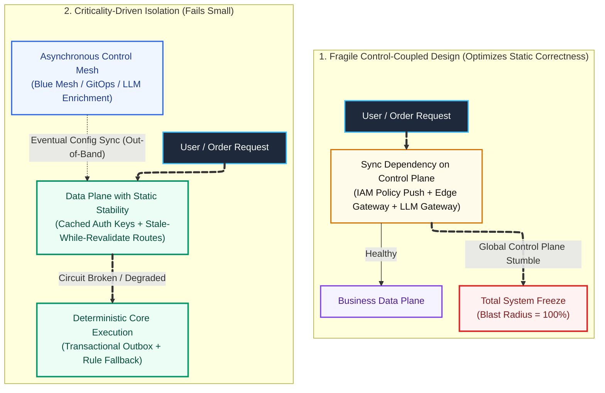
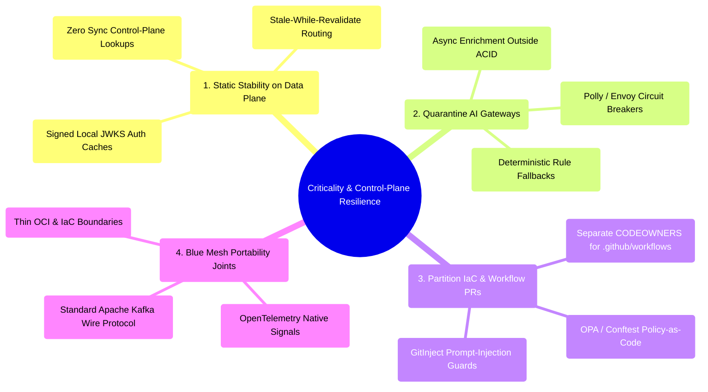

> **Original Thought & Source Lineage:** This research note synthesizes a multi-part resilience series originally published on LinkedIn across 2025: [*The Architect's Paradox: Static Correctness vs. Dynamic Criticality*](https://www.linkedin.com/feed/update/urn:li:activity:7311829185616830464/) (**March 29, 2025**), [*Living Through Architectural Consequences*](https://www.linkedin.com/feed/update/urn:li:activity:7341865509597921280/) (**June 20, 2025**, `998` impressions), [*Death by a Thousand YAMLs*](https://www.linkedin.com/feed/update/urn:li:activity:7375679266589515777/) (**September 21, 2025**), [*Cloud Control Planes Are the Real Single Points of Failure*](https://www.linkedin.com/feed/update/urn:li:activity:7396949732595634176/) (**November 19, 2025**), and [*Oracle built the "Red Stack." IBM is building the "Blue Mesh."*](https://www.linkedin.com/feed/update/urn:li:activity:7403987097352687616/) (**December 8, 2025**).

If you only watch application-layer hype—models, frontends, coding harnesses—you miss the biggest tectonic shift inside enterprise infrastructure over the past two years: **vendor lock-in and catastrophic outage blast radius have both migrated upward into the automation and control plane**.

Two phenomena I wrote about in late 2025—consolidation across horizontal infrastructure tooling ([*Red Stack vs. Blue Mesh*](https://www.linkedin.com/feed/update/urn:li:activity:7403987097352687616/)) and correlated outages across hyperscaler DNS, edge gateways, and state control planes ([*Cloud Control Planes*](https://www.linkedin.com/feed/update/urn:li:activity:7396949732595634176/))—have only sharpened by **November 2026**. Worse still, organizations have wired AI inference routers, multi-agent orchestrators, and automated Terraform pipelines straight into those same shared control surfaces.

---

## 1. History Rhyming: From Oracle's "Red Stack" to IBM's "Blue Mesh"

I began my career as a PeopleSoft ecosystem developer right as Oracle assembled the **"Red Stack"**: PeopleSoft, Siebel, BEA WebLogic, Hyperion, Streams, GoldenGate, and eventually Sun (Java, MySQL, hardware). Oracle's strategic thesis in the 2000s was vertical and unambiguous: **"Run your business on our stack,"** with the proprietary Oracle Database sitting as the economic gravity well at the center.

Fast-forward across two decades, and examine the horizontal chessboard assembled through 2025:

- **OS & Containers:** Red Hat / OpenShift
- **Infrastructure as Code:** HashiCorp / Terraform & Vault
- **Event Streaming:** Confluent / Kafka
- **Distributed Data Platforms:** DataStax / Cassandra

As I wrote on [December 8, 2025](https://www.linkedin.com/feed/update/urn:li:activity:7403987097352687616/), IBM ran a far subtler variation of the same consolidation play—not locking you into one application server, but owning the **control planes across every cloud you touch**:

> *Oracle's 2000s bet: "Run your business on our stack."*
> *IBM's 2020s–2026 bet: "Run your business anywhere — as long as our tools orchestrate, automate, and stream it."*

Simultaneously, cloud-native architectures accumulated what I dubbed [**"Death by a Thousand YAMLs"**](https://www.linkedin.com/feed/update/urn:li:activity:7375679266589515777/): typical Kubernetes production deployments stacking 20+ ecosystem tools—ingress controllers, service meshes, secrets vaults, policy engines, observability collectors, and GitOps controllers. Even multi-cloud portability turned into an accounting illusion when every deployment pipeline depended on one unified automation vendor mesh and centralized identity broker.

---

## 2. Control Planes Are the Real Single Points of Failure

Every time major cloud and network incidents hit global headlines—across **AWS DynamoDB/DNS control paths**, **Azure Front Door edge propagation**, and **Cloudflare global configuration planes**—the post-incident lesson repeats word for word, as I distilled on [November 19, 2025](https://www.linkedin.com/feed/update/urn:li:activity:7396949732595634176/):

1. **Control planes are the real single points of failure.** You can run three Kubernetes clusters across three availability zones, yet a single mis-propagated BGP/WAF/DNS rule or IAM token outage stops every region at once.
2. **You cannot test your way to zero failures.** Complex distributed platforms generate emergent failure interactions that synthetic staging suites never exercise until correlated load strikes.
3. **Reliability is a trade-off, not an absolute.** Treating 99.999% uptime as a purchase order from a hyperscaler rather than an explicit system boundary turns third-party blips into company-wide downtime.
4. **Architect for resilience, not perfection.** Systems that rely on synchronous real-time control-plane lookups on every user request convert control-plane latency spikes into data-plane blackouts.
5. **Treat hyperscalers as powerful, not infallible.**

By **November 2026**, teams introduced an *additional* control-plane fragility: routing deterministic business paths through **hosted AI inference endpoints and cloud agent orchestration loops**. When a transactional e-commerce fulfillment workflow blocks synchronously on an external LLM gateway or a hosted vector registry, you haven't decentralized intelligence—you have welded another brittle external dependency directly onto your revenue path.

---

## 3. Empirical Reality in 2026: Host & IaC Mutations Are High-Blast-Radius Surfaces

The danger isn't only hyperscaler control-plane bugs; it is **autonomous agent drift inside local infrastructure and CI/CD control files**.

In empirical triangulation across public multi-language pull-request corpora and security benchmarks:
- **`CodeReviewer` (`11,013` multilingual code reviews across `141` repositories)** and host-boundary extraction surfaced hundreds of high-blast-radius changes concentrated inside containers, Kubernetes manifests, CI/CD pipelines (`.github/workflows/`), and `Dockerfile` configurations—yet under automated review overload, infra mutations frequently slide alongside application changes without separated privilege gates.
- **`GitInject` (`19` CI/CD evaluation scenarios, including `11` malicious prompt-injection attacks)** showed how adversaries exploit unguarded CI workflows, agent instruction files (`AGENTS.md`, `CLAUDE.md`), and token configurations (`pr_token_exfiltration_via_git_config`) directly through pull-request control paths.

Adding autonomous YAML/Terraform generation into a 20-tool orchestration mesh without **control-plane isolation** widens the blast radius of a single misconfigured workflow change from one microservice to an entire cluster.

---

## 4. From Static Correctness to Barry O'Reilly's Criticality

Why do smart engineering teams keep building brittle architectures despite thicker runbooks and longer checklists?

In [March 2025](https://www.linkedin.com/feed/update/urn:li:activity:7311829185616830464/), drawing on Barry O'Reilly's **Residuality Theory**, I framed **The Architect's Paradox**: *designing strictly for static conformance to idealized specifications under expected conditions produces systems that shatter under unexpected turbulence.*

Chasing **Static Correctness** asks: *"Does this diagram verify all happy-path functional rules in an isolated staging test?"*
Designing for **Dynamic Criticality** asks: *"When our cloud DNS stalls, our Terraform control plane locks, our Schema Registry is unreachable for 15 minutes, or our hosted LLM gateway returns 429s—does the core order/settlement engine still sustain its essential purpose?"*

---

## 5. Four Architectural Rules for Failing Small in Late 2026

You don't build criticality by writing an inspiring reliability charter. You build it by severing synchronous dependencies between **Control Planes** and **Data Planes**, and by enforcing what I stressed in [June 2025](https://www.linkedin.com/feed/update/urn:li:activity:7341865509597921280/):

> *"An architect who hasn't lived with the consequences of their own designs shouldn't be trusted to make the next one."*

Put four concrete circuit breakers into practice across your estate:

1. **Demand Static Stability on the Data Plane:** Design payment processing, warehouse dispatch, authentication verification, and edge routing so that existing traffic continues smoothly using **last-known-good local state** (signed JWKS caches, cached feature/routing snapshots, local fallback rule tables) even if central configuration or identity control planes go dark for hours.
2. **Quarantine AI Gateways Outside Synchronous ACID Paths:** Never allow a synchronous checkout, dispatch, or inventory transaction to wait unguarded on an external frontier model endpoint. Enrich asynchronously; fall back deterministically via circuit breakers (`Polly` / Envoy timeouts) when inference degrades.
3. **Partition IaC & Workflow PRs From Application PRs:** Apply stricter cryptographic provenance, separate `CODEOWNERS`, and policy-as-code gates (`OPA`/`Conftest`) whenever a human or agent mutates `.github/workflows/`, `Dockerfile`, Helm charts, or Terraform modules—never let automation YAML ride inside noisy feature PRs.
4. **Preserve Portability Joints Across Any "Blue Mesh":** Bet on standard wire protocols (native **OpenTelemetry** signals over proprietary collectors, open **Apache Kafka** client contracts over vendor-specific control APIs, standard OCI containers, thin IaC modules) so commercial bundling across your orchestration layer never turns into unbreakable dependency lock-in.

Reliability isn't an SLA certificate on a vendor's status page. It is the deliberate architectural discipline of designing systems that **fail small, degrade gracefully, and keep their core commitment alive when the control plane stumbles**.
