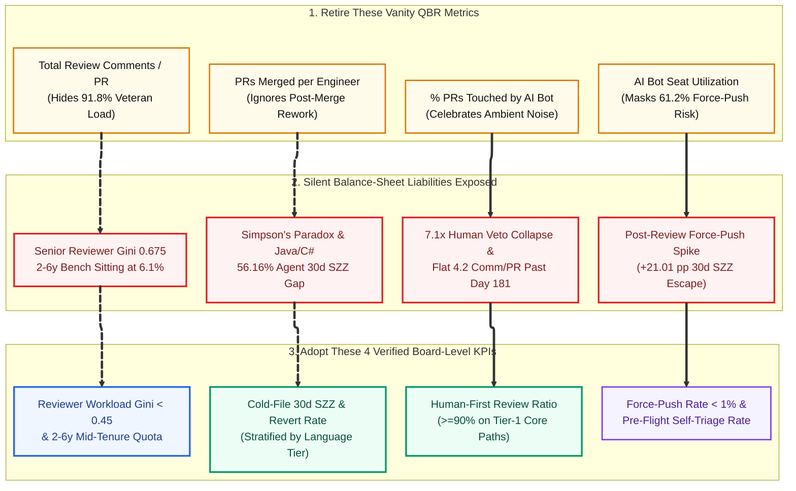
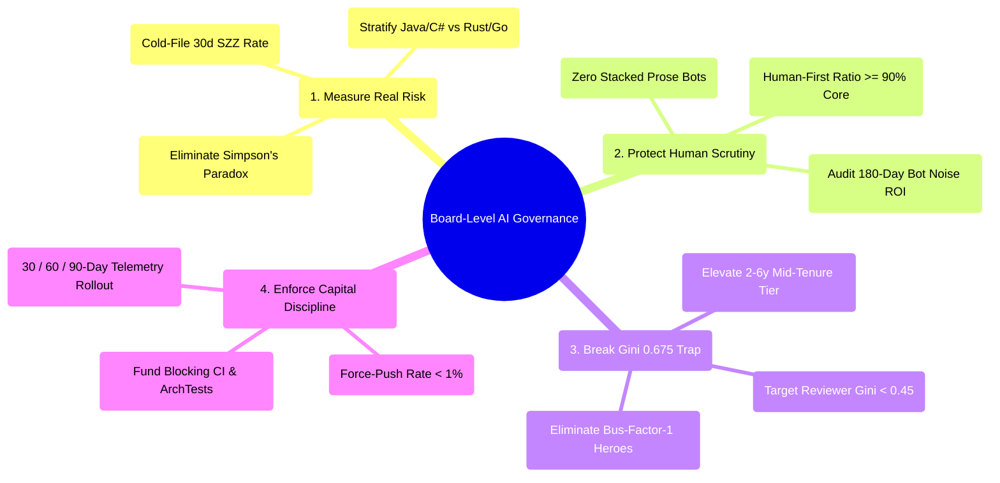

> **Empirical Provenance & Open-Science Replication:** This executive perspective is **Part 3 of a 3-part empirical series** grounded in our companion research manuscript ([`paper/draft_v1_ieee_software.md`](https://github.com/kumarshaz/pr-review-replication/blob/main/paper/draft_v1_ieee_software.md)) and standalone open-science replication package ([**`kumarshaz/pr-review-replication`**](https://github.com/kumarshaz/pr-review-replication) — **`81/81` assertions passing**, `36/36` SHA-256 verified artifacts in [`VERIFICATION_REPORT.md`](https://github.com/kumarshaz/pr-review-replication/blob/main/replication/VERIFICATION_REPORT.md)). Every number below comes from zero-fabrication repository telemetry (`BH-FDR q < 0.05` across headline claims): **`99,454`** CodeRabbit OSS pull requests (`87,899` fixed-cohort PRs across `362` repositories surviving `>= 61` days), **`2,491`** distinct human reviewers spanning **`16,886`** formal review events and **`3,615`** GitHub-matched tenure records, and **`10,410`** commit-attributed merged PRs across **`300`** local bare-git SZZ clones.

Walk into almost any enterprise Quarterly Business Review (QBR) in late 2026, and the engineering leadership slide deck celebrates two glowing green metrics:

1. **Pull requests merged per developer**—up sharply since rolling out coding agents.
2. **Percentage of pull requests reviewed by AI**—now approaching 98% after signing an enterprise-wide review-bot license.

Those numbers look great in front of a board committee. They are also **two of the most dangerous vanity metrics in modern software engineering.**

When you unzip those top-line averages down to bare-git commit history and reviewer identity graphs, those two slides systematically conceal **three silent balance-sheet liabilities**: extreme veteran review centralization (`Gini = 0.6747`), permanent low-signal bot spend past Day 181, and raw defect dashboards inverted by Simpson's Paradox.

---

## 1. Liability #1: The Senior Reviewer Gini Trap (`Gini = 0.6747`)

Start with the most common executive misdiagnosis of AI review fatigue: *"Our senior engineers are getting flooded by burst queues (`5+` PRs/day), so they're rubber-stamping under acute load."*

We tested acute 24-hour burst load across `16,886` formal human review events—and found the opposite. Maintainers handling **`5+` reviews in 24 hours (`N = 4,458`) actually cut bare rubber-stamping by `-21.12 pp`** (**`44.05% -> 22.93%`**, `p < 1e-15`, Power **`100%`**) while holding `CHANGES_REQUESTED` vetoes steady (`8.70%` vs. `9.04%`, `p = 0.55`). High-burst reviewers operate as disciplined triage hubs, not rubber-stampers.

The real organizational fracture isn't acute daily bursts. It is **chronic structural inequality in who carries institutional verification.**

Across **`2,491` distinct human maintainers**, review workload concentrates at **`Gini = 0.6747`**—deepening the [Conway Gatekeeper centralization](/blog/from-partner-diagram-rot-to-context-engineering/) we documented earlier (`66.43%` top-1 reviewer share across `521` active repos, with `23.42%` operating at Bus Factor = 1). Stratify GitHub-matched reviews by maintainer tenure (`N = 3,615`), and the organizational bottleneck jumps straight off the page:

| Maintainer Tenure Cohort | Share of Reviews (`N = 3,615`) | Human `CHANGES_REQUESTED` Veto % | Bare `APPROVED` Rubber-Stamp % | Organizational Diagnostic |
| :--- | ---: | ---: | ---: | :--- |
| **`6y+` Veterans** | **`91.8%`** (`3,317`) | **`6.39%`** | `28.91%` | **Over-concentrated bottleneck** defaulting to pattern-matching triage |
| **`2–6y` Mid-Tenure** | **`6.1%`** (`220`) | **`13.64%`** (`2.1x` veterans) | `33.18%` | **Highest-scrutiny asset**, severely under-allocated |
| **`<2y` Newcomers** | **`2.2%`** (`78`) | **`1.28%`** | `29.49%` | Low institutional authority; rarely vetoes architectural drift |

Read that middle row twice. **`2–6y` mid-tenure engineers issue `CHANGES_REQUESTED` vetoes at `13.64%`—more than twice the scrutiny rate of `6y+` veterans (`6.39%`)**—yet they receive only **`6.1%`** of review assignments while `91.8%` piles onto veteran principals. *(Full burst, tenure, and Gini calculations: [`nq08_queue_burst_and_fatigue_log.csv`](https://github.com/kumarshaz/pr-review-replication/blob/main/replication/results/pr_review/data_tables/nq08_queue_burst_and_fatigue_log.csv), [`analyzed_human_reviewed_prs_log.csv`](https://github.com/kumarshaz/pr-review-replication/blob/main/replication/results/pr_review/data_tables/analyzed_human_reviewed_prs_log.csv), and [`open_questions_nq01_nq08_results.json`](https://github.com/kumarshaz/pr-review-replication/blob/main/replication/results/pr_review/open_questions_nq01_nq08_results.json).)*

When an enterprise scales coding-agent PR volume 5x without systematically routing review ownership into its `2–6y` bench, it doesn't multiply engineering leverage. It quietly **liquidates institutional review capacity**: burning out Bus-Factor-1 architects while starving the next generation of engineers of the exact architectural judgment reps they need to become senior maintainers.

---

## 2. Liability #2: Permanent Low-Signal Bot Spend Past Day 181

The second QBR illusion is *"98% AI review coverage."* Many VPs assume that if an AI review bot is noisy or unhelpful, engineering teams will naturally drop it after 60 days—so continued seat utilization proves ROI.

Across **`99,454` CodeRabbit OSS pull requests** (`457` tenure repositories)—validated with a strict fixed-cohort survivorship check (`87,899` PRs across `362` repositories active `>= 61` days)—teams **do not** uninstall noisy bots at Day 60:

- Mean comments settle modestly during initial tuning in Days `16–30` (`4.92 -> 4.08` comments/PR; `4.84 -> 3.90` in the fixed cohort).
- From Day 31 past **Day 181 (`69,596` PRs)**, comment density flatlines indefinitely at **`4.20–4.34` comments per PR**, with `zero_comment_pct` never rising above **`0.20%`**.
- Over that exact same horizon, **bug-labeled PRs climb from `3.13%` (`Days 0–15`) to `5.86%` (`Days 61–180`)**, peaking on louder `.coderabbit.yaml` profiles (`default 2.01%`, `chill 7.78%`, **`assertive 8.90%`**) ([`nq08_queue_burst_and_fatigue_log.csv`](https://github.com/kumarshaz/pr-review-replication/blob/main/replication/results/pr_review/data_tables/nq08_queue_burst_and_fatigue_log.csv) · [`coderabbit_policy_outcomes_log.csv`](https://github.com/kumarshaz/pr-review-replication/blob/main/replication/results/pr_review/data_tables/coderabbit_policy_outcomes_log.csv)).

*(Methodological disclosure: The public Zenodo CodeRabbit corpus records all `99,454` PRs with `state='closed'` without a separate merged boolean, so we never invent merge rates—we track observed comment density, silence rate, close latency, and bug-label trends directly.)*

Pair that permanent `4.2`-comment background hum with the **Bot-First Anchoring Law** established in Parts 1 and 2 of this series: letting a Tier-1 prose bot speak before a human collapses human `CHANGES_REQUESTED` vetoes **`7.1x`** (`26.74% -> 3.76%`, `p = 2.29e-13`, Power `100%`), surges rubber-stamping `+22.34 pp`, and stacking `2+` bots drops human vetoes to **`2.20%`** (`N = 182`; see [`nq05_review_speed_bimodality_log.csv`](https://github.com/kumarshaz/pr-review-replication/blob/main/replication/results/pr_review/data_tables/nq05_review_speed_bimodality_log.csv) and [`multi_scale_sample_persistence_log.csv`](https://github.com/kumarshaz/pr-review-replication/blob/main/replication/results/pr_review/data_tables/multi_scale_sample_persistence_log.csv)).

From a capital-allocation lens, **"seat utilization" on prose review bots is an anti-metric.** You are measuring how faithfully a smoke alarm keeps chirping after everyone in the building stopped hearing it.

---

## 3. Liability #3: Simpson's Paradox in Raw Engineering Dashboards

Even mature engineering organizations that try to measure post-merge defects get tripped up by **pooled dashboard averages**. Three empirical inversions in our `300`-repo bare-git SZZ telemetry prove why naive KPIs actively steer CTOs toward the wrong investments:

1. **Tests Look Harmful Until You Filter Cold Files:** In naive pooled coding-agent telemetry, PRs that include tests suffer a **`+9.70 pp` higher** 30-day SZZ bugfix rate (`40.01% -> 49.71%`, `p = 5.10e-8`) purely because risky edits to turbulent "hotspot" modules attract both tests and follow-up fixes. Stratify strictly to **cold files** (`pre_pr_30d_hotspot_fixes == 0`), and the direction flips cleanly: co-authored tests **cut coding-agent 30-day SZZ by `-5.47 pp`** (`28.09% -> 22.63%`, `p = 0.0107`; [`nq06_assertion_theater_szz_log.csv`](https://github.com/kumarshaz/pr-review-replication/blob/main/replication/results/pr_review/data_tables/nq06_assertion_theater_szz_log.csv)).
2. **Compact Decision Checkers Look Buggier Until You Filter Cold Files:** Naive within-repo comparisons of `TypeSafe Jev` flagged vs. clean agent PRs show an alarming odds ratio (`OR_MH = 3.55`) driven by hotspot selection bias (`p = 5.42e-7`). Control for cold files, and merged-PR outcomes drop to exact parity (`OR_MH = 0.9537`, `p = 0.95`), exposing where Jev *actually* creates value—upstream pre-merge author self-triage (`-24.14 pp` merge drop, `5.04x` self-closure, Power `99.97%`)—and where it creates risk (`Jev_Clean` false-negative complacency: `+0.4205` vs. `+0.0588` net 14d DiD jump; [`JEV_JUDGMENT_AND_SZZ_REPORT.md`](https://github.com/kumarshaz/pr-review-replication/blob/main/replication/results/pr_review/JEV_JUDGMENT_AND_SZZ_REPORT.md) · [`jev_judgment_and_szz_outcomes.json`](https://github.com/kumarshaz/pr-review-replication/blob/main/replication/results/pr_review/jev_judgment_and_szz_outcomes.json)).
3. **Pooled Org Averages Mask Massive Enterprise Language-Stack Risk:** Look at 30-day bare-git SZZ defect rates split across language paradigms ([`nq07_language_turnover_szz_log.csv`](https://github.com/kumarshaz/pr-review-replication/blob/main/replication/results/pr_review/data_tables/nq07_language_turnover_szz_log.csv) · [`szz_defect_traceability_ledger.csv`](https://github.com/kumarshaz/pr-review-replication/blob/main/replication/results/pr_review/data_tables/szz_defect_traceability_ledger.csv)):

| Language Tier | Coding-Agent 30d SZZ (`N`) | Human Baseline 30d SZZ (`N`) | Agent Cold-File 30d SZZ | 30d Bugfix File Churn (Agent vs. Human) | Executive Risk Posture |
| :--- | ---: | ---: | ---: | ---: | :--- |
| **`Compiled_Systems`** (Rust, C++) | **`33.19%`** (`452`) | `32.41%` (`216`) | `22.93%` (Human `20.57%`) | `18.11%` vs. `13.76%` | **Near parity** — strict compiler invariants absorb agent errors |
| **`Dynamic_Gradual`** (Python, JS/TS) | `42.23%` (`2,543`) | `46.03%` (`1,460`) | `26.93%` (Human `27.13%`) | `25.29%` vs. `25.44%` | **Moderate watch** — enforce cold-file tests & schema contracts |
| **`Managed_OO`** (Java, C#) | **`56.16%`** (`536`) | **`25.00%`** (`56`) | **`35.71%`** | **`42.24%` vs. `10.23%`** | **High enterprise alert** — requires executable architecture tests (`ArchUnit` / `NetArchTest`) |

Notice the strategic punchline for Fortune 500 CTOs: **the exact managed object-oriented stack (`Java`, `.NET / C#`) powering core banking, ERP, healthcare, and logistics estates exhibits the sharpest coding-agent defect gap (`56.16%` vs. `25.00%` human baseline; `42.24%` vs. `10.23%` bugfix file churn).** A blended company-wide average completely hides that exposure until a production incident surfaces it.

---

## 4. The Four Board-Level KPIs for 2026–2027 Engineering Plans

Replace the vanity QBR slides with four instrumentable metrics you can compute directly from your own git history and GitHub/GitLab audit logs—zero extra SaaS spend required:

| Retire This Vanity Metric | Adopt This Verified Board KPI | Operational Target | Empirical Anchor & Evidence File |
| :--- | :--- | :--- | :--- |
| **PRs Merged per Engineer** | **Cold-File 30-Day SZZ Bugfix & Revert Rate** | Track Agent vs. Human parity per language tier (`Rust/C++` parity vs. `Java/C#` mandatory guardrail watch) | Eliminates Simpson's Paradox (`-5.47 pp` cold-file test shield; `56.16%` vs. `25.00%` Managed OO gap) — [`nq06`](https://github.com/kumarshaz/pr-review-replication/blob/main/replication/results/pr_review/data_tables/nq06_assertion_theater_szz_log.csv) · [`nq07`](https://github.com/kumarshaz/pr-review-replication/blob/main/replication/results/pr_review/data_tables/nq07_language_turnover_szz_log.csv) |
| **% PRs Covered by AI Review Bot** | **Human-First Review Ratio on Tier-1 Services** | **`>= 90%`** Human-First or Deterministic-Only on Auth, Payments, Settlement, and IaC | Protects against **`7.1x`** human CR collapse (`26.74% -> 3.76%`, `p = 2.29e-13`) and stacked-bot drop (`2.20%`) — [`nq05`](https://github.com/kumarshaz/pr-review-replication/blob/main/replication/results/pr_review/data_tables/nq05_review_speed_bimodality_log.csv) |
| **Total Review Comments / PR** | **Reviewer Workload Gini & `2–6y` Mid-Tenure Share** | Drive **Gini `< 0.45`**; expand `2–6y` active review quota to decentralize `6y+` saturation | Fixes **`Gini = 0.6747`** (`91.8%` on `6y+` veterans at `6.39%` CR vs. `2–6y` at `13.64%` CR) — [`nq08`](https://github.com/kumarshaz/pr-review-replication/blob/main/replication/results/pr_review/data_tables/nq08_queue_burst_and_fatigue_log.csv) |
| **AI Bot Seat Utilization** | **Post-Review Force-Push Rate & Pre-Flight Self-Triage Rate** | Drive post-review force-push **`< 1%`**; fund blocking deterministic CI gates over prose-bot renewals | Closes **`+21.01 pp`** force-push SZZ hazard (`40.22% -> 61.22%`) and captures `-24.14 pp` pre-merge self-triage — [`nq04`](https://github.com/kumarshaz/pr-review-replication/blob/main/replication/results/pr_review/data_tables/nq04_pingpong_rework_szz_log.csv) · [`Jev Report`](https://github.com/kumarshaz/pr-review-replication/blob/main/replication/results/pr_review/JEV_JUDGMENT_AND_SZZ_REPORT.md) |

---

## 5. Handling the Boardroom Objection: Capital Reallocation & 30 / 60 / 90-Day Rollout

Every CTO or Principal Architect reading this eventually faces the exact same political pushback inside a quarterly budget review:

> *"We just signed a 500-seat AI code-review bot contract last quarter, and our engineering productivity team put '98% AI review coverage' on the board deck. Are you telling me we have to tell the CFO we wasted that money?"*

No—frame it as **portfolio discipline and 3-year TCO management**, the same editorial discipline I outlined in [Be the Editor, Not the Author](/blog/editorial-architecture-and-three-year-tco/) and [From ADRs to Executable Constraints](/blog/from-adrs-to-executable-constraints/). You do not rip out automation; you **reallocate capital from redundant prose-review seats into compounding deterministic verification assets** (compiler rules, `ArchUnit`/`NetArchTest`, contract schema diffs, blocking pre-flight checks, and cold-file test synthesis).

Here is the pragmatic **30 / 60 / 90-day execution roadmap** that requires zero new vendor purchases on Day 1:

### Day 30 — Pure Git-Log Telemetry Audit (Zero Vendor Spend)
- Pull 90 days of GitHub/GitLab API review events and bare-git history across your **top 20 revenue-generating repositories**.
- Compute four baseline numbers: **Reviewer Workload Gini**, **`2–6y` vs. `6y+` review share**, **Post-Review Force-Push Rate**, and **Cold-File 30-Day SZZ Bugfix Rate** broken down by language (`Java`/`.NET` vs. `TypeScript`/`Python` vs. `Go`/`Rust`).
- Present that single 1-page baseline alongside your current QBR velocity slide. Numbers beat opinions in every executive room.

### Day 60 — Rewire CI Guardrails & Reallocate Renewal Budget
- Flip `.coderabbit.yaml` (or equivalent bot webhooks) to **Human-First Blind Review** (`auto_review: false`) on Tier-1 transactional, auth, and IaC repositories, while keeping deterministic scanners (`Semgrep`, `gitleaks`, `ast-grep`) active.
- Lock branch rulesets (`dismiss_stale_reviews: true`, `require_last_push_approval: true`, block non-fast-forward force-pushes) to shut the `+21.01 pp` force-push escape hatch.
- Turn on the **Cold-File Test Gate** for coding-agent PRs—prioritizing your `Java` and `.NET` services where agent 30d SZZ sits at `56.16%`.
- Redirect upcoming multi-bot or redundant prose-bot renewals into executable architectural fitness functions (`NetArchTest`, `ArchUnit`, OpenAPI/AsyncAPI contract gates).

### Day 90 — Rebuild Institutional Review Capacity
- Update `CODEOWNERS` and automated reviewer-rotation rules to pair **`2–6y` mid-tenure engineers** with **`6y+` veterans** as co-primary reviewers on Tier-1 and Tier-2 repositories.
- Track **Reviewer Workload Gini** monthly toward **`< 0.45`** and tie staff/principal engineering career ladders to **review decentralization** (growing new code owners) rather than heroically carrying 90% of the merge queue alone.

---

## Closing Reflection: Velocity Without Verification Capacity Is Borrowed Time

AI coding harnesses made generating software nearly free. They did not make institutional judgment free.

If your engineering scorecard celebrates rising PR throughput and 98% AI bot coverage while `91.8%` of real review accountability piles onto a shrinking handful of exhausted `6y+` veterans—and while your core `Java` and `.NET` services quietly absorb a `56.16%` coding-agent 30-day defect churn rate—you are not accelerating delivery. You are taking out a high-interest technical debt loan against next year's roadmap.

Retire the vanity slides. Put **Cold-File SZZ, Human-First Review Ratio, Reviewer Workload Gini, and Post-Review Force-Push Rate** on your next board deck. That is how engineering leaders turn raw AI code volume into durable enterprise reliability.

> **Verify Every Metric Yourself:** Clone [`kumarshaz/pr-review-replication`](https://github.com/kumarshaz/pr-review-replication) and run `python3 replication/run_replication.py` to independently audit all `36` SHA-256 verified JSON/CSV tables, `10,410` commit-attributed bare-git SZZ pull requests, and the full companion *IEEE Software* manuscript draft ([`paper/draft_v1_ieee_software.md`](https://github.com/kumarshaz/pr-review-replication/blob/main/paper/draft_v1_ieee_software.md)).

*(This concludes our 3-part empirical series on AI PR governance: **Part 1** details the data analysis pipeline and stress-tests five viral AI code-review myths across 130,000+ PRs; **Part 2** delivers the copy-paste 4-stage Human-First Blind Review pipeline; and **Part 3** equips executives to govern AI verification on the balance sheet.)*
