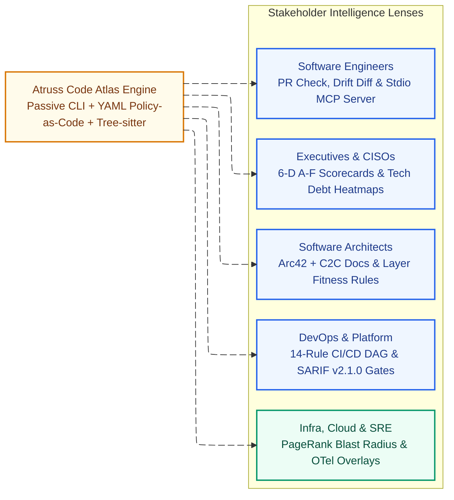
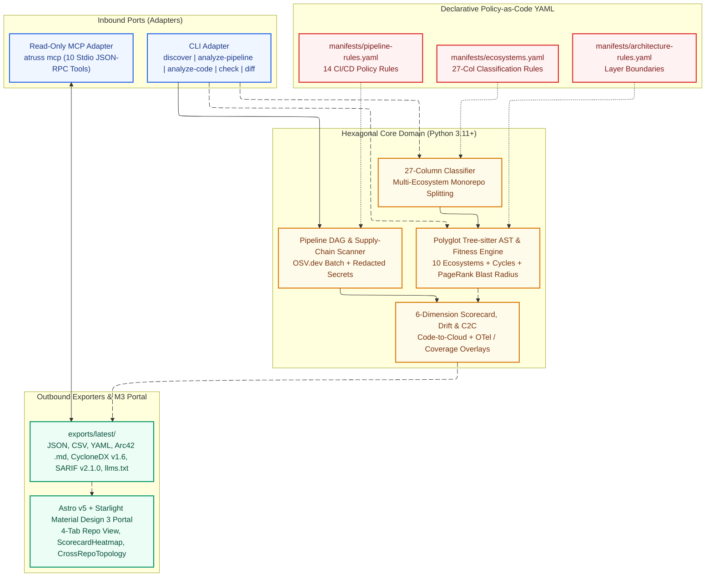
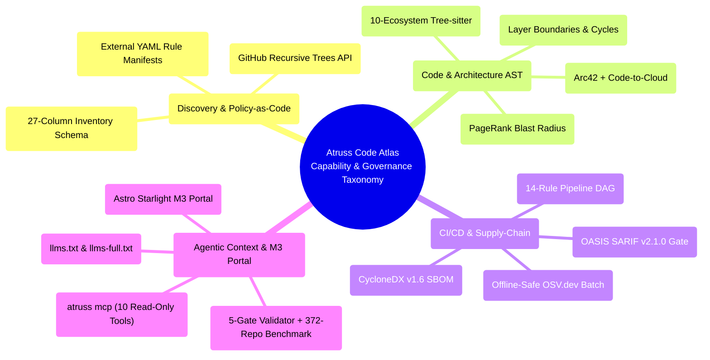

Enterprises suffer from silent architectural drift and CI/CD pipeline fragmentation. Across hundreds of repositories, engineering teams frequently operate like **"Master Blacksmiths"**—hand-crafting bespoke GitHub Actions workflows and burying critical domain logic and infrastructure couplings where only tribal memory can trace them.

**[Atruss Code Atlas](https://github.com/kumarshaz/atruss-code-atlas)** is my open-source CLI and static **Material Design 3 (Astro Starlight)** intelligence portal built to replace tribal archaeology with **passive, zero-agent, offline-capable architectural and pipeline observability**. Without requiring webhooks, background agents, or modifications to target repositories, Atruss answers three questions across an organization:

1. **What** is being built (structural code boundaries, workspace graphs, and infrastructure dependencies).
2. **How** it gets to production (end-to-end CI/CD execution DAGs from triggers to jobs and reusable workflows).
3. **Where** hidden risk lives (architectural layer violations, blast radius hotspots, supply-chain security anti-patterns, CVEs, and temporal drift).

---

## 1. The Market Gap & Stakeholder Value Model

Most static analysis and developer portal tools illuminate only a single slice of an engineering portfolio while imposing operational friction or proprietary lock-in:

| Tool Category | Blind Spot / Adoption Friction | How Atruss Code Atlas Solves It |
| :--- | :--- | :--- |
| **Static Code Scanners (e.g., SonarQube)** | Blind to CI/CD workflow DAGs, triggers, and deployment supply-chain risks | Parses `.github/workflows/*.yml` into NetworkX DAGs alongside source ASTs |
| **Proprietary Security UIs (e.g., GHAS)** | Locks governance insights inside vendor dashboards | Emits portable JSON, CSV, YAML, Arc42 Markdown, **CycloneDX v1.6 SBOMs**, and **OASIS SARIF v2.1.0** |
| **Active IDP Catalogs (e.g., Backstage)** | Demands months of manual `catalog-info.yaml` upkeep and running Postgres/plugins | **100% Passive**: discovers via GitHub `/git/trees` API and shallow `--depth 1` clones |
| **Runtime CI Telemetry (e.g., Datadog CI)** | Lacks code-level boundary and domain architecture mapping | Correlates CI/CD deployment jobs directly to code modules, containers, Kubernetes, and Terraform |

---

## 2. Core Hexagonal Architecture (`v1.0` + Horizon 2 `v2.0`)

Following the **"Lego" Framework**, Atruss Code Atlas enforces strict **Hexagonal (Ports & Adapters)** boundaries—remaining 100% database-free and broker-free (zero FastAPI, Celery, Redis, or Postgres runtime dependencies):

### Implemented Capabilities Across `FR-001`–`FR-030`

1. **Dual-Mode 27-Column Organization Discovery (`FR-005`)**:
   `atruss discover --org <org>` queries GitHub `/git/trees/{sha}?recursive=1` without full cloning, isolating monorepo submodules via `manifests/ecosystems.yaml` and exporting canonical `repositories.{json,csv,yaml}` with frameworks, deployable types, container/Kubernetes presence, and documentation priority (`Tier 1`–`Tier 3`).
2. **Polyglot Tree-sitter AST & Fitness Functions (`FR-012`, `FR-022`, `FR-023`)**:
   Analyzes **10 ecosystems** (`Python`, `.NET`, `TypeScript/JavaScript`, `Java`, `Go`, `Rust`, `Ruby`, `PHP`, `Elixir`, and `Container/Helm/IaC`) for `API_ROUTE`, `SERVICE`, `DATA_ACCESS_LAYER`, `UI_COMPONENT`, and `MODULE` boundaries—computing cyclomatic & cognitive complexity, AST clone duplication, dead code, declarative layer bypasses, circular dependencies (`nx.simple_cycles`), and **PageRank Blast Radius**.
3. **14-Rule CI/CD Pipeline DAG & Supply-Chain Security (`FR-010`, `FR-021`, `FR-024`, `FR-028`)**:
   Constructs NetworkX workflow DAGs (`workflow_call` / `workflow_run` cross-workflow edges included) and flags 7 operational gaps plus 7 supply-chain security anti-patterns (`UNPINNED_ACTION`, `TEMPLATE_INJECTION`, `PWN_REQUEST_RISK`, `EXCESSIVE_PERMISSIONS`, `NO_TIMEOUT`, `ARTIFACT_CREDENTIAL_PERSISTENCE`, `STATIC_CLOUD_CREDENTIALS`). Combines offline-safe `OSV.dev` lockfile scanning with redacted secret detection to emit **CycloneDX v1.6 SBOMs** and **OASIS SARIF v2.1.0** reports.
4. **6-Dimension A–F Scorecard & Code-to-Cloud Traceability (`FR-025`, `FR-026`, `FR-027`)**:
   Produces deterministic `0–100` A–F grades (*Code Quality*, *Security*, *Maintainability*, *Test Coverage*, *Dependency Health*, *Pipeline Health*), maps Arc42 Section 7 **Code-to-Cloud** flows with `--otel-traces` and `--coverage` overlays (`HOT_PATH`, `COVERED_STATIC`, `DEAD_UNOBSERVED`), and evaluates snapshot regressions via `atruss diff` and `atruss check --sarif`.
5. **AI Context Engineering (`llms.txt` / MCP) & Material Design 3 Observatory (`FR-017`, `FR-029`, `FR-030`)**:
   Exports deterministic `llms.txt` and `llms-full.txt` bundles, runs a read-only stdio **Model Context Protocol server (`atruss mcp`)** exposing 10 structural/security tools, and feeds an **Astro v5 + Starlight Material Design 3** static site with 4-tab repo deep dives, `ScorecardHeatmap`, `CrossRepoTopology`, SVG/PNG diagram exports, and Print/PDF layouts.

---

## 3. Built as a Living Laboratory for Agentic SDLC Governance

Over iterations `001` through `009` and Horizon 2, Atruss Code Atlas served as an empirical testbed for combining **SpecKit Specification-Driven Development** (`specs/001`–`006A`) with **Antigravity Native Agentic Coding & Parallel Swarms** (`006B`–`009`).

To prevent cross-iteration agent drift ("checkbox compliance" where a Markdown task is ticked while stubs or skipped tests remain), [`scripts/validate_agent_workflow.py`](https://github.com/kumarshaz/atruss-code-atlas/blob/main/scripts/validate_agent_workflow.py) enforces a zero-trust **5-Gate Conformance Validator** (`Grade A` target) alongside a **372-repository checkpointed corpus benchmark** (`--isolated --checkpoint-dir`):

- **Gate 1 — Traceability**: 100% of `FR-001`–`FR-030` and `SC-001`–`SC-010` map to tasks, and every path referenced in `plan.md` exists on disk.
- **Gate 2 — AST Anti-Stub Audit**: Zero empty `pass`/`...` stub functions, zero `# Mock` placeholders, and zero `pytest.skip` markers.
- **Gate 3 — Full Pytest Execution**: 100% pass rate with zero skipped tests (`--strict-markers`).
- **Gate 4 — Cross-Stack Schema Contract**: Backend JSON, SBOM, SARIF, `llms.txt`, and `catalog-history.json` match the Astro Starlight UI consumer contracts.
- **Gate 5 — SHA-256 Determinism**: Repeated runs against pinned fixtures produce byte-for-byte identical hashes.
