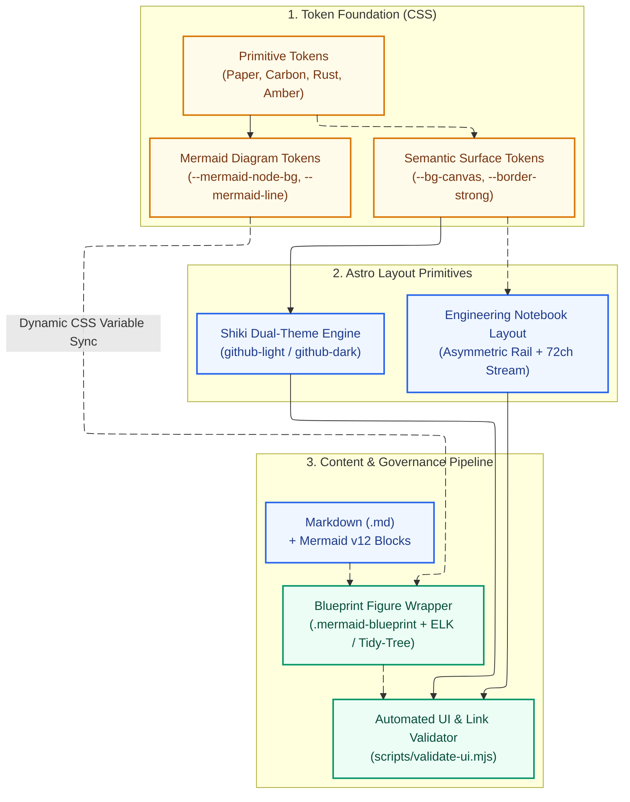

When writing about enterprise composability, domain autonomy, and socio-technical systems, the user interface itself should reflect architectural rigor. Rather than relying on a generic starter template or pulling in a heavy client-side component library that fights a pure Markdown workflow, I engineered this website as a **Token-Driven Editorial Design System**—anchored in an open **Engineering Notebook** aesthetic.

---

## 1. The Architectural Problem: Escaping the Hobbyist Template

Most developer blogs fall into one of two traps:
1. **The Un-Gridded Starter Template**: Centered columns with soft floating cards and mismatched diagram colors that lack executive technical authority.
2. **The Over-Engineered SPA**: Heavy React component libraries and client-side state machines shipped just to render static prose and SVG diagrams.

Following my **Master Goldsmith** philosophy and the **Lego Framework**, I designed this platform around a strict separation of concerns: **zero client-side JavaScript by default**, pure **Markdown + Mermaid** authoring, and a **single CSS token source of truth** shared across typography, layout rails, syntax highlighting, and architectural diagrams.



---

## 2. Three-Tier Design Token Architecture

Instead of scattering hex codes across components, [`src/styles/tokens.css`](https://github.com/kumarshaz/kumarshaz.github.io/blob/main/src/styles/tokens.css) enforces a three-tier token hierarchy:

- **Tier 1 — Primitives**: Raw archival paper tones (`#F2F1EC`, `#E7E5DD`), deep anvil carbon (`#111214`, `#181A1E`), and high-contrast signal accents (`#C84B20` Signal Rust for Light Mode; `#E87A48` Signal Amber for Dark Mode).
- **Tier 2 — Semantic Surfaces & Rules**: Context-aware tokens (`--bg-canvas`, `--bg-surface`, `--text-primary`, `--border-grid`, `--border-strong`) that switch instantaneously when `[data-theme="dark"]` is toggled.
- **Tier 3 — Mermaid Diagram Tokens**: Dedicated diagram primitives (`--mermaid-node-bg`, `--mermaid-node-border`, `--mermaid-line`, `--mermaid-cluster-bg`) consumed at runtime by Mermaid v12.

### Open-Source Technical Typography

Every typographic role is mapped to open-source fonts licensed under the **SIL Open Font License 1.1**:
- **Display & Mastheads (`--font-display`)**: `Space Mono` for unmistakable RFC/specification authority.
- **Long-Form Editorial Prose (`--font-sans`)**: `IBM Plex Sans` for effortless readability across 72-character lines.
- **Metadata Rails, Code & Diagrams (`--font-mono`)**: `IBM Plex Mono` for tabular alignment, taxonomy badges, and SVG node labels.

---

## 3. Token-Synced Mermaid v12 Blueprint Pipeline (ELK & Tidy-Tree)

Mermaid diagrams often look disconnected from the host site because Mermaid injects isolated default stylesheets. In this platform's [`BlogPost.astro`](https://github.com/kumarshaz/kumarshaz.github.io/blob/main/src/layouts/BlogPost.astro) layout:

1. **Zero-Friction Authoring**: Diagrams are authored as standard ```` ```mermaid ```` fenced blocks inside Markdown.
2. **Blueprint Figure Framing**: At load time, each Mermaid block is wrapped in a `.mermaid-blueprint` figure container featuring a radial dot-matrix technical background, an `Architecture Diagram` header bar, and an interactive `Expand` / `Collapse` viewport toggle.
3. **Live Theme Synchronization & Multi-Engine Layout**: Mermaid v12 is bundled with `@mermaid-js/layout-elk` and `@mermaid-js/layout-tidy-tree`, initialized with `theme: 'base'`, and reads active CSS variables via `getComputedStyle(document.documentElement)`. Flowcharts opt into `layout: elk` and mindmaps opt into `layout: tidy-tree` via diagram frontmatter (with runtime fallback in [`BlogPost.astro`](https://github.com/kumarshaz/kumarshaz.github.io/blob/main/src/layouts/BlogPost.astro)), while sequences and timelines render sequentially with monotonic SVG IDs. Listening to the custom `theme-change` event re-renders diagrams seamlessly whenever the reader switches between Light and Dark mode.

---

## 4. Agentic Authoring & The Automated Validation Gate

True **Spec-Driven Development (SDD)** means both human architects and AI coding agents operate under explicit, machine-verifiable contracts:

- **Operational Agent Charter ([`AGENTS.md`](https://github.com/kumarshaz/kumarshaz.github.io/blob/main/AGENTS.md))**: Defines how local and remote AI agents branch (`blogs/{topic-name}`), enforce the Zod content schema ([`src/content.config.ts`](https://github.com/kumarshaz/kumarshaz.github.io/blob/main/src/content.config.ts)), and apply visual Mermaid diagramming skills.
- **Automated Conformance Gate ([`scripts/validate-ui.mjs`](https://github.com/kumarshaz/kumarshaz.github.io/blob/main/scripts/validate-ui.mjs))**: Every build executes `npm run check`, auditing **4 quality gates** across all generated static routes:
  1. **Gate 1**: 3-Tier CSS token completeness (`tokens.css`).
  2. **Gate 2**: Layout & blueprint container invariants (`layout.css`).
  3. **Gate 3**: Zod schema integrity across `blog` and `foundry` collections.
  4. **Gate 4**: Static HTML route verification, zero broken internal links, accessibility landmarks (`skip-link`, `#main-content`), Shiki dual-theme contrast, and populated taxonomy badge counts.
