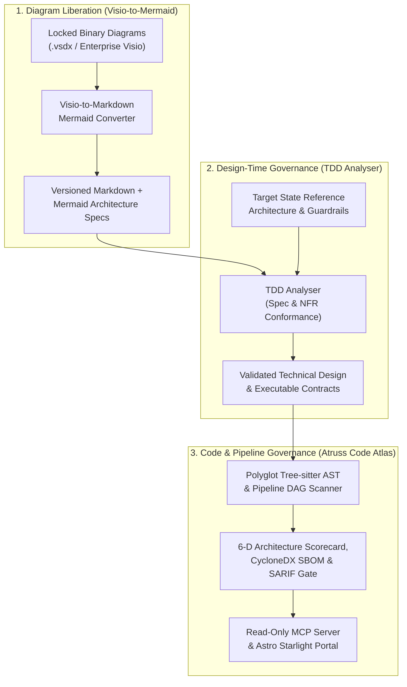
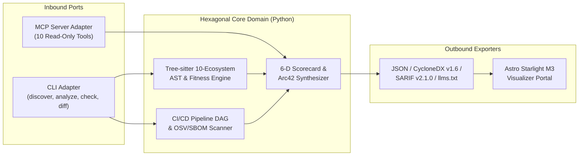

Transitioning an engineering organization from **Master Blacksmiths** (manual, repetitive toil) to **Master Goldsmiths** (high-precision architectural intent) requires more than written guidelines—it requires **executable, reusable architecture products**.

Rather than treating governance, design reviews, and diagramming as manual gatekeeping exercises, I build modular tools that automate the structural **90%** so architects and engineers can focus on the critical **10%** of domain complexity and business trade-offs. Below are three reusable products from my architectural foundry.



---

## 1. Atruss Code Atlas — Multi-Repo Structural Intelligence & Governance

**[Atruss Code Atlas](https://github.com/kumarshaz/atruss-code-atlas)** is an open-source, zero-backend structural analysis engine and documentation portal built using **Hexagonal Architecture (Ports & Adapters)** in Python and **Astro Starlight (Material Design 3)**.

In large enterprise portfolios, architectural drift happens silently across ratusan of repositories and CI/CD workflows. Atruss turns opaque repository fleets into deterministic, queryable architectural telemetry.

### Core Capabilities

- **Polyglot Tree-sitter AST Engine**: Analyzes 10 ecosystems (`Python`, `.NET`, `TypeScript/JavaScript`, `Java`, `Go`, `Rust`, `Ruby`, `PHP`, `Elixir`, and `Container/Helm/IaC`) to extract component dependencies, cognitive complexity, code clones, and dead code.
- **Architectural Fitness & Blast Radius**: Enforces declarative layer boundaries, detects circular dependencies (`nx.simple_cycles`), and computes **PageRank Blast Radius** to pinpoint high-risk structural coupling.
- **CI/CD Pipeline Topology & Supply-Chain Security**: Parses GitHub Actions and enterprise pipeline DAGs, inspects lockfiles across ecosystems, runs offline-safe OSV.dev batch vulnerability lookups, and exports **CycloneDX v1.6 SBOMs** and **OASIS SARIF v2.1.0** reports.
- **6-Dimension A–F Executive Scorecard**: Grades repositories (`0–100`) across modularity, testability, security, pipeline hygiene, observability (`OpenTelemetry` / Code-to-Cloud traceability), and documentation completeness.
- **AI Context & Read-Only MCP Server (`atruss mcp`)**: Exports deterministic `llms.txt` / `llms-full.txt` context bundles and exposes 10 read-only Model Context Protocol (MCP) tools so AI agents can query real architectural graphs without hallucinating.



---

## 2. TDD Analyser — Automated Technical Design Conformance

In enterprise software delivery, **Technical Design Documents (TDDs)** frequently suffer from two failure modes: they are either written as box-checking prose that omits critical non-functional requirements (NFRs), or they drift immediately from the actual codebase once implementation begins.

The **TDD Analyser** is a reusable specification review and conformance product designed around the **LLM-as-a-Judge** pattern combined with deterministic structural rubrics:

### How It Works

1. **Rubric-Driven Specification Audit**: Evaluates draft TDDs against enterprise reference architecture standards—verifying explicit API contracts (REST/gRPC/GraphQL), domain boundary definitions (DDD bounded contexts), data residency, idempotency, failure modes, and observability (`OpenTelemetry` traces/metrics).
2. **Shift-Left Architecture Review**: Identifies missing sequence flows, unaddressed security boundaries, or anti-patterns *before* an Architecture Review Board (ARB) meeting, shortening feedback loops from weeks to minutes.
3. **Spec-to-Code Alignment**: Cross-references declared design components against repository structures and API schemas to flag drift between what was approved in the TDD and what is wired in code.

---

## 3. Visio-to-Markdown Mermaid Converter — Liberating Legacy Diagrams

Across enterprise architecture teams, decades of critical institutional knowledge are locked inside binary **Microsoft Visio (`.vsdx`)** files stored on SharePoint drives. Binary diagrams cannot be diffed in Pull Requests, cannot be searched semantically, and are invisible to AI coding assistants.

To bridge legacy documentation into a modern **Docs-as-Code** and **Spec-Driven Development** workflow, I built the **Visio-to-Markdown Mermaid Converter**:

### Key Engineering Highlights

- **Deterministic XML Graph Extraction**: Parses `.vsdx` package internals (pages, shape masters, connectors, `Connects` XML relationships, and swimlane containers) into an intermediate directed graph model.
- **Mermaid Syntax Synthesis**: Translates shapes, subgraphs/clusters, and directional edges into clean, human-readable **Mermaid (`flowchart`, `sequenceDiagram`, and C4-style subgraphs)** embedded in structured Markdown documents.
- **AI-Ready Context**: Once converted from `.vsdx` into Markdown + Mermaid, legacy system topologies become first-class Git artifacts—ready to render natively in GitHub, Astro blueprint containers, and AI agent context windows.

---

## Summary: The "Lego" Thread Across All Three Products

| Product | Primary Problem Solved | Architectural Pattern | Output Artifact |
| :--- | :--- | :--- | :--- |
| **Visio-to-Mermaid Converter** | Institutional knowledge trapped in binary `.vsdx` files | Deterministic XML AST → Graph-to-Mermaid compiler | Versioned `.md` + ```` ```mermaid ```` specs |
| **TDD Analyser** | Incomplete design specs & manual ARB bottlenecks | Spec-Driven Rubric + LLM-as-a-Judge evaluation | Conformance scorecard & actionable gap report |
| **Atruss Code Atlas** | Multi-repo architectural drift & opaque CI/CD risk | Hexagonal Core + Tree-sitter AST + MCP Server | Arc42 docs, 6-D Scorecard, CycloneDX SBOM, SARIF & Astro Portal |
