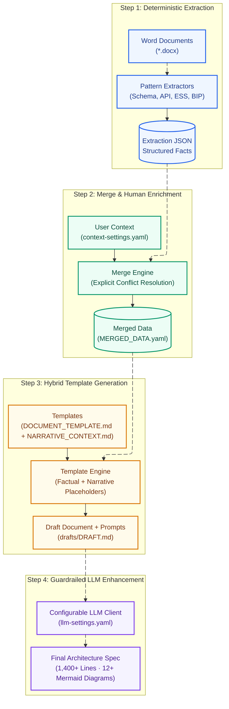
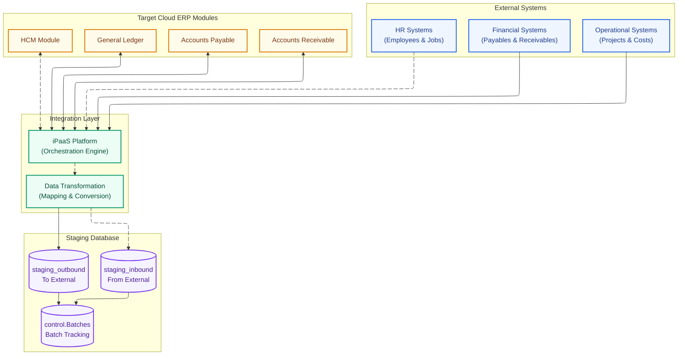
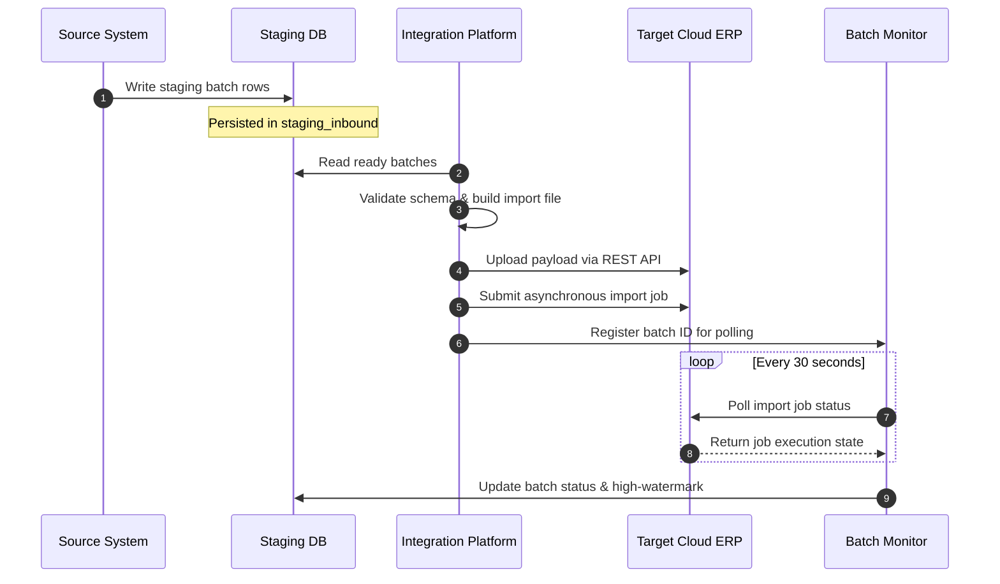
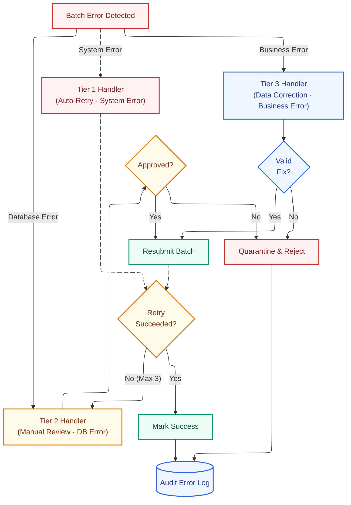
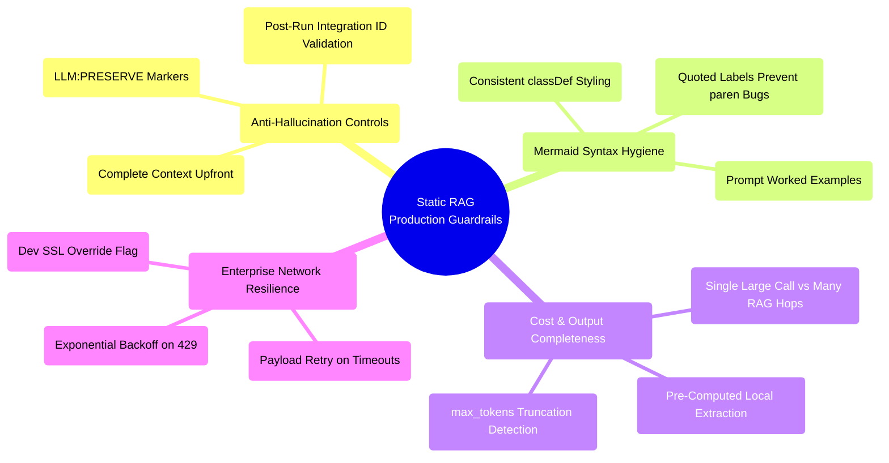

In modern AI engineering, Retrieval-Augmented Generation (RAG) has become the default reflex for grounding LLMs with domain-specific knowledge. **But what if your use case does not need the complexity of vector databases, embeddings, and semantic search?** What if your source documents are enterprise **Technical Design Documents (TDDs)** with predictable structure and your goal is deterministic batch documentation synthesis rather than interactive Q&A?

**TDD Analyzer** implements a **Static RAG (Manual RAG)** architecture built for generating comprehensive, internally consistent enterprise documentation from scattered Word design specs.

---

## 1. The Hard Part: Why Vector RAG Struggles with Documentation Generation

Organizations with complex enterprise integration landscapes frequently have technical specifications scattered across dozens of Word (`.docx`) TDDs covering:

- Integration patterns and data flows
- API specifications (`REST`, `SOAP`, and file-based batch interfaces)
- Database schemas, staging tables, and watermarks
- Error handling procedures and batch orchestration configurations

Traditional vector-based RAG systems excel at interactive Q&A, yet routinely break down during full-document synthesis for five structural reasons:

1. **Vector Search Returns Fragments**: Semantic chunking retrieves isolated paragraphs without preserving how entities relate across an entire system.
2. **Loss of Document Hierarchy**: Embeddings capture local similarity while destroying the structural link between section headers, payload schemas, and integration IDs.
3. **Hallucination Under Partial Context**: Missing a chunk forces the LLM to "fill in gaps" with plausible-sounding—but fabricated—endpoint names or batch schedules.
4. **Cross-Section Consistency Failures**: Integration names, API routes, and staging tables must match 100% identically between architecture diagrams, data-flow sequences, and API catalog tables.
5. **Latency and Token Cost**: Pushing 50+ scattered design documents through embedding pipelines and chained retrieval calls inflates both latency and API cost.

---

## 2. The Static RAG Architecture: Separation of Facts from Prose

Instead of chunking documents into a vector database at runtime, **TDD Analyzer** pre-computes every required fact deterministically before invoking an LLM:

| Architectural Dimension | Traditional Vector RAG | Static RAG (TDD Analyzer) |
| :--- | :--- | :--- |
| **Knowledge Store** | Vector database & embeddings | Deterministic JSON + structured YAML (`MERGED_DATA.yaml`) |
| **Extraction Mechanism** | Chunking & runtime semantic similarity | Regex + AST/heuristic pattern extractors |
| **Structural Control** | Free-form prompt assembly | Master Markdown templates (`DOCUMENT_TEMPLATE.md`) + placeholders |
| **Context Assembly** | Dynamic top-$k$ retrieval | Pre-computed, complete factual payload + human YAML overrides |
| **Execution Mode** | Interactive multi-turn Q&A | Reproducible batch synthesis via single guarded LLM pass |



### Core Design Decisions

1. **Strict Separation of Facts from Prose**:
   - **Facts** originate exclusively from deterministic extraction (Step 1) and curated human context (Step 2).
   - **Prose** originates from narrative templates (Step 3) and single-pass LLM enhancement (Step 4).
   - The LLM is explicitly constrained as a *presentation enhancer*, never a fact inventor. If deterministic extractors missed an attribute, it is surfaced as a gap in the extraction ledger rather than hallucinated.
2. **Human-in-the-Loop Business Context (`context-settings.yaml`)**:
   Enterprise integration context that never appears cleanly inside individual `.docx` specs (enabled ERP modules, platform topology, schema prefixes) is declared explicitly and takes precedence over heuristic extraction conflicts:

```yaml
# config/context-settings.yaml
project:
  name: "Integration Architecture"
  version: "1.0"

business_context:
  company: "Enterprise Corp"
  erp_system: "Cloud ERP"
  integration_hub: "Integration Hub"
  integration_platform: "iPaaS Platform"

paths:
  raw_documents: "raw-documents"
  output_dir: "outputs"

modules:
  enabled:
    - AP   # Accounts Payable
    - AR   # Accounts Receivable
    - GL   # General Ledger
    - FA   # Fixed Assets
    - PPM  # Project Portfolio Management
    - HCM  # Human Capital Management

database:
  schemas:
    staging_outbound:
      prefix: "staging_out"
    staging_inbound:
      prefix: "staging_in"
    control:
      prefix: "control"
```

3. **Full Audit Trail Across Pipeline Stages**:

| Stage | Core Script | Deterministic Artifact Produced | Purpose |
| :--- | :--- | :--- | :--- |
| **Step 1** | `run_analysis.py` | `extraction/*.json` | Audit exact schemas, APIs, and jobs extracted per `.docx` |
| **Step 2** | `generate_drafts.py` | `enriched/MERGED_DATA.yaml` | Inspect conflict-resolved, human-enriched truth model |
| **Step 3** | `prepare_enrichment.py` | `drafts/DRAFT.md` + `prompts/*.md` | Verify pre-LLM facts and instruction markers before calling an API |
| **Step 4** | `enrich_with_perplexity.py` | `final-docs/*.md` | Deliver publication-ready 1,000+ line Markdown architecture docs |

---

## 3. Guardrails: Deterministic Extraction & Hybrid Templates

### Pattern-Based Extraction

Extractors apply auditable regular expressions and structural heuristics across Word XML paragraphs and tables:

```python
# Example: Schema extraction patterns
SCHEMA_PATTERNS = [
    r'(staging_in|staging_out|control|config)\.\w+',
    r'FROM\s+(\w+\.\w+)',
    r'INTO\s+(\w+\.\w+)',
]

# Example: API detection patterns
REST_INDICATORS = [
    r'/fscmRestApi/',
    r'REST\s*API',
    r'GET|POST|PUT|DELETE\s+/',
]
```

### Hybrid Placeholder & LLM Instruction Marker System

Master templates (`DOCUMENT_TEMPLATE.md`) separate fixed facts (`{{TOTAL_INTEGRATIONS}}`, `{{INBOUND_COUNT}}`) from reusable narrative blocks (`{{NARRATIVE:PLATFORM_OVERVIEW}}`) and embed fine-grained HTML comment directives stripped after execution:

| Instruction Marker | Execution Rule Enforced by Prompt & Validator |
| :--- | :--- |
| `<!-- LLM:PRESERVE -->` | Lock tables, integration IDs, and schema names verbatim (zero rewriting) |
| `<!-- LLM:EXPAND -->` | Elaborate operational guidance and architectural rationale cleanly |
| `<!-- LLM:EXAMPLE -->` | Add concise, bounded code or payload illustrations (capped to avoid token truncation) |
| `<!-- LLM:VALIDATE -->` | Cross-check entity naming consistency across diagrams, prose, and catalogs |

Provider parameters remain completely externalized in `config/llm-settings.yaml` (supporting Perplexity `sonar-pro`, OpenAI-compatible reasoning models, or swappable enterprise gateways without touching pipeline logic):

```yaml
# config/llm-settings.yaml
provider: perplexity    # or openai-compatible gateway

perplexity:
  api_key_env: PERPLEXITY_API_KEY
  model: sonar-pro
  max_tokens: 32000
  temperature: 0.3

openai:
  api_key_env: OPENAI_API_KEY
  model: gpt-4o
  max_tokens: 16000
  temperature: 0.3
```

---

## 4. What the Pipeline Produces: Sample Generated Architecture Views

When executed across an enterprise integration portfolio, TDD Analyzer emits **1,400+ lines** of structured documentation, **25+ cross-referenced tables**, and **12+ Mermaid diagrams** covering high-level system boundaries, batch polling sequences, and 3-tier error escalation.

### Generated High-Level Integration Topology



### Generated Batch Data-Flow Sequence & 3-Tier Error Framework





---

## 5. Production Lessons Learned: Hallucinations, Mermaid Syntax & Cost Control

Building **TDD Analyzer** against real enterprise Word specifications surfaced four practical constraints that shaped its architecture:



1. **Zero-Hallucination Verification**: Explicit prompt prohibitions (*"Never invent integration names or IDs"*), `<!-- LLM:PRESERVE -->` factual locks, and post-processing reconciliation verify that 100% of integration IDs in the generated Markdown trace directly back to `extraction/*.json` or `context-settings.yaml`.
2. **Mermaid Syntax Hygiene**: Unquoted parentheses inside bracket labels (such as `A[Node (detail)]`) break Mermaid parsers—requiring quoted labels (`A["Node (detail)"]`) and validated examples inside the prompt template.
3. **Truncation Priority & Single-Call Economics**: Pre-computing all extraction locally keeps API usage to a single structured synthesis call per document (paired with completion-priority rules ensuring every table and Mermaid diagram finishes cleanly).
4. **Companion Architecture**: For related contract-first API and specification governance patterns, see [Contract-First .NET Beyond Codegen: Specifying Failure, State, and Evolution](/blog/contract-first-net-beyond-codegen/) and the GitHub repository [`kumarshaz/tdd-analyzer`](https://github.com/kumarshaz/tdd-analyzer).
