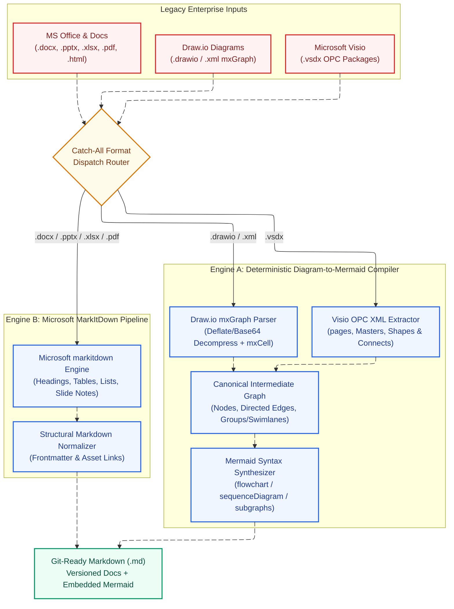
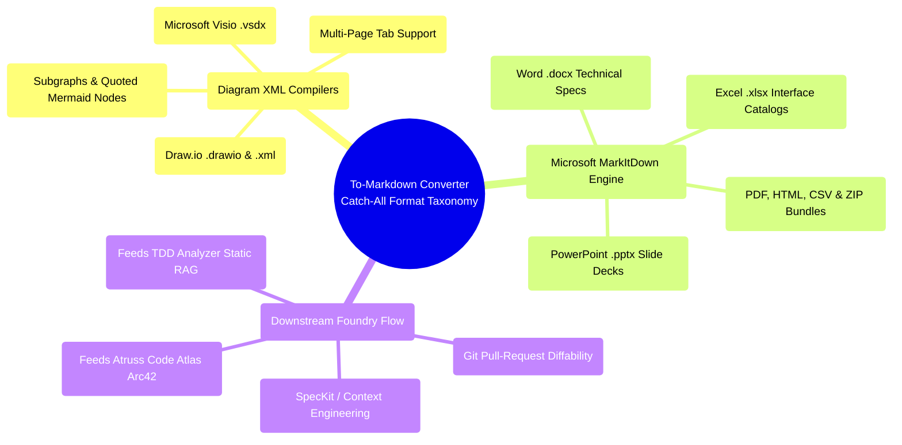

Across large enterprises, critical institutional architecture knowledge is trapped inside proprietary binary and XML containers on SharePoint drives and local project folders: **Microsoft Visio (`.vsdx`)** topologies, **Draw.io (`.drawio` / `.xml`)** integration flows, **MS Word (`.docx`)** functional designs, **PowerPoint (`.pptx`)** ARB decks, and **Excel (`.xlsx`)** interface inventories.

These formats share a fatal flaw for modern engineering teams and AI coding agents: **they cannot be cleanly diffed in Pull Requests, indexed cleanly in Git repositories, or consumed efficiently by LLM context windows.**

I built the **To-Markdown Converter** as a **catch-all unified ingestion pipeline**—combining deterministic XML diagram extraction for Visio and Draw.io directly into Mermaid syntax alongside **Microsoft MarkItDown** orchestration for MS Office documents and rich business attachments.

---

## 1. Why a Single Catch-All Pipeline Beats Fragmented Converters

In real-world enterprise modernization, an architecture deliverable is rarely just a diagram or just a document—it arrives as an interconnected bundle of Visio network maps, Draw.io sequence charts, Word Technical Design Documents, and Excel field mappings.

Treating text documents and structural diagrams separately creates brittle glue scripts and fractured context. Instead, the **To-Markdown Converter** uses a unified dispatch router that inspects file formats and routes each input to the highest-fidelity deterministic parser:



---

## 2. Engine A: Deterministic Diagram Extraction (Visio & Draw.io → Mermaid)

Visual diagrams are graphs—not bitmap pixels. Running OCR or vision-only LLMs over exported PNGs guesses edge directions and hallucinates overlapping labels. **Engine A** reads the authoritative XML geometry and topological glue records natively.

### Microsoft Visio (`.vsdx`) Extraction
A `.vsdx` file is an Open Packaging Conventions (OPC) ZIP archive containing structured XML parts:
1. **Master & Page Resolution**: Reads `visio/masters/masters.xml` and `visio/pages/page*.xml` so inherited stencil semantics (decisions, databases, terminators, containers) stay intact even when shapes override only coordinates or text.
2. **Explicit Edge Binding via `<Connect>`**: Instead of inferring arrows from pixel proximity, `<Connect>` records bind `FromSheet` (connector) explicitly to `ToSheet` (source and target `Shape` IDs), preserving exact graph causality.
3. **Container & Swimlane Mapping**: Bounded container relationships map cleanly into Mermaid `subgraph` clusters, separating system boundaries and responsibility lanes.

### Draw.io (`.drawio` / `.xml`) Extraction
Draw.io files embed `mxGraphModel` trees inside `<diagram>` elements—either as plain XML or zlib/Deflate-compressed Base64 payloads:
1. **Payload Normalization**: Automatically detects URL-encoded + Deflate + Base64 compressed `<diagram>` payloads versus raw uncompressed `<mxGraphModel>` XML trees across single-page and multi-page files.
2. **Vertex, Edge & Group Hierarchy (`<mxCell>`)**: Distinguishes vertices (`vertex="1"`), directional connectors (`edge="1"` with `source` / `target` references), and nested containers (`parent="<group_id>"`) so hierarchical subgraphs mirror the visual canvas without flattening architecture layers.
3. **Mermaid Compilation**: Emits readable, node-normalized Mermaid (`flowchart` / `sequenceDiagram`) using quoted labels (`A["Service (REST)"]`) so parenthetical metadata never triggers parser errors.

---

## 3. Engine B: MS Office & Multi-Format Conversion via Microsoft MarkItDown

For non-diagram enterprise documents—Word (`.docx`) TDDs, PowerPoint (`.pptx`) architecture reviews, Excel (`.xlsx`) interface catalogs, HTML exports, CSVs, and PDFs—the converter delegates parsing to **Microsoft [`markitdown`](https://github.com/microsoft/markitdown)**.

Rather than writing fragile custom Office XML readers for spreadsheets, slide speaker notes, and merged Word tables, leveraging Microsoft MarkItDown provides:
- **Structural Fidelity for LLMs & Git**: Preserves semantic headings (`#`–`####`), Markdown tables, bullet hierarchies, hyperlinks, and slide notes in token-efficient plain text rather than visual-layout HTML bloat.
- **Recursive Archive & Folder Processing**: Iterates cleanly across directory trees and ZIP bundles so whole migration dropboxes convert into organized Markdown workspaces in one pass.
- **Zero-Surprises Handoff**: Converted `.docx` Markdown tables and headings flow seamlessly into downstream analysis pipelines—including [**TDD Analyzer**](/foundry/tdd-analyzer/) for deterministic Static RAG extraction and [**Atruss Code Atlas**](/foundry/atruss-code-atlas/) for Docs-as-Code Arc42 portals.

---

## 4. Format Coverage & Role in the Foundry Ecosystem



Within the broader **Foundry** toolchain, **To-Markdown Converter** serves as the **liberation layer** bridging legacy enterprise documentation and modern Spec-Driven Development:

| Foundry Stage | Tool | Input | Output |
| :--- | :--- | :--- | :--- |
| **1. Liberation** | **To-Markdown Converter** | `.vsdx`, `.drawio`, `.docx`, `.pptx`, `.xlsx`, `.pdf` | Versioned Markdown `.md` + ```` ```mermaid ```` specs |
| **2. Synthesis** | [**TDD Analyzer**](/foundry/tdd-analyzer/) | Scattered Markdown / `.docx` TDDs + `context-settings.yaml` | Audit-ready 1,400+ line design specifications |
| **3. Governance** | [**Atruss Code Atlas**](/foundry/atruss-code-atlas/) | GitHub Orgs, Codebases & CI/CD Workflows | 6-D Scorecards, SARIF v2.1.0, CycloneDX SBOM & M3 Portal |
